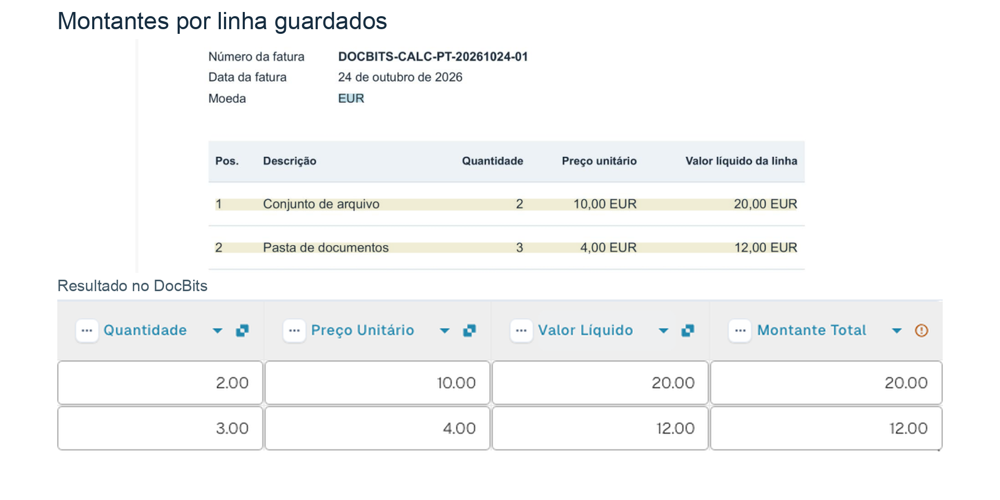

# Calcular colunas com

O cartão aplica uma operação matemática a duas colunas da mesma tabela e guarda o resultado numa coluna de destino em cada linha.

## Quando e onde usar

Use o cartão quando o passo seguinte do workflow precisar de valores calculados por linha, por exemplo **quantidade × preço unitário**. Adicione-o na secção **Então**, categoria **Tabela**. Verifique primeiro se ambas as colunas de entrada contêm números e se os valores necessários estão completos.

<figure><figcaption>
Cartão versão 2: INVOICE_TABLE, Quantidade × Preço unitário → TOTAL_AMOUNT. A interface apresenta o nome da tabela duas vezes.
</figcaption></figure>

## Vídeo de administração

**37 segundos · Português.** João explica quando utilizar o cartão, configura a multiplicação e mostra os resultados guardados na mesma fatura de exemplo.



[Ver com legendas em português](https://docbits-videos.fra1.cdn.digitaloceanspaces.com/settings-assistant/workflow-card-calc-columns-admin/v1/pt.html) · [Ler a transcrição](https://docbits-videos.fra1.cdn.digitaloceanspaces.com/settings-assistant/workflow-card-calc-columns-admin/v1/pt.txt)

## Configurar o cartão

| Definição | Seleção no exemplo |
| --- | --- |
| Tabela | `INVOICE_TABLE` |
| Primeira coluna | `QUANTITY` — Quantidade |
| Operação | `*` — multiplicação |
| Segunda coluna | `UNIT_PRICE` — Preço unitário |
| Coluna de resultado | `TOTAL_AMOUNT` — Montante total |

Também estão disponíveis `+` (adição), `-` (subtração) e `/` (divisão). Na subtração e na divisão, a ordem das duas colunas é importante. Selecione os identificadores de tabela e coluna configurados na sua organização.

<!-- workflow-card-practical-example-20261021 -->

## Exemplo prático verificado

A fatura de exemplo contém duas linhas. Antes do cálculo, a coluna de resultado ainda não existe:

| Linha | Quantidade | Preço unitário | Valor guardado em `TOTAL_AMOUNT` |
| --- | --- | --- | --- |
| 1 | 2 | 10 | 20 |
| 2 | 3 | 4 | 12 |

No teste apresentado, o cartão cria a coluna de resultado. Depois de reabrir a mesma fatura, os valores `20.00` e `12.00` estão visíveis na coluna **Montante total**. As colunas de entrada e os valores originais em `NET_AMOUNT` permanecem inalterados neste exemplo. Se a coluna de resultado selecionada já contiver valores, o cálculo substitui-os.

<figure><picture><source srcset="../../../../.gitbook/assets/workflow-card-calc-columns-saved-result-pt-dark-20261025.png" media="(prefers-color-scheme: dark)"></picture><figcaption>
Depois de reabrir a mesma fatura, TOTAL_AMOUNT contém 20,00 e 12,00 nas duas linhas. Os valores originais em NET_AMOUNT permanecem inalterados.
</figcaption></figure>

## Verificações e contraexemplos

Verifique ambas as colunas de entrada e confirme os valores guardados depois do cálculo.

- Um preço em falta pode produzir zero neste exemplo. Zero não prova que os dados estejam completos: verifique os dados antes do cálculo.
- Um texto como `ABC` em vez de um número provoca um erro de cálculo. Corrija o valor e volte a verificar o caso.

Estes dois contraexemplos descrevem resultados esperados; não são execuções adicionais da fatura apresentada.
