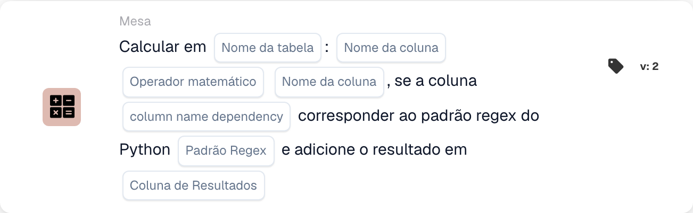

# Calcular em

<figure><figcaption>
Campos do cartão na versão apresentada. Os campos ainda não estão configurados. Algumas etiquetas desta versão da interface ainda não estão traduzidas ou têm uma tradução incorreta. As explicações desta página usam os termos corretos; a imagem mostra a interface real.
</figcaption></figure>

## **Propósito:**

O cartão de fluxo de trabalho **"Calcular com dependência de Regex"** permite aos utilizadores realizar cálculos entre colunas numa tabela selecionada, com uma condição adicional baseada num padrão de expressão regular (regex) aplicado a uma coluna de dependência. Se o padrão corresponder, o cálculo é realizado e o resultado é armazenado na coluna de resultado especificada.

## **Componentes do cartão:**

1. **Nome da tabela**
   * **Descrição:** Especifica a **tabela** na qual as colunas serão calculadas.
   * **Detalhe:** É disponibilizada uma lista pendente com todas as **tabelas** disponíveis para seleção.
2. **Column Name (1ª coluna)**
   * **Descrição:** Especifica a **primeira coluna** envolvida no cálculo.
   * **Detalhe:** É disponibilizada uma lista de todas as **colunas** disponíveis para seleção.
3. **Operação**
   * **Descrição:** Define a operação matemática a aplicar entre as colunas selecionadas.
   * **Opções:**
     * **Add (+):** Adiciona o valor da segunda coluna ao valor da primeira coluna.
     * **Subtrair (-):** Subtrai o valor da segunda coluna à primeira coluna.
     * **Multiply (\*):** Multiplica o valor da primeira coluna pelo valor na segunda coluna.
     * **Dividir (/):** Divide o valor da primeira coluna pela segunda coluna.
4. **Column Name (2ª coluna)**
   * **Descrição:** Especifica a **segunda coluna** envolvida no cálculo.
   * **Detalhe:** É disponibilizada uma lista de todas as **colunas** disponíveis para seleção.
5. **Nome da coluna (dependência)**
   * **Descrição:** Especifica a **coluna de dependência** à qual o padrão regex será aplicado.
   * **Detalhe:** É disponibilizada uma lista de todas as **colunas** disponíveis para a correspondência de padrões.
6. **Padrão Regex**
   * **Descrição:** Define o **padrão regex** que será utilizado para corresponder à coluna de dependência.
   * **Detalhe:** Se o valor na coluna de dependência corresponder ao padrão regex, o cálculo será realizado.
7. **Coluna de resultados**
   * **Descrição:** Especifica a **coluna de resultado** onde o resultado do cálculo será armazenado.
   * **Detalhe:** Pode ser uma coluna nova ou existente onde o valor calculado será armazenado.

## **Funcionalidade:**

* **Avaliação da condição:**
  * O cartão só executa a sua ação se tanto a secção **"Quando"** como as **"E Seções"** forem avaliadas como verdadeiras.
  * O cartão só executa a sua ação se o valor na coluna de dependência corresponder ao **padrão regex** fornecido.
* **Cálculo de colunas:**\
  Se o padrão regex corresponder, o cartão realiza a operação matemática selecionada entre as duas colunas escolhidas.
* **Armazenamento do resultado:**\
  O resultado do cálculo é armazenado na **coluna de resultado** selecionada.

## **Configuração:**

* **Selecionar a tabela:**\
  Escolha a **tabela** onde as colunas serão calculadas.
* **Escolher colunas:**\
  Selecione a **primeira coluna** e a **segunda coluna** que serão utilizadas no cálculo.
* **Selecionar a operação:**\
  Escolha a operação matemática (**Add (+)**, **Subtrair (-)**, **Multiply (\*)**, **Divide (/)**) a aplicar entre as colunas.
* **Selecionar a coluna de dependência:**\
  Escolha a **coluna de dependência** onde o padrão regex será aplicado.
* **Definir o padrão regex:**\
  Introduza o **padrão regex** que a coluna de dependência deve corresponder.
* **Selecionar a coluna de resultado:**\
  Escolha a **coluna de resultado** onde o valor calculado será armazenado.

## **Conclusão:**

O cartão de fluxo de trabalho **"Calcular com dependência de Regex"** oferece uma forma poderosa de realizar cálculos com lógica condicional baseada num padrão regex. Isto assegura que apenas as linhas em que a coluna de dependência corresponde ao padrão especificado serão sujeitas ao cálculo indicado, e o resultado é armazenado na coluna de resultado escolhida.

<!-- workflow-card-practical-example-20261021 -->

## Exemplo prático

**Quando usar:** Calcula apenas as linhas selecionadas da tabela.

**Configuração:** Use tabela de demonstração `lines` com colunas numéricas `quantity` e `unit_price`. Selecione as linhas correspondentes por meio da coluna de dependência e regex, multiplique as colunas numéricas e escreva em `line_total`.

**Resultado esperado e contra-exemplo:** Uma linha selecionada com `2` e `10` recebe `20`. Uma linha não correspondente deve ser verificada separadamente para confirmar que não foi selecionada para cálculo.

Esta é uma configuração ilustrativa e resultado esperado. Utilize campos, usuários e grupos configurados em sua organização de teste; não é uma afirmação de que este exemplo foi executado.
