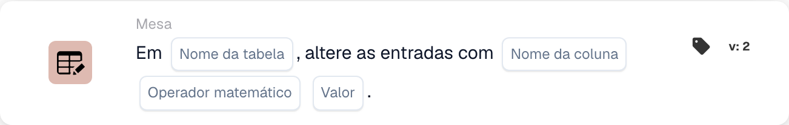

# Alterar entradas com

<figure><figcaption>
Campos do cartão na versão apresentada. Os campos ainda não estão configurados. Algumas etiquetas desta versão da interface ainda não estão traduzidas ou têm uma tradução incorreta. As explicações desta página usam os termos corretos; a imagem mostra a interface real.
</figcaption></figure>

## **Propósito:**

O cartão de fluxo de trabalho **"Change Entries in Table"** é utilizado para atualizar entradas numa tabela de base de dados especificada. Permite selecionar uma **tabela** e uma **coluna** e, em seguida, realizar operações matemáticas (adição, subtração, multiplicação ou divisão) sobre os valores dessa coluna, utilizando um valor especificado.

## **Componentes do cartão:**

1. **Nome da tabela**
   * **Descrição:** Especifica a **tabela** na qual as entradas serão atualizadas.
   * **Detalhe:** É disponibilizada uma lista pendente das **tabelas** disponíveis, permitindo selecionar a tabela de destino para a atualização de entradas.
2. **Nome da coluna**
   * **Descrição:** Especifica a **coluna** dentro da tabela selecionada a atualizar.
   * **Detalhe:** Será disponibilizada uma lista de todas as **colunas** disponíveis para seleção.
3. **Operação**
   * **Descrição:** Define a operação matemática a realizar sobre os valores da **coluna**.
   * **Opções:**
     * **Add (+):** Adiciona um **valor** especificado ao valor atual na coluna selecionada.
     * **Subtrair (-):** Subtrai um **valor** especificado ao valor atual na coluna selecionada.
     * **Multiply (\*):** Multiplica o valor atual na coluna selecionada por um **valor** especificado.
     * **Dividir (/):** Divide o valor atual na coluna selecionada por um **valor** especificado.
4. **Valor**
   * **Descrição:** Especifica o **valor** a utilizar na operação selecionada.
   * **Detalhe:** Este é o número que será adicionado, subtraído, multiplicado ou dividido com as entradas da coluna selecionada.

## **Funcionalidade:**

* **Avaliação da condição:**\
  O cartão só executa a sua ação se tanto a secção **"Quando"** como as **"E Seções"** forem avaliadas como verdadeiras.
* **Atualização de entradas da tabela:**\
  O cartão realiza a operação selecionada (**+**, **-**, **\*** ou **/**) sobre os valores da **coluna** escolhida da **tabela** selecionada, utilizando o **valor** especificado.

## **Configuração:**

* **Selecionar a tabela:**\
  Escolha a **tabela** onde as alterações serão aplicadas.
* **Escolher a coluna:**\
  Selecione a **coluna** dentro da tabela que pretende atualizar.
* **Selecionar a operação:**\
  Escolha a operação matemática (**+**, **-**, **\***, **/**) a aplicar aos valores da coluna selecionada.
* **Introduzir o valor:**\
  Forneça o **valor** a utilizar na operação selecionada.

## **Conclusão:**

O cartão de fluxo de trabalho **"Change Entries in Table"** permite atualizações automatizadas das entradas da base de dados ao selecionar uma **tabela**, uma **coluna** e a **operação matemática** pretendida. Este cartão é essencial para realizar modificações de dados em massa ou cálculos dentro da sua base de dados.

<!-- workflow-card-practical-example-20261021 -->

## Exemplo prático

**Quando usar:** Aplique um ajuste numérico a uma coluna de tabela existente.

**Configuração:** Selecione tabela de demonstração `lines`, coluna numérica `quantity`, adição e valor `1`.

**Resultado esperado e contra-exemplo:** Uma quantidade existente de `2` torna-se `3`. Repetir esta ação produz `4`, portanto, use-o somente quando for pretendida adição repetida.

Esta é uma configuração ilustrativa e resultado esperado. Utilize campos, usuários e grupos configurados em sua organização de teste; não é uma afirmação de que este exemplo foi executado.
