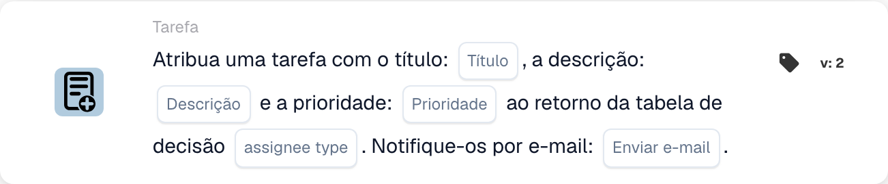

# Atribuir uma tarefa com título

<figure><figcaption>
Campos do cartão na versão apresentada. Os campos ainda não estão configurados. Algumas etiquetas desta versão da interface ainda não estão traduzidas ou têm uma tradução incorreta. As explicações desta página usam os termos corretos; a imagem mostra a interface real.
</figcaption></figure>

## **Propósito:**

O cartão de fluxo de trabalho "Assign Task / Notification from Decision Table" foi concebido para atribuir dinamicamente tarefas ou notificações com base nos resultados de uma decision table. Este cartão assegura que as tarefas ou notificações são atribuídas ao utilizador ou grupo correto de acordo com a lógica definida na decision table, com o envio opcional de uma notificação por e-mail ao destinatário.

## **Componentes do cartão:**

1. **Título**
   * **Descrição**: Especifica o título da tarefa ou notificação a criar.
   * **Detalhe**: O título deve fornecer contexto e descrever o propósito da tarefa ou notificação.
2. **Descrição**
   * **Descrição**: Define o conteúdo ou propósito da tarefa ou notificação.
   * **Detalhe**: Fornece informação adicional sobre a tarefa ou notificação, explicando o contexto ou a ação necessária.
3. **Prioridade**
   * **Descrição**: Define o nível de urgência da tarefa ou notificação.
   * **Opções**:
     * **High**: Tarefas ou notificações que exigem atenção imediata.
     * **Médio**: Tarefas importantes que devem ser tratadas com prontidão.
     * **Low**: Tarefas que podem ser tratadas posteriormente.
4. **Tipo de responsável**
   * **Descrição**: Especifica o utilizador ou grupo atribuído à tarefa ou notificação com base no resultado da decision table.
   * **Detalhe**: A decision table avalia dinamicamente as condições e devolve o utilizador ou grupo adequado para a atribuição.
5. **Notificação por e-mail**
   * **Descrição**: Configura se será enviada uma notificação por e-mail ao utilizador ou grupo atribuído.
   * **Opções**:
     * **True**: Envia uma notificação por e-mail ao destinatário.
     * **False**: Não é enviada qualquer notificação por e-mail.

#### **Componentes adicionais na Versão 3**

1. **Tipo de notificação**
   * **Descrição**: Especifica se o cartão cria uma tarefa ou uma notificação.
   * **Opções**:
     * **Tarefa**: Cria uma tarefa atribuída ao utilizador ou grupo proveniente da decision table.
     * **Notification**: Envia uma notificação ao utilizador ou grupo proveniente da decision table.

## **Funcionalidade:**

* **Avaliação da condição:**\
  O cartão só executa a sua ação se tanto a secção **"Quando"** como as **"E Seções"** forem avaliadas como verdadeiras.
* **Atribuição de tarefa / notificação**\
  O cartão atribui a tarefa ou notificação ao utilizador ou grupo identificado pela decision table. A decision table avalia dinamicamente condições predefinidas e devolve o destinatário correspondente.
* **Notificação por e-mail**\
  Se assim for configurado, é enviada uma notificação por e-mail ao utilizador ou grupo atribuído.
* **Funcionalidade da Versão 3**\
  Na Versão 3, o cartão permite a criação de uma Task ou de uma Notification, proporcionando mais flexibilidade para a gestão de tarefas e a comunicação.

## **Configuração:**

1. **Definir os detalhes da tarefa ou notificação**:\
   Introduza o título, a descrição e a prioridade da tarefa ou notificação.
2. **Configurar a decision table**:\
   Configure a decision table para determinar dinamicamente que utilizador ou grupo deve ser atribuído à tarefa ou notificação.
3. **Ativar a notificação por e-mail**:\
   Especifique se deve ser enviada uma notificação por e-mail ao utilizador ou grupo atribuído.
4. **Especificar o Notification Type (Versão 3)**:\
   Escolha se o cartão irá criar uma tarefa ou enviar uma notificação.

## **Conclusão:**

O cartão de fluxo de trabalho **"Atribuir tarefa/notificação da tabela de decisão"** automatiza a atribuição de tarefas ou notificações com base em condições dinâmicas definidas numa decision table. A Versão 3 melhora a sua funcionalidade ao permitir aos utilizadores escolher entre criar uma tarefa ou uma notificação, e assegura que o destinatário correto é sempre atribuído. A funcionalidade de notificação por e-mail mantém os utilizadores informados, simplificando a comunicação e a gestão de tarefas.

<!-- workflow-card-practical-example-20261021 -->

## Exemplo prático

**Quando usar:** Crie uma tarefa para o responsável retornado por uma tabela de decisão.

**Configuração:** Use uma regra de demonstração correspondente retornando `Demo Reviewer A`, título `Review invoice` e a prioridade desejada.

**Resultado esperado e contra-exemplo:** A tarefa resultante é atribuída de acordo com o destinatário retornado. Teste uma regra sem correspondência separadamente e inspecione o registro do cartão.

Esta é uma configuração ilustrativa e resultado esperado. Utilize campos, usuários e grupos configurados em sua organização de teste; não é uma afirmação de que este exemplo foi executado.
