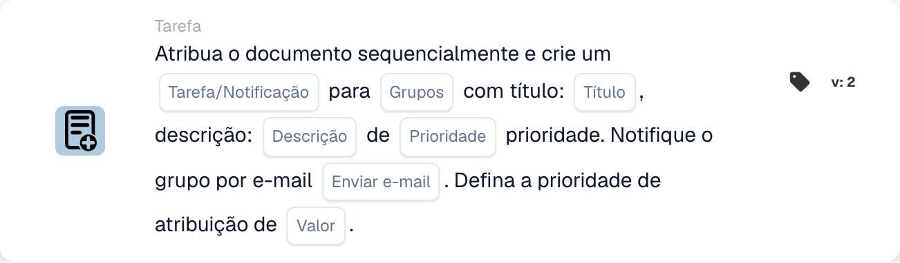

# Atribuir documento e criar tarefa/notificação para grupo

<figure><figcaption>
Campos do cartão na versão apresentada. Os campos ainda não estão configurados.
</figcaption></figure>

## **Propósito**

O cartão de fluxo de trabalho "**Atribuir documento e criar tarefa/notificação para grupo**" atribui um documento a um grupo especificado, cria uma tarefa ou notificação com detalhes personalizáveis e, opcionalmente, envia uma notificação por e-mail ao grupo. Este cartão suporta ainda a atribuição de um valor de prioridade numérico para determinar a ordem de execução.

## **Componentes do cartão**

1. **Nome do grupo**
   * **Descrição:** Especifica o grupo que receberá a tarefa ou notificação.
   * **Detalhe:** Uma lista pendente para escolher o nome do grupo ao qual o documento e a tarefa/notificação serão atribuídos.
2. **Tarefa/Notificação**
   * **Descrição:** Especifica o tipo de ação a criar para o grupo.
   * **Detalhe:** Uma lista pendente para selecionar "Task" ou "Notification" consoante a ação pretendida.
3. **Título**
   * **Descrição:** Fornece o título da tarefa ou notificação.
   * **Detalhe:** Um campo para adicionar um título conciso e descritivo para a tarefa ou notificação.
4. **Descrição**
   * **Descrição:** Descreve mais detalhadamente a tarefa ou notificação.
   * **Detalhe:** Um campo para fornecer detalhes adicionais sobre o propósito da tarefa ou o conteúdo da notificação.
5. **Prioridade**
   * **Descrição:** Define o nível de urgência da tarefa ou notificação.
   * **Opções:**
     * **High:** Exige atenção imediata.
     * **Médio:** Importante mas não urgente.
     * **Low:** Pode ser tratado posteriormente.
6. **Enviar e-mail**
   * **Descrição:** Configura se é enviada uma notificação por e-mail ao grupo.
   * **Opções:**
     * **True:** Envia uma notificação por e-mail.
     * **False:** Não envia qualquer e-mail.
7. **Valor**
   * **Descrição:** Define a prioridade numérica para a atribuição do documento.
   * **Detalhe:** Um campo para introduzir um valor numérico, em que um número mais baixo indica uma prioridade mais elevada.

## **Funcionalidade**

* **Avaliação da condição:**\
  O cartão só executa as suas ações se as condições configuradas no fluxo de trabalho forem cumpridas.
* **Atribuição do documento e criação de tarefa/notificação:**\
  O documento é atribuído ao grupo especificado no campo "Group Name". É criada uma tarefa ou notificação com o título, descrição e nível de prioridade configurados.
* **Notificação por e-mail:**\
  Se "Send Mail" estiver definido como True, é enviada uma notificação por e-mail ao grupo para o informar sobre a tarefa ou notificação.

## **Configuração**

1. **Definir o Nome do Grupo:**
   * Introduza o nome do grupo no campo Group Name.
2. **Selecionar Tarefa/Notificação:**
   * Escolha "Task" ou "Notification" na lista pendente Task/Notification.
3. **Definir os detalhes da tarefa/notificação:**
   * Introduza o Title e a Description da tarefa ou notificação.
   * Selecione Prioridade na lista pendente (Alta, Média ou Baixa).
4. **Ativar a notificação por e-mail:**
   * Configure a opção Send Mail como True ou False, consoante deva ser enviada uma notificação por e-mail.
5. **Atribuir a prioridade numérica:**
   * Introduza um valor numérico no campo Value para determinar a prioridade da atribuição, em que os valores mais baixos têm precedência.
6. Guarde a configuração do cartão e ative o fluxo de trabalho.

## **Conclusão**

O cartão de fluxo de trabalho "Assign Document and Create Task/Notification for Group" assegura que os documentos são atribuídos ao grupo adequado, ao mesmo tempo que cria tarefas ou notificações com opções de prioridade e de notificação por e-mail personalizáveis. Isto simplifica a gestão de documentos e melhora a eficiência do fluxo de trabalho.

<!-- workflow-card-practical-example-20261021 -->

## Exemplo prático

**Quando usar:** Crie uma tarefa de equipe juntamente com a atribuição de documentos priorizados.

**Configuração:** Selecione `Demo Finance`, título `Review invoice` e as prioridades da tarefa e atribuição.

**Resultado esperado e contra-exemplo:** Verifique a atribuição do documento do grupo e a tarefa/notificação separadamente. Uma tarefa por si só não é evidência de uma aprovação de documento concluída.

Esta é uma configuração ilustrativa e resultado esperado. Utilize campos, usuários e grupos configurados em sua organização de teste; não é uma afirmação de que este exemplo foi executado.
