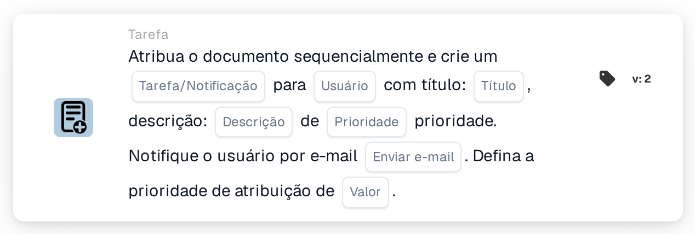

# Atribuir documento e criar tarefa/notificação para usuário

<figure><figcaption>
Versão 2
</figcaption></figure>

## **Propósito**

O cartão de fluxo de trabalho "**Atribuir documento e criar tarefa/notificação para usuário**" atribui um documento a um utilizador especificado, cria uma tarefa ou notificação com detalhes configuráveis e, opcionalmente, envia uma notificação por e-mail ao utilizador. Este cartão permite ainda definir um valor de prioridade numérico para determinar a ordem de execução.

## **Componentes do cartão**

1. **Usuário**
   * **Descrição:** Especifica o utilizador que receberá a tarefa ou notificação.
   * **Detalhe:** Um menu pendente para selecionar o utilizador ao qual o documento e a tarefa/notificação serão atribuídos.
2. **Tarefa/Notificação**
   * **Descrição:** Especifica o tipo de ação a criar para o utilizador.
   * **Detalhe:** Uma lista pendente para escolher "Task" ou "Notification" consoante a ação pretendida.
3. **Título**
   * **Descrição:** O título da tarefa ou notificação.
   * **Detalhe:** Um campo para fornecer um título conciso e descritivo para a tarefa ou notificação.
4. **Descrição**
   * **Descrição:** Detalhes adicionais sobre a tarefa ou notificação.
   * **Detalhe:** Um campo para descrever o propósito da tarefa ou fornecer contexto para a notificação.
5. **Prioridade**
   * **Descrição:** Define o nível de urgência da tarefa ou notificação.
   * **Opções:**
     * **High:** Exige atenção imediata.
     * **Médio:** Importante mas não urgente.
     * **Low:** Pode ser tratado posteriormente.
6. **Enviar e-mail**
   * **Descrição:** Configura se é enviada uma notificação por e-mail ao utilizador.
   * **Opções:**
     * **True:** Envia uma notificação por e-mail ao utilizador.
     * **False:** Não é enviada qualquer notificação por e-mail.
7. **Valor**
   * **Descrição:** Define a prioridade numérica para a atribuição do documento.
   * **Detalhe:** Um campo para introduzir um valor numérico, em que números mais baixos indicam uma prioridade mais elevada.

## **Funcionalidade**

* **Avaliação da condição:**\
  O cartão só executa as suas ações se as condições configuradas no fluxo de trabalho forem cumpridas.
* **Atribuição do documento e criação de tarefa/notificação:**\
  O documento é atribuído ao utilizador especificado no campo "User". É criada uma tarefa ou notificação com o título, descrição e nível de prioridade fornecidos.
* **Notificação por e-mail:**\
  Se "Send Mail" estiver definido como True, é enviado um e-mail ao utilizador a notificá-lo sobre a tarefa ou notificação.

## **Configuração**

1. **Selecionar o User:**
   * Escolha o utilizador no menu pendente User.
2. **Configurar os detalhes da tarefa/notificação:**
   * Selecione "Tarefa" ou "Notificação" na lista pendente Tarefa/Notificação.
   * Introduza o Title e a Description da tarefa ou notificação.
   * Defina uma Prioridade selecionando Alta, Média ou Baixa na lista pendente.
3. **Ativar a notificação por e-mail:**
   * Configure a opção Send Mail como True ou False, consoante deva ser enviada uma notificação por e-mail.
4. **Definir a prioridade numérica:**
   * Introduza um valor numérico no campo Value para determinar a prioridade da atribuição, em que os valores mais baixos são processados em primeiro lugar.
5. Guarde a configuração do cartão e ative o fluxo de trabalho.

## **Conclusão**

O cartão de fluxo de trabalho "Assign Document and Create Task/Notification for User" assegura que os documentos são atribuídos ao utilizador adequado, ao mesmo tempo que cria tarefas ou notificações com prioridades definidas e notificações por e-mail opcionais. Este cartão ajuda a simplificar a delegação de tarefas e melhora a eficiência do fluxo de trabalho.

<!-- workflow-card-practical-example-20261021 -->

## Exemplo prático

**Quando usar:** Crie uma tarefa de revisão do usuário juntamente com a atribuição de documentos priorizados.

**Configuração:** Selecione `Demo Reviewer A`, título da tarefa `Review invoice`, prioridade da tarefa e prioridade da atribuição.

**Resultado esperado e contraexemplo:** Verifique se tanto a atribuição do documento quanto a tarefa/notificação existem para o usuário selecionado, com as prioridades pretendidas.

Esta é uma configuração ilustrativa e resultado esperado. Utilize campos, usuários e grupos configurados em sua organização de teste; não é uma afirmação de que este exemplo foi executado.
