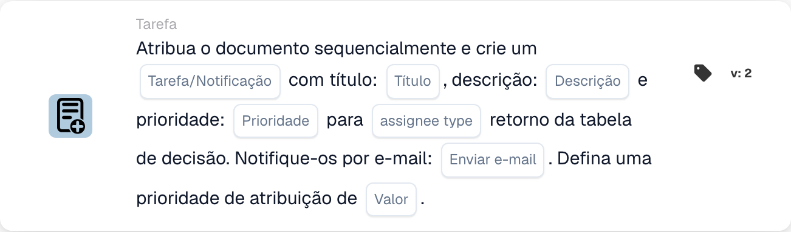

# Atribuir documento e criar tarefa/notificação

<figure><figcaption>
Campos do cartão na versão apresentada. Os campos ainda não estão configurados. Algumas etiquetas desta versão da interface ainda não estão traduzidas ou têm uma tradução incorreta. As explicações desta página usam os termos corretos; a imagem mostra a interface real.
</figcaption></figure>

## **Propósito**

O cartão de fluxo de trabalho "**Atribuir documento e criar tarefa/notificação com base na tabela de decisão**" atribui um documento e cria uma tarefa ou notificação com detalhes configuráveis. O responsável é determinado pelo retorno de uma decision table, e o cartão permite definir prioridades e enviar notificações por e-mail.

## **Componentes do cartão**

1. **Tipo de responsável**
   * **Descrição:** Especifica se o retorno da decision table atribui o documento e a tarefa/notificação a um utilizador ou a um grupo.
   * **Detalhe:** Um campo para configurar o tipo de responsável como "User" ou "Group" com base no resultado da decision table.
2. **Tarefa/Notificação**
   * **Descrição:** Especifica o tipo de ação a criar para o responsável.
   * **Detalhe:** Uma lista pendente para selecionar "Task" ou "Notification" consoante as necessidades do fluxo de trabalho.
3. **Título**
   * **Descrição:** O título da tarefa ou notificação.
   * **Detalhe:** Um campo para fornecer um título conciso que identifica a tarefa ou notificação.
4. **Descrição**
   * **Descrição:** Detalhes adicionais sobre a tarefa ou notificação.
   * **Detalhe:** Um campo para descrever o propósito e o contexto da tarefa ou notificação.
5. **Prioridade**
   * **Descrição:** Define o nível de urgência da tarefa ou notificação.
   * **Opções:**
     * **High:** Exige atenção imediata.
     * **Médio:** Importante mas não urgente.
     * **Low:** Pode ser tratado posteriormente.
6. **Tipo de responsável**
   * **Descrição:** Este campo determina o tipo de responsável (User ou Group) ao qual o documento e a tarefa/notificação são atribuídos.
   * **Detalhe:** Um menu pendente para selecionar se a tarefa/notificação é atribuída a um utilizador ou a um grupo com base no resultado da decision table.
7. **Enviar e-mail**
   * **Descrição:** Configura se é enviada uma notificação por e-mail ao responsável.
   * **Opções:**
     * **True:** Envia uma notificação por e-mail.
     * **False:** Não é enviada qualquer notificação por e-mail.
8. **Valor**
   * **Descrição:** Define a prioridade numérica para a atribuição do documento.
   * **Detalhe:** Um campo para introduzir um valor numérico, em que números mais baixos indicam uma prioridade mais elevada.

## **Funcionalidade**

* **Avaliação da condição:**\
  O cartão só executa as suas ações se as condições do fluxo de trabalho forem cumpridas.
* **Avaliação da decision table:**\
  A decision table determina se o documento e a tarefa/notificação são atribuídos a um utilizador ou a um grupo.
* **Atribuição do documento e criação de tarefa/notificação:**\
  O documento é atribuído ao resultado da decision table. É criada uma tarefa ou notificação com o título, descrição e nível de prioridade especificados.
* **Notificação por e-mail:**\
  Se "Send Mail" estiver definido como True, é enviada uma notificação por e-mail ao responsável.

## **Configuração**

1. **Definir o Assignee Type:**
   * Configure o campo Assignee Type como "User" ou "Group" com base no resultado da decision table.
2. **Selecionar Tarefa/Notificação:**
   * Escolha "Task" ou "Notification" na lista pendente Task/Notification.
3. **Definir os detalhes da tarefa/notificação:**
   * Introduza o Title e a Description da tarefa ou notificação.
   * Selecione a Prioridade (Alta, Média ou Baixa) na lista pendente.
4. **Ativar a notificação por e-mail:**
   * Defina a opção Send Mail como True ou False, consoante deva ser enviada uma notificação por e-mail.
5. **Definir a prioridade numérica:**
   * Introduza um valor numérico no campo Value para determinar a prioridade da atribuição, em que os números mais baixos são processados em primeiro lugar.
6. Guarde a configuração do cartão e ative o fluxo de trabalho.

## **Conclusão**

O cartão de fluxo de trabalho "Assign Document and Create Task/Notification Based on Decision Table" assegura que as tarefas ou notificações são atribuídas dinamicamente ao utilizador ou grupo adequado com base nos resultados da decision table. Este cartão facilita uma delegação de tarefas eficiente, prioridades personalizáveis e notificações por e-mail opcionais para melhorar a capacidade de resposta do fluxo de trabalho.

<!-- workflow-card-practical-example-20261021 -->

## Exemplo prático

**Quando usar:** Use um resultado de tabela de decisão para atribuir um documento e criar uma tarefa de revisão em sequência.

**Configuração:** Selecione a tabela de decisão de demonstração, título da tarefa `Review invoice`, descrição e prioridade. Configure o formato de retorno do responsável e a opção de e-mail exigidos pela versão selecionada.

**Resultado esperado e contra-exemplo:** O cessionário retornado correspondente recebe a atribuição do documento documentado e a tarefa/notificação. Verifique ambos os resultados; um retorno de tabela vazio não é uma atribuição bem-sucedida.

Esta é uma configuração ilustrativa e resultado esperado. Utilize campos, usuários e grupos configurados em sua organização de teste; não é uma afirmação de que este exemplo foi executado.
