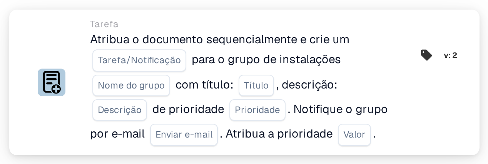

# Atribuir ao grupo da instalação e criar uma tarefa/notificação

<figure><figcaption>
Versão 2
</figcaption></figure>

## Propósito:

Este cartão de fluxo de trabalho acrescenta o grupo responsável pela instalação da ordem de compra do documento à atribuição sequencial do documento e associa uma tarefa ou notificação a este passo. A instalação é obtida a partir das ordens de compra com as quais o documento está associado, e o grupo é determinado pelo seu nome, que contém tanto o nome de grupo introduzido no cartão como o código da instalação. A tarefa ou notificação pertence ao passo do grupo na sequência.

## Componentes do cartão:

1. **Tarefa/Notificação**
   * **Descrição:** Define se é criada uma tarefa ou uma notificação para o grupo.
   * **Opções:**
     * **Tarefa:** É criada uma tarefa.
     * **Notificação:** É criada uma notificação.
2. **Nome do grupo**
   * **Descrição:** A parte do nome que os grupos de instalações têm em comum.
   * **Detalhe:** Um texto que é comparado com os nomes dos grupos de utilizadores da organização. Um grupo corresponde se o seu nome contiver este texto e o código da instalação da ordem de compra. A comparação não distingue maiúsculas de minúsculas. Por exemplo, com o nome de grupo **Approver** e uma ordem de compra para a instalação **1000**, corresponderia um grupo chamado **Approver 1000**.
3. **Título**
   * **Descrição:** O título da tarefa ou notificação.
   * **Detalhe:** Um texto curto que identifica a tarefa ou notificação.
4. **Descrição**
   * **Descrição:** Mais detalhes sobre a tarefa ou notificação.
   * **Detalhe:** Um texto que descreve o que deverá ser feito ou por que motivo o grupo é informado.
5. **Prioridade**
   * **Descrição:** A urgência da tarefa ou notificação.
   * **Opções:**
     * **peso elevado:** A tarefa ou notificação é criada com prioridade elevada.
     * **peso médio:** A tarefa ou notificação é criada com prioridade média.
     * **baixo peso:** A tarefa ou notificação é criada com prioridade baixa.
6. **Enviar e-mail**
   * **Descrição:** Define se o grupo é também informado por e-mail sobre a tarefa.
   * **Opções:**
     * **Verdadeiro:** É enviada uma notificação por e-mail ao grupo.
     * **Falso:** Não é enviada qualquer notificação por e-mail.
7. **Valor**
   * **Descrição:** A prioridade do grupo na atribuição sequencial.
   * **Detalhe:** Um número inteiro. Os números mais baixos vêm primeiro, sendo 0 a prioridade mais elevada. Se não for introduzido nenhum valor, ou se for introduzido um valor negativo, é utilizada a prioridade 1.

## Funcionalidade:

* **Determinação da instalação:** O cartão lê as ordens de compra com as quais o documento está associado e recolhe o código da instalação (a localização da ordem de compra) de cada uma delas.
* **Determinação do grupo:** Para cada código de instalação, o cartão procura grupos de utilizadores cujo nome contenha tanto o **Nome do grupo** indicado no cartão como o código da instalação. Os códigos de instalação para os quais não é encontrado nenhum grupo são listados no registo do fluxo de trabalho.
* **Execução da ação:** Cada grupo correspondente é acrescentado à atribuição sequencial com a prioridade do campo **Valor**, juntamente com a tarefa ou notificação. A atribuição propriamente dita ocorre no fim da execução do fluxo de trabalho: a entrada com o número de prioridade mais baixo é atribuída primeiro e a respetiva tarefa ou notificação é criada. Todas as entradas, incluindo a primeira, são guardadas no documento como os seus pedidos de aprovação, e os passos seguintes da sequência são obtidos a partir delas por ordem crescente de prioridade. Se outro cartão já tiver atribuído o documento diretamente na mesma execução, esta primeira atribuição sequencial é ignorada e a respetiva tarefa ou notificação não é criada nesta execução.
* **Valores predefinidos:** Se não for definida nenhuma prioridade da tarefa, é utilizado **peso médio**. Se **Enviar e-mail** não estiver definido, não é enviado nenhum e-mail. Se **Tarefa/Notificação** não estiver definido, é criada uma tarefa e o registo do fluxo de trabalho indica a definição em falta.
* **Dados em falta:**
  * Se o nome do grupo, o título ou a descrição estiverem vazios, o cartão não é executado e regista os dados em falta no registo do fluxo de trabalho.
  * Se o documento não estiver associado a uma ordem de compra, o cartão regista os dados em falta em vez de acrescentar um grupo.
  * Se nenhum grupo corresponder a qualquer dos códigos de instalação, não é acrescentado nenhum grupo e o registo do fluxo de trabalho indica que não foi encontrado nenhum grupo correspondente.

## Configuração:

* Os grupos de utilizadores deverão ser nomeados de forma a que cada nome contenha a parte comum do nome e o código da instalação, por exemplo **Approver 1000**, **Approver 2000**.
* O cartão pode ser adicionado a partir da categoria **Tarefa**. Em seguida, podem ser configurados o tipo (**Tarefa** ou **Notificação**), a parte comum do nome dos grupos, o título, a descrição, a prioridade da tarefa, a definição de e-mail e a posição na sequência (**Valor**).
* Para formar uma cadeia de aprovadores, podem ser combinados vários cartões sequenciais no fluxo de trabalho, cada um com o seu próprio **Valor**.

## Conclusão:

O cartão de fluxo de trabalho "Assign to Facility Group and Create a Task/Notification" coloca a equipa responsável pela instalação numa posição definida de uma aprovação sequencial e atribui-lhe uma tarefa clara para o seu passo. Um único cartão abrange todas as instalações, desde que os grupos de utilizadores sigam um esquema de nomes consistente, com o código da instalação no nome.
