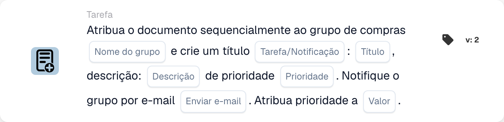

# Atribuir ao grupo de compras e criar uma tarefa/notificação

<figure><figcaption>
Campos do cartão na versão apresentada. Os campos ainda não estão configurados.
</figcaption></figure>

## **Propósito**

O cartão de fluxo de trabalho "**Atribuir documento ao grupo de compras e criar tarefa/notificação**" atribui um documento a um grupo de compras especificado, cria uma tarefa ou notificação com detalhes definidos e, opcionalmente, notifica o grupo por e-mail. Prioriza a execução de tarefas com base num valor de prioridade numérico configurável.

## **Componentes do cartão**

1. **Nome do grupo**
   * **Descrição:** Especifica o grupo de compras responsável por tratar o documento.
   * **Detalhe:** Um campo onde o utilizador pode introduzir manualmente o nome do grupo de compras.
2. **Tarefa/Notificação**
   * **Descrição:** Define se é criada uma tarefa ou uma notificação para o grupo.
   * **Detalhe:** Um campo onde o utilizador pode escolher entre criar uma tarefa ou uma notificação.
3. **Título**
   * **Descrição:** O título da tarefa ou notificação criada para o grupo.
   * **Detalhe:** Um campo para fornecer um título conciso e identificável para a tarefa ou notificação.
4. **Descrição**
   * **Descrição:** Mais detalhes sobre a tarefa ou notificação.
   * **Detalhe:** Um campo para descrever o propósito da tarefa e fornecer contexto ou instruções.
5. **Prioridade**
   * **Descrição:** Define o nível de urgência da tarefa ou notificação.
   * **Opções:**
     * **High:** A tarefa exige atenção imediata.
     * **Médio:** A tarefa é importante mas não urgente.
     * **Low:** A tarefa pode ser tratada posteriormente.
6. **Enviar e-mail**
   * **Descrição:** Configura se deve ser enviada uma notificação por e-mail ao grupo.
   * **Opções:**
     * **True:** Envia uma notificação por e-mail ao grupo de compras.
     * **False:** Não é enviada qualquer notificação por e-mail.
7. **Valor**
   * **Descrição:** Define a prioridade numérica para a execução da tarefa.
   * **Detalhe:** Um campo para introduzir um valor numérico, em que um número mais baixo representa uma prioridade mais elevada.

## **Funcionalidade**

* **Avaliação da condição:**\
  O cartão só realiza as suas ações se as condições definidas no fluxo de trabalho forem cumpridas.
* **Atribuição ao grupo e criação de tarefa/notificação:**\
  O documento é atribuído ao grupo de compras especificado. É criada uma tarefa ou notificação com o título, descrição e prioridade fornecidos.
* **Notificação por e-mail:**\
  Se "Send Mail" estiver definido como True, o grupo recebe um e-mail sobre a tarefa ou notificação.

## **Configuração**

1. **Definir o Nome do Grupo:**
   * Introduza o nome do grupo de compras no campo Group Name.
2. **Configurar os detalhes da tarefa/notificação:**
   * Especifique o Título e a Descrição da tarefa ou notificação.
   * Selecione a Prioridade no menu pendente (Alta, Média ou Baixa).
3. **Ativar a notificação por e-mail:**
   * Defina "Send Mail" como True ou False consoante o grupo deva receber um e-mail.
4. **Definir a prioridade numérica:**
   * Introduza um valor numérico no campo Value para determinar a prioridade da tarefa, em que os valores mais baixos são processados em primeiro lugar.
5. Guarde a configuração do cartão e ative o fluxo de trabalho.

## **Conclusão**

O cartão de fluxo de trabalho "Assign Document to Procurement Group and Create Task/Notification" assegura que os documentos são direcionados para o grupo adequado com instruções de tarefa claras e níveis de prioridade. Ao permitir notificações por e-mail opcionais, este cartão melhora a visibilidade das tarefas e assegura uma execução fluida do fluxo de trabalho.

<!-- workflow-card-practical-example-20261021 -->

## Exemplo prático

**Quando usar:** Combine a atribuição de compras priorizadas com uma tarefa de revisão.

**Configuração:** Selecione `Demo Procurement`, título `Review order variance`, prioridade de tarefa e prioridade de atribuição.

**Resultado esperado e contra-exemplo:** O alvo de aquisição configurado recebe a atribuição documentada e a tarefa/notificação. Verifique ambos e suas prioridades no resultado.

Esta é uma configuração ilustrativa e resultado esperado. Utilize campos, usuários e grupos configurados em sua organização de teste; não é uma afirmação de que este exemplo foi executado.
