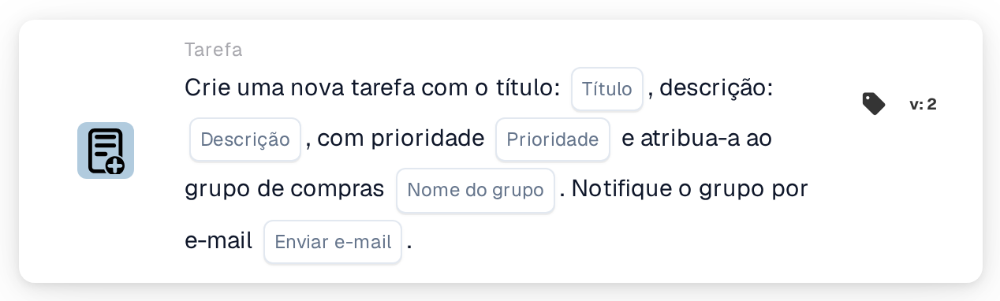
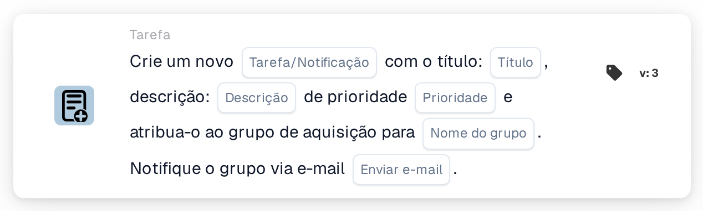

# Crie uma nova tarefa e atribua-a ao grupo de compras

<figure><figcaption>
Versão 2
</figcaption></figure>

<figure><figcaption>
Versão 3
</figcaption></figure>

## **Propósito:**

O cartão de fluxo de trabalho **"Criar tarefa para grupo de compras"** cria uma nova tarefa atribuída dinamicamente ao grupo de compras especificado na configuração. Esta tarefa pode ser atribuída com diferentes níveis de prioridade e pode ser enviada uma notificação por e-mail opcional para informar o grupo sobre a tarefa. Este cartão assegura que a equipa certa é alertada com base nas condições do fluxo de trabalho.

## **Componentes do cartão:**

1. **Título**
   * **Descrição:** Especifica o título da tarefa.
   * **Detalhe:** Este campo identifica a tarefa que está a ser criada, fornecendo um título conciso para fácil identificação.
2. **Descrição**
   * **Descrição:** Fornece mais detalhes sobre a tarefa.
   * **Detalhe:** Este campo é utilizado para descrever o objetivo da tarefa e qualquer contexto ou instruções necessárias.
3. **Prioridade**
   * **Descrição:** Define a urgência da tarefa.
   * **Opções:**
     * **High:** A tarefa exige atenção imediata.
     * **Médio:** A tarefa é importante mas não urgente.
     * **Low:** A tarefa pode ser tratada posteriormente.
4. **Nome do grupo**
   * **Descrição:** Especifica o grupo de compras ao qual a tarefa será atribuída.
   * **Detalhe:** Este campo designa o grupo de compras responsável pela tarefa. Assegura que a tarefa é direcionada para a equipa certa.
5. **Notificação por e-mail**
   * **Descrição:** Configura se deve ser enviada uma notificação por e-mail ao grupo de compras atribuído.
   * **Opções:**
     * **True:** Envia uma notificação por e-mail ao grupo de compras.
     * **False:** Não é enviada qualquer notificação por e-mail.

## **Funcionalidade:**

* **Avaliação da condição:**\
  O cartão só executa a sua ação se tanto a secção **"Quando"** como as **"E Seções"** forem avaliadas como verdadeiras.
* **Criação da tarefa:**\
  O cartão cria uma nova tarefa, atribuindo-a ao grupo de compras definido no campo "Group Name". Esta tarefa incluirá o título, a descrição e o nível de prioridade especificados.
* **Notificação por e-mail:**\
  Se a opção de notificação por e-mail estiver definida como true, é enviado um e-mail ao grupo de compras a informá-lo sobre a tarefa.

## **Configuração:**

* **Definir os detalhes da tarefa:**\
  Introduza o título, a descrição e o nível de prioridade da tarefa.
* **Selecionar o grupo de compras:**\
  Escolha o grupo de compras que será responsável pela tarefa.
* **Ativar a notificação por e-mail:**\
  Especifique se deve ser enviada uma notificação por e-mail ao grupo aquando da criação da tarefa.

## **Conclusão:**

O cartão de fluxo de trabalho "Create Task for Procurement Group" assegura que as tarefas são automaticamente atribuídas ao grupo de compras adequado com prioridades definidas. Este cartão pode também notificar o grupo por e-mail para assegurar que as tarefas são tratadas com prontidão, melhorando a eficiência do fluxo de trabalho e a gestão de tarefas.

<!-- workflow-card-practical-example-20261021 -->

## Exemplo prático

**Quando usar:** Peça à equipe de compras para revisar uma exceção de fatura.

**Configuração:** Selecione `Demo Procurement`, título `Review order variance`, descrição e prioridade.

**Resultado esperado e contra-exemplo:** Uma tarefa é criada para o grupo de compras selecionado. Verifique o responsável pela tarefa e a descrição; a criação por si só não confirma que a variação foi resolvida.

Esta é uma configuração ilustrativa e resultado esperado. Utilize campos, usuários e grupos configurados em sua organização de teste; não é uma afirmação de que este exemplo foi executado.
