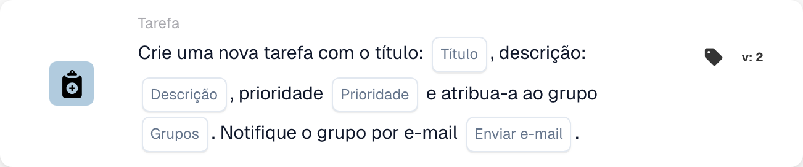

# Crie uma nova tarefa e atribua-a ao grupo

<figure><figcaption>
Campos do cartão na versão apresentada. Os campos ainda não estão configurados.
</figcaption></figure>

## **Propósito:**

O cartão de fluxo de trabalho **"Criar tarefa ou notificação de grupo"** facilita a criação de tarefas ou notificações para grupos especificados, assegurando uma comunicação e gestão de tarefas eficientes. Melhorado com a funcionalidade de árvore de decisão em versões posteriores, determina dinamicamente o grupo atribuído ou o método, simplificando as operações.

## **Componentes do cartão:**

1. **Título**
   * **Descrição**: Especifica o título da tarefa ou notificação.
   * **Detalhe**: Funciona como identificador da tarefa ou notificação criada.
2. **Descrição**
   * **Descrição**: Descreve o contexto ou os detalhes da tarefa ou notificação.
   * **Detalhe**: Fornece clareza sobre o seu propósito.
3. **Prioridade**
   * **Descrição**: Define o nível de importância da tarefa.
   * **Opções**:
     * **High**: Exige ação imediata.
     * **Médio**: Importante mas menos urgente.
     * **Low**: Pode ser tratado posteriormente.
4. **Grupo Atribuído**
   * **Descrição**: Especifica o grupo responsável pela tarefa ou notificação.
   * **Detalhe**: Selecionado a partir de uma lista pendente de grupos disponíveis.
5. **Notificação por e-mail**
   * **Descrição**: Permite enviar um e-mail para notificar o grupo atribuído.
   * **Opções**:
     * **True**: Envia uma notificação por e-mail.
     * **False**: Não é enviada qualquer notificação por e-mail.

## **Componentes adicionais na Versão 3 e na Versão 4**

1. **Árvore de Decisão (apenas na Versão 3)**
   * **Descrição**: Permite a utilização de uma árvore de decisão para a criação dinâmica de tarefas.
   * **Opções**:
     * **True**: Ativa o processamento da árvore de decisão.
     * **False**: Desativa o processamento da árvore de decisão.
2. **Opção de Tarefa/Notificação** **(apenas na Versão 4)**
   * **Descrição**: Permite criar uma tarefa ou uma notificação.
   * **Opções**:
     * **Tarefa**: Cria uma tarefa para o grupo selecionado.
     * **Notification**: Envia uma notificação em vez de criar uma tarefa.

## **Funcionalidade:**

* **Avaliação da condição**:\
  Executa a ação do cartão apenas quando as secções **"Quando"** e **"E Seções"** forem verdadeiras.
* **Criação de tarefa ou notificação**:
  * É criada uma tarefa para o grupo selecionado com o título, descrição e prioridade especificados.
  * Na Versão 4, o cartão pode criar uma notificação em vez de uma tarefa.
* **Atribuição dinâmica (apenas na Versão 3)**:\
  Se ativada, a árvore de decisão determina dinamicamente o grupo de destino.
* **Notificação por e-mail**:\
  Envia uma notificação por e-mail ao grupo se a opção de e-mail estiver definida como true.

## **Configuração:**

1. **Definir os detalhes da tarefa ou notificação**: Introduza o título, a descrição e a prioridade.
2. **Atribuir a um grupo**: Selecione um grupo a partir da lista pendente para a atribuição da tarefa ou notificação.
3. **Ativar a notificação por e-mail**: Indique se o grupo deve ser notificado por e-mail.
4. **Use Árvore de Decisão (apenas na Versão 3)**: Ative a árvore de decisão para atribuir dinamicamente o grupo.
5. **Selecionar o tipo de saída (apenas na Versão 4)**: Escolha se o cartão cria uma tarefa ou uma notificação.

## **Conclusão:**

O cartão de fluxo de trabalho **"Criar tarefa ou notificação de grupo"** simplifica a gestão de tarefas e notificações ao direcioná-las diretamente para os grupos. A sua funcionalidade de atribuição dinâmica, possibilitada pela árvore de decisão, melhora a flexibilidade, enquanto as notificações por e-mail asseguram uma comunicação atempada. As Versões 3 e 4 acrescentam funcionalidades avançadas, tornando-o uma ferramenta versátil para uma execução eficiente do fluxo de trabalho.

<!-- workflow-card-practical-example-20261021 -->

## Exemplo prático

**Quando usar:** Dê a uma equipe compartilhada uma tarefa de revisão concreta.

**Configuração:** Selecione o grupo `Demo Finance`, título `Review invoice`, uma descrição útil e prioridade. Desative o e-mail para o primeiro teste.

**Resultado esperado e contraexemplo:** O grupo recebe a tarefa. Confirme o título e o responsável na lista de tarefas; a entrega de e-mail é uma verificação separada quando ativada.

Esta é uma configuração ilustrativa e resultado esperado. Utilize campos, usuários e grupos configurados em sua organização de teste; não é uma afirmação de que este exemplo foi executado.
