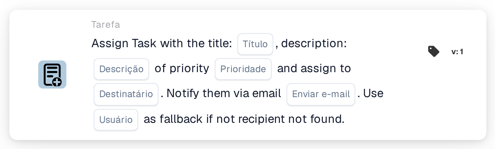
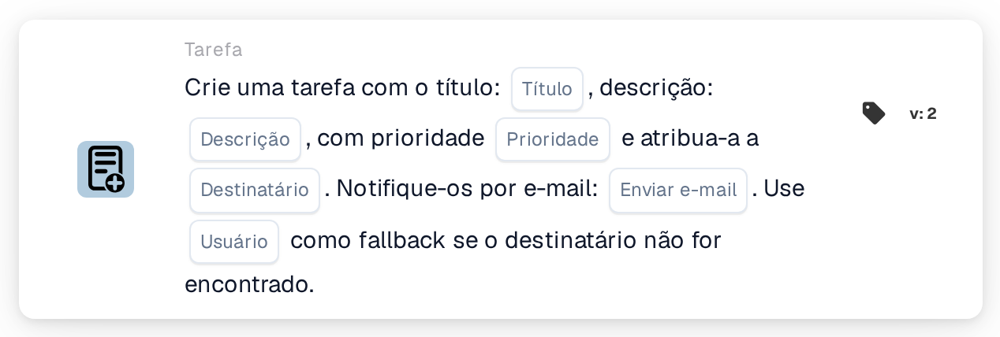

# Crie uma nova tarefa e atribua-a ao destinatário

<figure><figcaption>
Versão 1
</figcaption></figure>

<figure><figcaption>
Versão 2
</figcaption></figure>

## **Propósito:**

O cartão de fluxo de trabalho **"Criar tarefa com substituto"** assegura uma delegação de tarefas eficiente ao atribuir tarefas a funções específicas — dispatcher ou purchaser — incorporando ao mesmo tempo um mecanismo alternativo para evitar falhas na atribuição de tarefas. Este cartão melhora a fiabilidade e a adaptabilidade do fluxo de trabalho em cenários dinâmicos.

## **Componentes do cartão:**

1. **Título**
   * **Descrição**: Especifica o título da tarefa que está a ser criada.
   * **Detalhe**: Fornece um identificador conciso para a tarefa.
2. **Descrição**
   * **Descrição**: Descreve o propósito ou o contexto da tarefa.
   * **Detalhe**: Clarifica os detalhes da tarefa.
3. **Prioridade**
   * **Descrição**: Define o nível de urgência da tarefa.
   * **Opções**:
     * **High**: Exige atenção imediata.
     * **Médio**: Importante mas não urgente.
     * **Low**: Pode ser tratado posteriormente.
4. **Função Atribuída**
   * **Descrição**: Especifica a função principal à qual a tarefa é atribuída.
   * **Opções**:
     * **Disponent**: Atribui a tarefa ao disponent.
     * **Comprador**: Atribui a tarefa ao comprador.
5. **Notificação por e-mail**
   * **Descrição**: Permite notificar o utilizador atribuído por e-mail.
   * **Opções**:
     * **True**: Envia uma notificação por e-mail ao utilizador.
     * **False**: Não é enviada qualquer notificação por e-mail.
6. **Usuário substituto**
   * **Descrição**: Fornece uma opção alternativa para a atribuição da tarefa caso a função de destinatário não seja encontrada.
   * **Detalhe**: Permite selecionar um utilizador a partir de uma lista pendente para assegurar a delegação da tarefa.

## **Funcionalidade:**

* **Avaliação da condição**:\
  O cartão só é executado se as condições nas secções **"Quando"** e **"E Seções"** forem cumpridas.
* **Atribuição da tarefa**:
  * A tarefa é atribuída à função selecionada (dispatcher ou purchaser).
  * Se a função especificada não for encontrada, a tarefa é atribuída a um utilizador da lista pendente alternativa.
* **Notificação por e-mail**:\
  Envia um e-mail ao utilizador atribuído se a notificação por e-mail estiver ativada.

## **Configuração:**

1. **Especificar os detalhes da tarefa**: Introduza o título, a descrição e a prioridade da tarefa.
2. **Selecionar a função principal**: Escolha a função à qual a tarefa será atribuída (dispatcher ou purchaser).
3. **Configurar o usuário substituto**: Selecione um utilizador alternativo a partir da lista pendente para assegurar a atribuição da tarefa caso a função principal não seja encontrada.
4. **Ativar a notificação por e-mail**: Indique se o utilizador atribuído deve receber uma notificação por e-mail.

## **Conclusão:**

O cartão de fluxo de trabalho **"Criar tarefa com substituto"** assegura uma delegação de tarefas transparente ao integrar um mecanismo alternativo. Ao atribuir tarefas com base em funções e ao fornecer uma opção de utilizador alternativo, melhora a fiabilidade e a flexibilidade nos processos de gestão de tarefas.

<!-- workflow-card-complete-example-20261021 oc_task -->

### Exemplo de tarefa de destinatário

**Configuração:** Insira o título `Review delivery date`, uma descrição que identifica o documento sintético, uma prioridade, função Comprador e usuário substituto configurado `DEMO_REVIEWER`. Desative a notificação por e-mail para esta configuração ilustrativa.

**Resultado esperado e contra-exemplo:** Quando um comprador pode ser resolvido, a nova tarefa é atribuída a esse usuário. Se a função não puder ser resolvida, o substituto configurado será usado. Verifique a propriedade real da tarefa; um destinatário principal ausente não é prova de que o usuário substituto existe ou de que uma tarefa foi criada.

Esta é uma configuração de teste ilustrativa e resultado esperado; não foi executado. Use dados e destinatários configurados na sua organização de teste.
