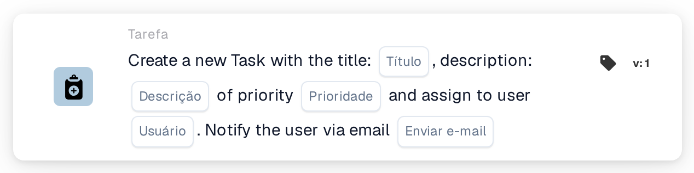
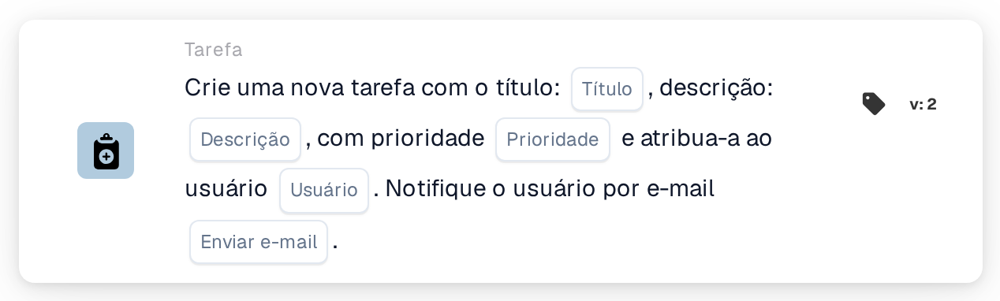
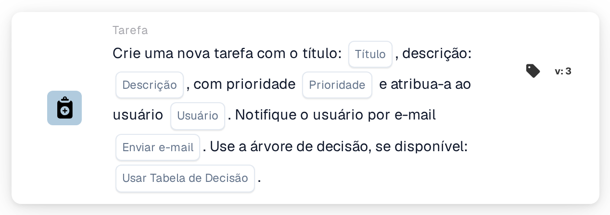
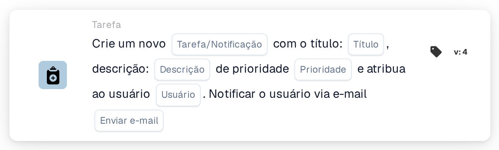

# Crie uma nova tarefa e atribua-a ao usuário

<figure><figcaption>
Versão 1
</figcaption></figure>

<figure><figcaption>
Versão 2
</figcaption></figure>

<figure><figcaption>
Versão 3
</figcaption></figure>

<figure><figcaption>
Versão 4
</figcaption></figure>

## **Propósito**

O cartão de fluxo de trabalho **"Criar tarefa ou notificação"** simplifica a gestão de tarefas e notificações dentro dos fluxos de trabalho. Consoante a versão, o cartão pode criar tarefas, enviar notificações e aproveitar funcionalidades adicionais, como árvores de decisão, para um processamento dinâmico.

## **Componentes do cartão**

1. **Título**
   * **Descrição**: Define o título da tarefa ou notificação que está a ser criada.
   * **Detalhe**: O título fornece um identificador claro e conciso para a tarefa ou notificação.
2. **Descrição**
   * **Descrição**: Fornece detalhes sobre a tarefa ou notificação.
   * **Detalhe**: Ajuda a clarificar o propósito ou o contexto da tarefa ou notificação para o utilizador atribuído.
3. **Prioridade**
   * **Descrição**: Define o nível de urgência da tarefa.
   * **Opções**:
     * **High**: Exige atenção imediata.
     * **Médio**: Importante mas não urgente.
     * **Low**: Pode ser tratado posteriormente.
4. **Usuário atribuído**
   1. **Descrição**: Especifica o utilizador ao qual a tarefa é atribuída.
   2. **Detalhe**: Os utilizadores são selecionados a partir de uma lista pendente de pessoal disponível.
5. **Notificação por e-mail**
   * **Descrição**: Determina se o utilizador atribuído recebe uma notificação por e-mail.
   * **Opções**:
     * **True**: Envia uma notificação por e-mail ao utilizador.
     * **False**: Não é enviada qualquer notificação por e-mail.

## Componentes adicionais **na Versão 3 e na Versão 4**

1. **Árvore de Decisão (apenas na Versão 3)**
   * **Descrição**: Permite a utilização de uma árvore de decisão para a criação dinâmica de tarefas.
   * **Opções**:
     * **True**: Ativa o processamento da árvore de decisão.
     * **False**: Desativa o processamento da árvore de decisão.
2. **Tarefa ou Notificação (apenas na Versão 4)**
   * **Descrição**: Permite escolher entre criar uma tarefa ou uma notificação.
   * **Opções**:
     * **Tarefa**: Cria uma tarefa.
     * **Notification**: Cria uma notificação em vez de uma tarefa.

## **Funcionalidade:**

* **Avaliação da condição**:\
  Este cartão só é acionado se as condições nas secções **"Quando"** e **"E Seções"** forem cumpridas.
* **Criação de tarefa ou notificação**:
  * Versões 2 e 3: É criada uma tarefa com o título, descrição, prioridade e utilizador atribuído especificados.
  * Versão 4: Permite criar uma tarefa ou uma notificação.
* **Atribuição dinâmica**:
  * Na Versão 3, a árvore de decisão determina dinamicamente o utilizador ao qual a tarefa será atribuída com base nos parâmetros do fluxo de trabalho.
* **Notificação por e-mail**:\
  Envia um e-mail ao utilizador atribuído se a opção de notificação estiver ativada.

## **Configuração:**

1. **Selecionar a versão**: Escolha a versão do cartão com base na funcionalidade necessária:
   * Versão 2: Criação básica de tarefas com atribuição manual de utilizador e notificações por e-mail.
   * Versão 3: Inclui a funcionalidade de árvore de decisão para a atribuição dinâmica de utilizador.
   * Versão 4: Acrescenta a capacidade de criar uma notificação em vez de uma tarefa.
2. **Introduzir os detalhes da tarefa**: Especifique o título, a descrição e a prioridade da tarefa ou notificação.
3. **Atribuir utilizador**:
   * Para as Versões 2 e 4, selecione manualmente um utilizador na lista pendente.
   * Para a Versão 3, ative a árvore de decisão para determinar dinamicamente o utilizador atribuído.
4. **Ativar a notificação por e-mail**: Especifique se o utilizador atribuído deve receber uma notificação por e-mail.
5. (Para a Versão 4) **Escolher Task ou Notification**: Indique se pretende criar uma tarefa ou uma notificação.

## **Conclusão:**

O cartão de fluxo de trabalho **"Criar tarefa ou notificação"** é uma ferramenta versátil para gerir tarefas e notificações. Ao suportar a atribuição dinâmica de utilizadores através de árvores de decisão e ao oferecer opções para a criação de tarefas ou notificações, melhora a adaptabilidade do fluxo de trabalho e a eficiência da colaboração.

<!-- workflow-card-practical-example-20261021 -->

## Exemplo prático

**Quando usar:** Dê a um revisor um item de ação explícito.

**Configuração:** Selecione `Demo Reviewer A`, título `Review invoice`, descrição e prioridade.

**Resultado esperado e contraexemplo:** O usuário selecionado recebe a nova tarefa. Confirme o título da tarefa e o responsável; a tarefa ainda precisa ser concluída pelo revisor.

Esta é uma configuração ilustrativa e resultado esperado. Utilize campos, usuários e grupos configurados em sua organização de teste; não é uma afirmação de que este exemplo foi executado.
