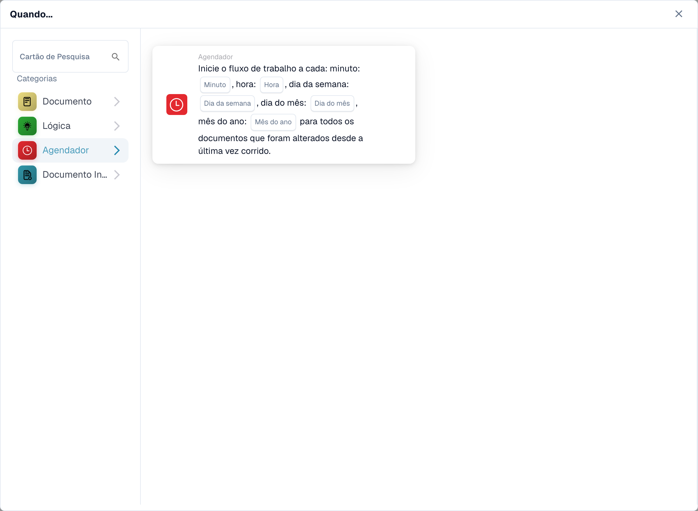
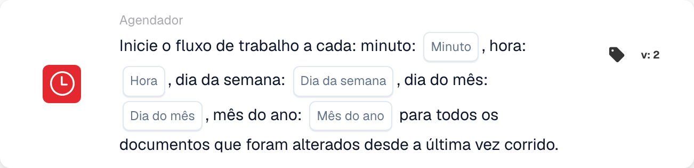

# Quando

Os cartões nesta categoria, mostrados na biblioteca **Adicionar cartão** do Workflow Builder:

<figure><figcaption>
Cartões disponíveis na categoria selecionada. Configure os campos antes de utilizar. Algumas etiquetas desta versão da interface ainda não estão traduzidas ou têm uma tradução incorreta. As explicações desta página usam os termos corretos; a imagem mostra a interface real.
</figcaption></figure>

#### Compreendendo o “quando” nas configurações do fluxo de trabalho

**Objetivo de "Quando"**

* A seção "Quando" em uma configuração de fluxo de trabalho define as condições de gatilho que iniciam uma ação de fluxo de trabalho específica. Essas condições são baseadas em critérios específicos relacionados aos atributos do documento ou às atividades do usuário no sistema ERP.

**Como funciona**

* Na sua interface, "Quando" parece ser um ponto de partida onde os usuários podem selecionar diferentes cartões de gatilho. Cada cartão especifica as condições sob as quais as ações subsequentes (definidas na seção "E") serão executadas.

**Cartões de condição de tipo de documento**

* Os cartões com o ícone do documento exibidos na captura de tela são variações das condições "Tipo de Documento", que são usadas para acionar fluxos de trabalho com base no tipo de documento que está sendo processado. Aqui está uma análise de cada tipo de cartão de condição mostrado:
  * **Tipo de documento (Operador) um de (Tipo)**: Este cartão aciona uma ação quando o tipo de documento corresponde a um dos tipos especificados em uma lista. O operador pode incluir opções como “é” ou “não é”, permitindo condições inclusivas ou exclusivas.
  * **Tipo de documento (Operador) (Tipo)**: Esta variante mais simples é acionada com base em uma única condição de tipo de documento. Normalmente verificaria se o tipo de documento "é" ou "não é" um tipo específico, sem a opção de selecionar vários tipos.
  *

**Batida de aipo**

* O cartão com o ícone de relógio na captura de tela é uma condição “Celery Beat”, usada para acionar fluxos de trabalho com base em data e hora.

#### Configurando um cartão de gatilho "Quando"

1. **Seleção do tipo de condição**: Os usuários começam selecionando um tipo de condição que seja relevante para o fluxo de trabalho que desejam automatizar. Neste caso, os tipos de documentos são o foco.
2. **Definindo o Operador**: Os usuários devem decidir o operador lógico — como "é" ou "não é" — que estabelece a base para comparar os tipos de documentos reais com as condições definidas.
3. **Especificando tipos de documentos**: Dependendo do cartão, os usuários podem selecionar um ou vários tipos de documentos que acionarão o fluxo de trabalho quando documentos desses tipos forem processados.
4. **Finalizando o Trigger**: Uma vez configurada a condição, ela se torna a base para o disparo de ações específicas definidas no fluxo de trabalho. Se um documento atender à condição definida, as ações definidas serão iniciadas automaticamente.

#### Aplicação Prática

Na prática, esses cartões disparadores são cruciais para automatizar processos como aprovações, notificações ou qualquer procedimento que dependa do tipo de documento que está sendo tratado. Por exemplo, se um tipo de documento "for" uma "Fatura" e corresponder às condições definidas no cartão "Quando", o fluxo de trabalho poderá encaminhar automaticamente o documento para processamento de pagamento.

Esta configuração garante que os fluxos de trabalho não são apenas eficientes, mas também adaptados às necessidades operacionais específicas da organização, reduzindo a supervisão manual e acelerando os processos de tratamento de documentos.

Em resumo, a parte "Quando" da configuração do seu fluxo de trabalho trata de definir o cenário para ações automatizadas com base em condições específicas e predefinidas. É uma ferramenta poderosa para garantir que o seu sistema ERP reaja de forma dinâmica às necessidades do negócio, aumentando a produtividade e a precisão na gestão documental.

[Referência de gatilho de mudança de variável e evento de webhook](../cards-overview/logic-cards-guide.md).

<!-- workflow-card-example-celery_beat-20261021 -->

### Processamento agendado

<figure><figcaption>
Campos do cartão na versão apresentada. Os campos ainda não estão configurados. Algumas etiquetas desta versão da interface ainda não estão traduzidas ou têm uma tradução incorreta. As explicações desta página usam os termos corretos; a imagem mostra a interface real.
</figcaption></figure>

`CELERY_BEAT` · versão 2

Use um gatilho programado para documentos alterados desde a execução anterior. Para uma programação de demonstração diária, selecione minuto `0`, hora `9` e os valores diários/mês oferecidos. Verifique o fuso horário do agendador configurado e a próxima execução planejada. Este gatilho não é prova de que documentos inalterados sejam reprocessados.
