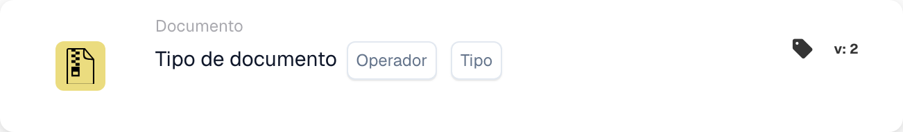
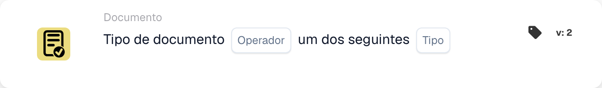

# Descrição do cartão

## **Cartões When: Tipo de documento**

Um workflow pode ser iniciado com estes dois cartões. Aqui você decide com qual tipo de documento o workflow começa ou se ele não deve afetar determinados tipos de documento.

\\

<figure><figcaption>
Campos do cartão na versão apresentada. Os campos ainda não estão configurados.
</figcaption></figure>

<figure><figcaption>
Campos do cartão na versão apresentada. Os campos ainda não estão configurados.
</figcaption></figure>

Este cartão também pode ser usado para especificar vários tipos de documento que o workflow deve afetar.
