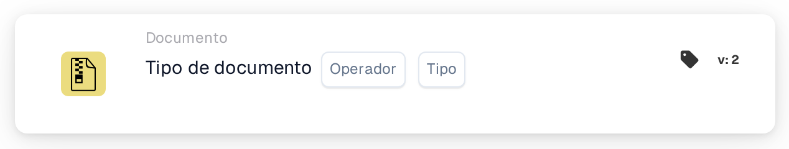

# Operação de Tipo de Documento

<figure><figcaption>
Versão 1
</figcaption></figure>

<figure><figcaption>
Versão 2
</figcaption></figure>

## **Propósito:**

Este cartão de fluxo de trabalho é especificamente projetado para realizar operações predefinidas em documentos categorizados por tipo. Ele simplifica o manuseio de várias formas de documentos dentro de um sistema ERP, garantindo que cada tipo seja processado de acordo com seus requisitos exclusivos e políticas organizacionais.

## **Funcionalidade:**

* **Validação de Tipo de Documento**: Este cartão verifica se um documento corresponde a um tipo específico, permitindo que os usuários confirmem sua categorização.
* **Operador**: Os usuários podem definir condições para determinar o tipo de documento. Os operadores disponíveis incluem:
  * **É**: Confirma que o documento corresponde ao tipo de documento especificado.
  * **Não É**: Garante que o documento não corresponda ao tipo de documento especificado.
* **Tipos de Documentos**: Os tipos de documentos suportados incluem:
  * **Fatura**
  * **Nota de Débito**
  * **Nota de Crédito**
  * **Ordem de Compra**
  * **Confirmação de Pedido**
  * **Aviso de Remessa Antecipada**

## **Uso**:

Este cartão é útil para gerentes de documentos e administradores que precisam garantir que os documentos sejam classificados corretamente para um processamento simplificado. A validação dos tipos de documentos aprimora a automação do fluxo de trabalho, permite ações específicas de documentos e mantém os registros organizados.

## **Cenário de Exemplo**:

* Um usuário faz upload de um documento rotulado como "Nota de Débito". Usando o operador "É", o cartão confirma que o tipo de documento é realmente "Nota de Débito", permitindo que o sistema aplique regras de processamento relevantes e o categorize adequadamente.

Ao implantar o cartão "Tipo de Documento", as organizações podem automatizar a classificação de documentos, garantir consistência no manuseio de documentos e melhorar a eficiência dos fluxos de trabalho de gerenciamento de documentos.
