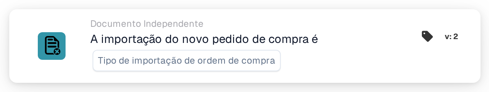

# Importação de ordem de compra

<figure><figcaption>
Versão 2
</figcaption></figure>

## Propósito:

Este cartão de fluxo de trabalho inicia um fluxo de trabalho (acionador) quando uma ordem de compra é importada para o DocBits. Pode reagir a ordens de compra recém-criadas, a atualizações de ordens de compra existentes, ou a ambas. O fluxo de trabalho é executado sem documento, pelo que pode ser utilizado para informar pessoas ou para chamar outros sistemas sempre que chegam dados de ordens de compra.

## Componentes do cartão:

1. **Tipo de importação de ordem de compra**
   * **Descrição:** Define que tipo de importação inicia o fluxo de trabalho.
   * **Opções:**
     * **uma nova ordem de compra.** A ordem de compra não existia anteriormente e foi criada pela importação.
     * **uma atualização de um pedido de compra existente.** Uma ordem de compra existente foi atualizada pela importação.

     Podem ser selecionadas ambas as opções.

## Funcionalidade:

* **Quando o fluxo de trabalho é iniciado:** Quando uma ordem de compra do sistema ERP é processada pela importação de ordens de compra, o sistema regista se era nova ou uma atualização. Em seguida, inicia todos os fluxos de trabalho independentes de documentos ativados da organização (exceto os fluxos de trabalho de webhook e os agendados) e transmite-lhes esta informação, juntamente com o ID e o número da ordem de compra. Isto só acontece se o módulo de fluxos de trabalho estiver ativo para a organização e existirem fluxos de trabalho ativos. Uma ordem de compra que é ignorada porque a versão recebida não é mais recente do que a guardada não inicia fluxos de trabalho.
* **Avaliação da condição:** O cartão verifica se o tipo de importação transmitido ao fluxo de trabalho é um dos tipos selecionados no cartão.
* **Execução da ação:**
  * **Condição Verdadeira:**\
    Se o tipo de importação corresponder a uma opção selecionada, o fluxo de trabalho continua com os cartões seguintes.
  * **Condição Falsa:**\
    Se o tipo de importação não corresponder, ou se o fluxo de trabalho tiver sido iniciado por outro evento independente de documentos (por exemplo, uma alteração do estado de um fornecedor), o cartão não é cumprido e os passos seguintes não são executados.
* **Dados em falta:** Se não estiver selecionado nenhum tipo de importação no cartão, o cartão não avalia a condição. Regista a entrada em falta (ou um erro) no registo do fluxo de trabalho, e os passos seguintes não são executados.

## Configuração:

* O cartão pode ser adicionado a partir da secção **WHEN**, categoria **Documento Independente**. Em seguida, são selecionados um ou ambos os tipos de importação, são adicionadas as restantes condições e ações, e o fluxo de trabalho é guardado e ativado.

## Conclusão:

O cartão "Purchase order import" permite que os fluxos de trabalho reajam assim que os dados de uma ordem de compra são criados ou atualizados, sem esperar por um documento. Assim, os processos de acompanhamento mantêm-se sincronizados com as ordens de compra provenientes do sistema ERP.
