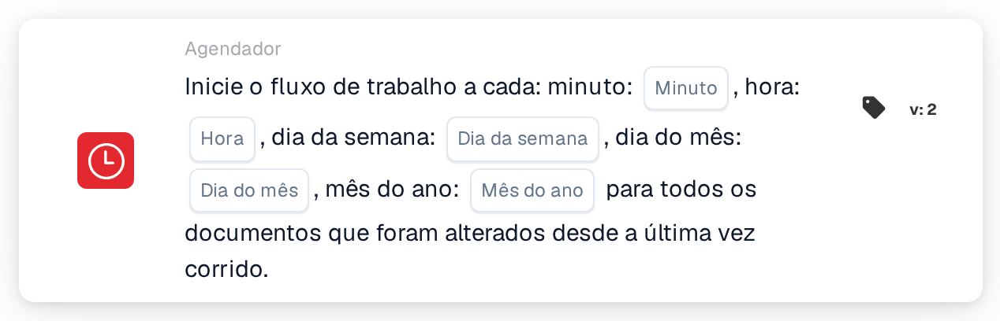

# Início agendado do fluxo de trabalho

<figure><figcaption>
Versão 2
</figcaption></figure>

## Propósito:

Este cartão de fluxo de trabalho inicia um fluxo de trabalho (acionador) segundo um horário definido, à semelhança de uma tarefa cron. Em cada hora agendada, o fluxo de trabalho é executado para todos os documentos que foram alterados desde a execução anterior. Isto é útil para processamentos regulares, como verificações noturnas, lembretes periódicos ou ações de acompanhamento que não devam ser executadas imediatamente a cada alteração de um documento.

## Componentes do cartão:

1. **Minuto**
   * **Descrição:** O(s) minuto(s) da hora em que o fluxo de trabalho é iniciado.
   * **Detalhe:** Valor no estilo cron, por exemplo `0`, `30`, `0,30` ou `*/15`. Vazio significa a cada minuto (`*`).
2. **Hora**
   * **Descrição:** A(s) hora(s) do dia em que o fluxo de trabalho é iniciado.
   * **Detalhe:** Valor no estilo cron, por exemplo `6` ou `8-18`. Vazio significa a cada hora (`*`).
3. **Dia da semana**
   * **Descrição:** O(s) dia(s) da semana em que o fluxo de trabalho é iniciado.
   * **Detalhe:** Valor no estilo cron, por exemplo `1-5`. Vazio significa todos os dias da semana (`*`).
4. **Dia do mês**
   * **Descrição:** O(s) dia(s) do mês em que o fluxo de trabalho é iniciado.
   * **Detalhe:** Valor no estilo cron, por exemplo `1` ou `1,15`. Vazio significa todos os dias (`*`).
5. **Mês do ano**
   * **Descrição:** O(s) mês(es) em que o fluxo de trabalho é iniciado.
   * **Detalhe:** Valor no estilo cron, por exemplo `1` ou `1-6`. Vazio significa todos os meses (`*`).

## Funcionalidade:

* **Fuso horário:** Todas as horas estão em UTC, o fuso horário dos servidores DocBits. Por exemplo, 6:00 UTC corresponde às 8:00 na hora de verão da Europa Central.
* **Quando o fluxo de trabalho é iniciado:** Quando o fluxo de trabalho é guardado e ativado, é criada uma entrada de agendamento a partir dos cinco campos. Se o fluxo de trabalho for desativado ou eliminado, a entrada de agendamento é removida. Em cada hora agendada, o sistema:
  * procura documentos da organização que foram modificados, guardados ou que mudaram de estado desde a última execução do fluxo de trabalho,
  * inicia o fluxo de trabalho separadamente para cada um destes documentos em segundo plano, e
  * memoriza a hora desta execução como ponto de partida para a seguinte.

  Os documentos que atingiram o limite de execuções do fluxo de trabalho são ignorados. Se o fluxo de trabalho for desativado enquanto os documentos estão a ser processados, os documentos restantes não são executados.
* **Avaliação da condição:** O cartão verifica se o fluxo de trabalho foi iniciado pelo agendamento.
* **Execução da ação:**
  * **Condição Verdadeira:**\
    Quando o fluxo de trabalho é iniciado pelo agendamento, o cartão é cumprido e o fluxo de trabalho continua com os cartões seguintes.
  * **Condição Falsa:**\
    Quando o fluxo de trabalho é iniciado de qualquer outra forma, por exemplo por um acionador de documento, um webhook ou uma alteração de variável, o cartão não é cumprido e os passos seguintes não são executados.
* **Apenas um agendamento por fluxo de trabalho:** No Advanced Workflow Builder, se um fluxo de trabalho contiver vários cartões de agendamento, apenas o primeiro é utilizado para o agendamento.
* **Guardar:** Se não for possível atualizar a entrada de agendamento ao guardar, o fluxo de trabalho é guardado na mesma e é apresentado um aviso. Ao guardar novamente o fluxo de trabalho, a atualização é repetida.

## Configuração:

* O cartão pode ser adicionado a partir da secção **WHEN**, categoria **Agendador**. Em seguida, são preenchidos os campos de tempo; os campos deixados vazios significam "todos". Por exemplo, minuto `0`, hora `6`, dia da semana `1-5` e os restantes campos vazios iniciam o fluxo de trabalho às 6:00 UTC nos dias úteis. Depois disso, são adicionadas as restantes condições e ações, e o fluxo de trabalho é guardado e ativado.

## Conclusão:

O cartão "Scheduled workflow start" executa fluxos de trabalho a horas fixas, em vez de a cada evento. Como cada execução considera apenas os documentos que foram alterados desde a execução anterior, o processamento regular mantém-se centrado no trabalho novo.
