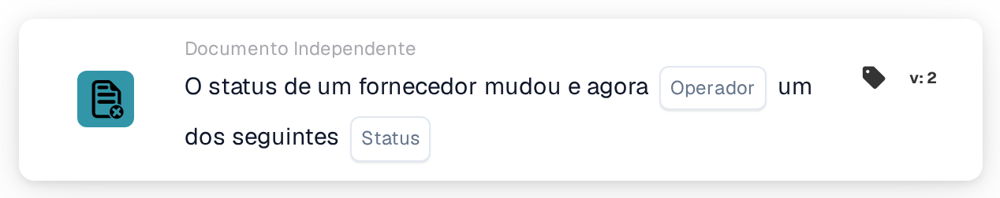

# Estado do fornecedor alterado

<figure><figcaption>
Versão 2
</figcaption></figure>

## Propósito:

Este cartão de fluxo de trabalho inicia um fluxo de trabalho (acionador) quando o estado de um fornecedor muda, por exemplo quando um fornecedor é aprovado ou rejeitado. O fluxo de trabalho é executado sem documento, pelo que pode ser utilizado para notificar pessoas ou para iniciar passos de acompanhamento na integração de fornecedores.

## Componentes do cartão:

1. **Operador**
   * **Descrição:** Define se o novo estado do fornecedor deverá ser um dos estados selecionados ou nenhum deles.
   * **Opções:**
     * **É:** A condição é verdadeira se o novo estado for um dos estados selecionados.
     * **Não é:** A condição é verdadeira se uma alteração do estado do fornecedor tiver iniciado o fluxo de trabalho e o novo estado não for um dos estados selecionados.
2. **Status**
   * **Descrição:** Os estados de fornecedor com os quais o novo estado é comparado.
   * **Opções:** Um ou mais dos seguintes:
     * **Aprovado**
     * **Aprovação AP pendente**
     * **Aprovação pendente**
     * **Registro pendente**
     * **Rejeitado**

## Funcionalidade:

* **Quando o fluxo de trabalho é iniciado:** Uma alteração do estado de um fornecedor na gestão de fornecedores inicia todos os fluxos de trabalho independentes de documentos ativados da organização (exceto os fluxos de trabalho de webhook e os agendados) e transmite-lhes o novo estado. Isto acontece, por exemplo, quando um novo fornecedor é convidado (estado de registo pendente), quando um fornecedor é enviado para aprovação, aprovado ou rejeitado, ou quando os dados do fornecedor são guardados com um estado diferente. Se o estado não for um dos estados de fornecedor configurados para a organização, não é iniciado nenhum fluxo de trabalho. Os fluxos de trabalho só são iniciados se o módulo de fluxos de trabalho estiver ativo para a organização e existirem fluxos de trabalho ativos.
* **Avaliação da condição:** O cartão compara o estado transmitido ao fluxo de trabalho com os estados selecionados no cartão.
* **Execução da ação:**
  * **Condição Verdadeira:**\
    Com **É**, o novo estado é um dos estados selecionados. Com **Não é**, uma alteração do estado do fornecedor iniciou o fluxo de trabalho e o novo estado não é um dos estados selecionados. O fluxo de trabalho continua com os cartões seguintes.
  * **Condição Falsa:**\
    Se a condição não for cumprida, o cartão não é cumprido e os passos seguintes não são executados.
* **Outros eventos independentes de documentos:** Uma importação de ordem de compra também inicia todos os fluxos de trabalho independentes de documentos, incluindo os fluxos de trabalho com este cartão. Uma execução deste tipo não cumpre o cartão com nenhum dos operadores, pelo que os passos seguintes só são executados para alterações do estado do fornecedor.
* **Dados em falta:** Se não estiver selecionado nenhum estado no cartão, o cartão não avalia a condição. Regista a entrada em falta (ou um erro) no registo do fluxo de trabalho, e os passos seguintes não são executados.
* **Operador inválido:** Se o operador não for **É** nem **Não é**, o cartão regista um erro de configuração do cartão no registo do fluxo de trabalho.

## Configuração:

* O cartão pode ser adicionado a partir da secção **WHEN**, categoria **Documento Independente**. Em seguida, são selecionados o operador e um ou mais estados, são adicionadas as restantes condições e ações, e o fluxo de trabalho é guardado e ativado.

## Conclusão:

O cartão "Supplier status changed" liga a gestão de fornecedores aos fluxos de trabalho. Aprovações, rejeições e outras alterações de estado podem acionar diretamente notificações e passos de acompanhamento, pelo que a integração de fornecedores não depende de verificações manuais.
