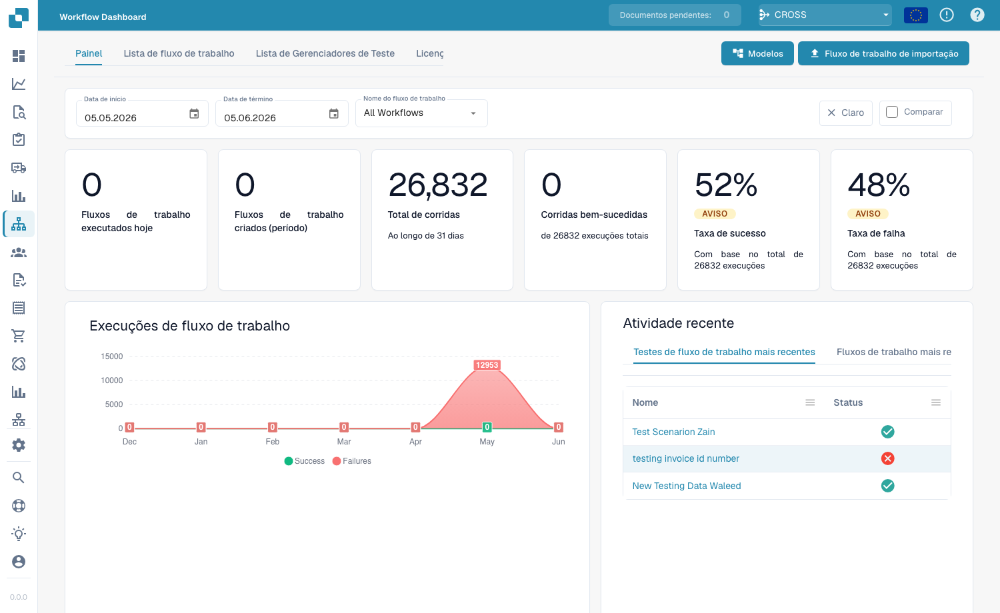
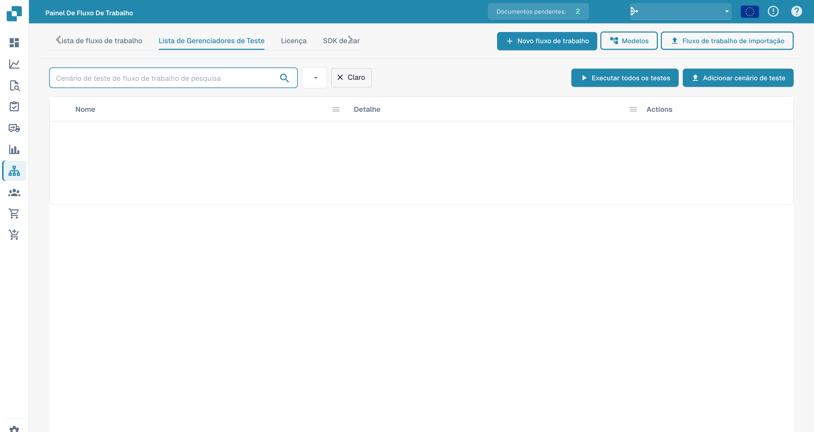

# Painel

O **Painel de fluxo de trabalho** é a página inicial da área de workflows. Ele mostra o desempenho dos seus workflows — totais de execuções, taxas de sucesso e falha, um gráfico de execuções ao longo do tempo e a atividade recente — e dá acesso à lista de workflows, ao gerenciador de testes e ao Card SDK.

<figure><figcaption>
O Workflow Dashboard — totais de execuções, taxas de sucesso/falha e atividade recente de cada workflow.
</figcaption></figure>

## Abas

- **Painel** — métricas de execução e atividade recente (mostrados acima).
- **Lista de fluxo de trabalho** — todos os workflows com tipo, ordem de execução e gatilho. Crie um novo com **Novo fluxo de trabalho**.
- **Lista de Gerenciadores de Teste** — cenários de teste que validam seus workflows; execute-os com **Executar todos os testes**.
- **Licença** — informações de licenciamento dos workflows.
- **Card SDK** — crie e envie cartões de workflow personalizados (consulte [Card SDK](card-sdk.md)).

A barra de ferramentas também oferece **Modelos**, que abre a biblioteca de [Modelos de workflow](standard-workflow-builder.md#workflow-templates), e **Fluxo de trabalho de importação**, que importa um workflow a partir de um arquivo JSON.

O **Gestão de testes** permite salvar cenários de teste por workflow e executá-los em conjunto, para confirmar que seus workflows continuam se comportando corretamente após alterações:

<figure><figcaption>
Lista de cenários de teste dos fluxos. O botão Claro limpa o filtro.
</figcaption></figure>

## Próximos passos

- Crie uma automação linear com o construtor **Fluxo padrão**.
- Crie um fluxo com ramificações com o construtor **Fluxo de trabalho avançado**.
