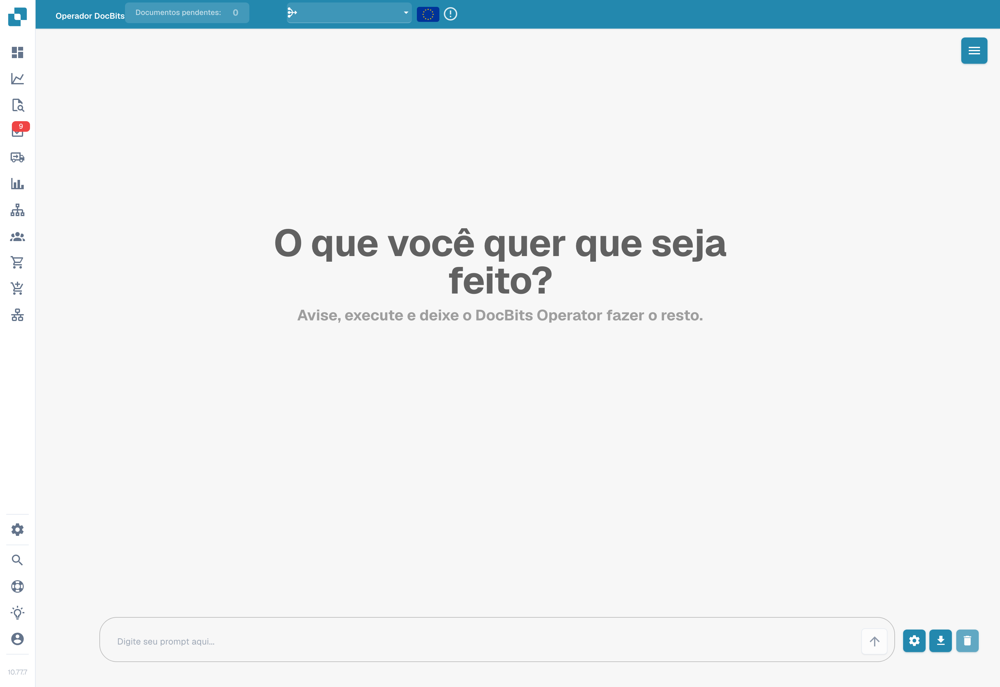
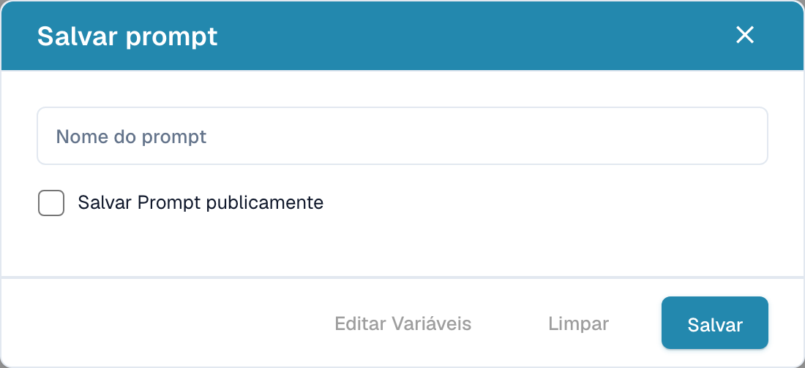

# Operador DocBits

O DocBits Operator executa tarefas a partir das instruções do utilizador. A instrução descreve os passos, enquanto as variáveis fornecem os dados necessários para cada execução.

## Ativação e acesso

1. Abra **Definições → Módulo → Integração de documentos**.
2. Desloque-se até **DocBits Operator** e ative a funcionalidade se tiver as permissões necessárias.
3. Abra o **Operador DocBits** na navegação principal da aplicação.

<figure><figcaption>
Módulos de integração de documentos: scripts, digitalização, códigos de barras e dados mestre personalizados. A etiqueta Select do seletor de códigos de barras mantém-se em inglês na versão ilustrada.
</figcaption></figure>

## Introduzir uma instrução

Introduza a instrução no campo na parte inferior do ecrã. Descreva o resultado esperado e os passos necessários. As variáveis usam chavetas, por exemplo `{invoice_number}` ou `{url}`. O botão com a roda dentada abre a janela para definir os nomes e valores das variáveis.

<figure><figcaption>
Interface portuguesa do DocBits Operator com o campo de instruções vazio. Não foi iniciada nenhuma tarefa.
</figcaption></figure>

O botão com a seta inicia a execução. O ícone de transferência abre a janela para guardar a instrução, e o caixote do lixo limpa a conversa. Abrir a janela de gravação não guarda o modelo.

Consulte os exemplos no [guia de escrita de instruções](prompt-writing-guide.md).

## Guardar uma instrução

Na janela de gravação, introduza um **nome para a instrução**. A opção de publicação define a partilha do modelo. Ao preparar um modelo para partilha, use nomes de variáveis no texto e preencha os valores necessários antes de cada execução.

<figure><figcaption>
Janela portuguesa para guardar uma instrução, sem valores introduzidos e sem acionar o botão final de gravação.
</figcaption></figure>

O botão de edição das variáveis abre as respetivas definições. O botão de gravação guarda o modelo. Para fechar a janela sem guardar, use a cruz no canto superior direito.

Na versão ilustrada, o botão Limpar fecha a janela; o seu rótulo não descreve corretamente essa ação.

## Lista de instruções guardadas

O menu no canto superior direito abre o painel de instruções guardadas. A lista tem secções separadas para instruções da organização e instruções públicas, além de pesquisa por nome.

As instruções da organização apresentam ícones para executar, editar e eliminar. Na secção pública, a seta executa o modelo selecionado. Preencha os valores das variáveis antes da execução.

## Controlar a execução

Durante a execução, pode colocar em pausa, retomar, cancelar ou assumir o controlo. A pausa interrompe os passos seguintes para permitir verificar o estado atual. Retomar continua o trabalho; cancelar termina a execução. Assumir o controlo permite interagir manualmente com a vista do navegador.

<figure><figcaption>
Exemplo dos ícones para retomar e parar.
</figcaption></figure>

## Vista detalhada

O botão de expansão abre a vista detalhada da execução. Esta permite acompanhar as ações, o passo atual e as mensagens do operador, bem como usar os controlos da execução.

<figure><figcaption>
Ícone para expandir a vista detalhada.
</figcaption></figure>
