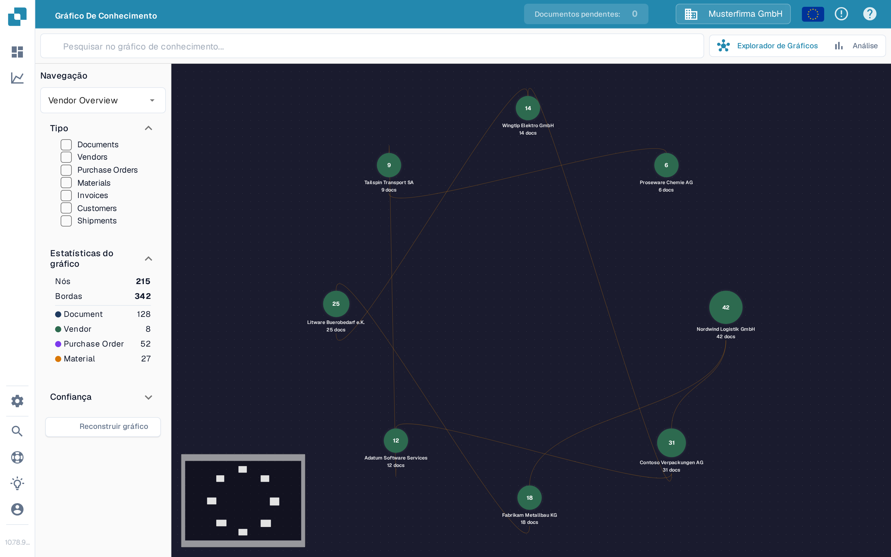

# Explorador de Gráficos de Conhecimento

O **Explorador de Gráficos de Conhecimento** ajuda-o a ver as ligações entre fornecedores, documentos, ordens de compra e outros registos. Use-o quando quiser seguir uma relação ou verificar quantos itens ligados estão disponíveis. O exemplo abaixo mostra um gráfico com dados na organização de teste Sandbox em português.

<figure><figcaption>
O gráfico de exemplo mostra fornecedores ligados. Pesquise um item ou reconstrua o gráfico para ver as suas próprias ligações.
</figcaption></figure>

## Começar

1. Abra o **Explorador de Gráficos** no DocBits. Confirme que a organização mostrada no topo é a que pretende inspecionar.
2. Se o centro mostrar **Search for a node or compute the graph to get started**, escolha **Reconstruir gráfico** e aguarde que a mensagem de progresso termine. Isto prepara os dados do gráfico; pode demorar. Se a organização ainda não tiver relações correspondentes, **Nós** e **Bordas** podem ficar a zero.
3. Escreva um nome ou outro termo de pesquisa em **Search knowledge graph** e prima Enter ou selecione o ícone de pesquisa. Quando aparecerem vários resultados, escolha o de que precisa. Um único resultado abre diretamente o respetivo gráfico.
4. Selecione um nó para ver os detalhes. Feche o painel de detalhes com **X** quando quiser voltar ao gráfico.

## Escolher o que vê

| Controlo                             | O que faz                                                                                                                                                                                                                       |
| ------------------------------------ | ------------------------------------------------------------------------------------------------------------------------------------------------------------------------------------------------------------------------------- |
| **Navegação**                        | Alterna entre **Vendor Overview** (fornecedores ligados), **Vendor Intelligence** (uma tabela de fornecedores), **Document Journey** (passos e variantes do processamento de documentos) e **Anomalies** (relações invulgares). |
| **Tipo**                             | Selecione os tipos de itens em que se quer concentrar, como Documents, Vendors, Purchase Orders ou Invoices. Os tipos selecionados também limitam os resultados da pesquisa.                                                    |
| **Estatísticas do gráfico**          | Mostra o número de nós (itens) e bordas (ligações) atualmente disponíveis. Expanda ou recolha esta secção conforme necessário.                                                                                                  |
| **Confiança**                        | Abra esta secção para definir a confiança mínima das relações ao expandir um nó. Um valor mais alto restringe as ligações mostradas.                                                                                            |
| **Reconstruir gráfico**              | Inicia um novo cálculo do gráfico. Aguarde que o progresso termine antes de voltar a pesquisar.                                                                                                                                 |
| **Explorador de Gráficos / Análise** | Alterna entre o gráfico interativo e gráficos de resumo. A Análise mostra contagens e gráficos quando existem dados do gráfico; um gráfico vazio deixa também a Análise vazia.                                                  |

Se precisar de resolver uma diferença entre uma fatura e a sua ordem de compra, continue com o ecrã de [Correspondência de Ordem de Compra](../end-user-and-partner-section/end-user-section/purchase-order-matching/). Para métricas mais amplas fora do gráfico, consulte o [Painel de Análises](../administration-and-setup/analytics-dashboard.md).
