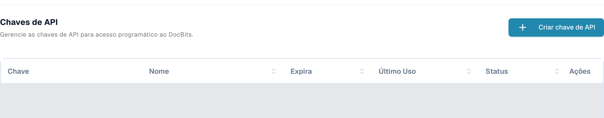
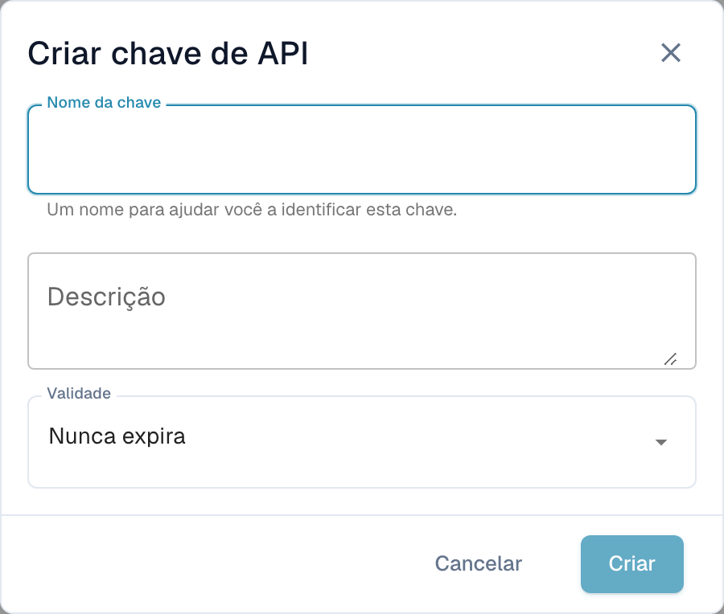

# Postman para o DocBits

O Postman permite enviar pedidos HTTP para a API do DocBits. Comece por um pedido apenas de leitura num ambiente que esteja autorizado a utilizar. Separe os ambientes de teste e produção e guarde as credenciais em variáveis privadas ou num cofre de segredos.

## Configuração

### API DocBits

Abra a documentação da API do ambiente adequado, por exemplo, a [API Sandbox](https://sandbox.api.docbits.com/docs) ou a [API de produção](https://api.docbits.com/docs). Utilize os caminhos atuais das operações e o valor **Servers** apresentado nessa documentação. Um caminho relativo do servidor é acrescentado à origem da API.

Na [documentação Dev verificada aqui](https://eu.dev.api.docbits.com/docs), esse caminho é `/dev-api`. Assim, o URL base completo é `https://eu.dev.api.docbits.com/dev-api`. Outros ambientes podem utilizar um caminho de servidor diferente.

A especificação da API apresenta vários esquemas de cabeçalho distintos:

| Cabeçalho | Finalidade |
| --- | --- |
| `X-ORG-ID` | Identifica a organização de destino quando a operação o exige. |
| `Authorization` | Contém o valor de autorização exigido pelo mecanismo de autenticação correspondente. |
| `X-API-KEY` | Contém uma chave de API para as operações que utilizam esse esquema. |

Estes cabeçalhos não são intercambiáveis. A caixa de diálogo global **Authorize** mostra os esquemas disponíveis; nem todas as operações necessitam de todos os cabeçalhos. Consulte os parâmetros e as informações de autorização da operação concreta.

Peça as credenciais adequadas ao seu administrador. Os utilizadores autorizados encontram a gestão de chaves em **Integração e SSO → Chaves de API**, nas definições do DocBits. A lista apresenta o prefixo da chave, o nome, a validade, a última utilização e o estado. As linhas existentes estão ocultadas na captura.

<figure><figcaption><p>Vista real de Dev em português: Chaves de API, botão Criar chave de API e colunas Chave, Nome, Expira, Último Uso, Status e Ações; as linhas existentes estão ocultadas.</p></figcaption></figure>

**Criar chave de API**, acima da lista, abre primeiro um formulário vazio com **Nome da chave**, **Descrição** e **Validade**. Só o envio desse formulário cria uma chave. O formulário ilustrado foi fechado com **Cancelar**, sem ser enviado. Não foi criada, apresentada, copiada nem revogada qualquer chave. Crie chaves apenas de acordo com as suas permissões e as regras da sua organização.

<figure><figcaption><p>Formulário vazio Criar chave de API em português, com Nome da chave, Descrição, Validade, Cancelar e Criar; Criar está desativado enquanto o nome estiver vazio.</p></figcaption></figure>

### Criar uma área de trabalho no Postman

Abra o Postman e utilize uma área de trabalho com a visibilidade adequada à sua organização. Crie um ambiente com a variável `base_url`. O seu valor deve ser o URL base completo, incluindo o caminho do servidor. Selecione esse ambiente antes de enviar um pedido. O [guia de ambientes do Postman](https://learning.postman.com/docs/use/send-requests/variables/managing-environments/) explica como selecionar e utilizar as variáveis.

Crie um pedido ou adicione-o à sua coleção. Os nomes dos controlos do Postman abaixo correspondem às etiquetas técnicas da aplicação; as imagens anteriores mostram a gestão de chaves do DocBits em português.

## Exemplo do método GET

Selecione **GET** e o URL `{{base_url}}/version`. Em **Authorization**, escolha **No Auth** e depois **Send**. O pedido Dev apenas de leitura verificado foi:

```http
GET https://eu.dev.api.docbits.com/dev-api/version
```

O endpoint devolveu HTTP 200 sem uma chave de API. Verifica a disponibilidade da API e devolve informações de versão. Não demonstra acesso aos documentos ou utilizadores de uma organização. Verifique o estado e o conteúdo da resposta; em caso de erro, confirme primeiro o ambiente selecionado, a origem da API e o caminho do servidor.

Para uma operação que utiliza uma chave de API, selecione **Authorization → API Key** no Postman. Introduza `X-API-KEY` em **Key**, utilize um segredo privado em **Value** e selecione **Header** em **Add to**. Acrescente `X-ORG-ID` em **Headers** se a operação o exigir. Consulte os guias oficiais sobre [autorização por chave de API](https://learning.postman.com/docs/use/send-requests/authorization/authorization-types/#api-key) e [segredos do Vault](https://learning.postman.com/docs/use/postman-vault/use-vault-secrets/).

## Exemplo do método POST

**POST** pode criar dados ou iniciar um processamento. Copie o método, o caminho, os parâmetros obrigatórios e o esquema do corpo a partir da especificação atual da API. Execute estes pedidos apenas para uma tarefa concreta e autorizada. Um pedido de versão bem-sucedido não demonstra que um pedido de escrita terá sucesso.

### Carregar um documento

Antes de carregar um documento, consulte a operação atualmente documentada. Se exigir dados de formulário multipart, selecione esse tipo de corpo e utilize os nomes dos campos e os tipos de ficheiro indicados. Não os deduza a partir de uma captura de uma versão anterior da API. Não foi carregado qualquer documento para este guia.

## Exemplo do método DELETE

**DELETE** pode eliminar dados de forma permanente. Verifique a operação concreta, o identificador de destino e as permissões necessárias. Não foi executada qualquer eliminação nem apresentada como testada com sucesso neste guia.

## Exemplo do método PUT

**PUT** pode alterar dados existentes. Utilize exclusivamente os parâmetros e o esquema do corpo da operação atual e confirme o âmbito da alteração pedida. Não foi executada qualquer alteração neste guia.

## Alterar o endereço de e-mail de um utilizador

Obtenha o caminho e os campos obrigatórios na especificação atual da API e peça uma verificação funcional da alteração do utilizador antes de a executar. Este guia não utiliza dados reais de utilizadores ou organizações nem demonstra uma alteração de e-mail bem-sucedida.

Foram verificadas a especificação atual da API Dev, o pedido de versão sem autenticação e as vistas reais do DocBits em português da gestão de chaves e do formulário vazio. Para verificar as vistas, foram utilizadas a conta de teste autorizada e leituras de metadados da interface. Não foram executadas criações de chaves, carregamentos, criações de utilizadores, alterações ou eliminações. Não foram testadas operações de negócio da API sobre documentos ou registos de utilizadores, nem pedidos na aplicação Postman.
