# Tabella AI

A **Tabela extraída de IA** é a tabela de itens de linha que o DocBits lê com IA quando um fornecedor não tem regras de tabela treinadas. Ela aparece na tela de validação, abaixo dos campos de cabeçalho. Esta página explica todos os controles em torno dela: como corrigir uma coluna errada, como dar instruções à IA, como testar uma alteração antes de mantê-la, como ver o que a IA fez, o que o Assistente pode e não pode fazer por você e quem pode salvar o quê.

## Quando você obtém a tabela de IA

* Um administrador ativou a **Extração de tabela de IA** (Configurações → Processamento de documentos → Tipos de documentos → Classificação e Extração, veja [Configurações para administradores](./#configuracoes-para-administradores)). Se ela estiver desativada, a área da tabela mostra _A tabela AI será exibida aqui. Habilite em_.
* O fornecedor **não tem regras salvas**. Assim que alguém treina a tabela do fornecedor e salva as regras, as regras salvas substituem a tabela de IA para esse fornecedor. As linhas passam então a aparecer na aba **Tabela extraída**, e a aba **Tabela extraída de IA** fica acinzentada com a dica _Tabela AI desativada: uma tabela personalizada está em uso._
* Exceção: as colunas marcadas como **Usar IA** nas configurações das colunas da tabela são preenchidas pela IA mesmo para fornecedores com regras salvas, veja [Usar IA por coluna](./#usar-ia-por-coluna).

O nível de IA que lê a tabela (Fast, Full, Nexus) é definido por organização e pode ser substituído por fornecedor, veja Modelo de IA Específico do Fornecedor para Extração de Campos e Tabelas.

## A tabela de IA em resumo

<figure>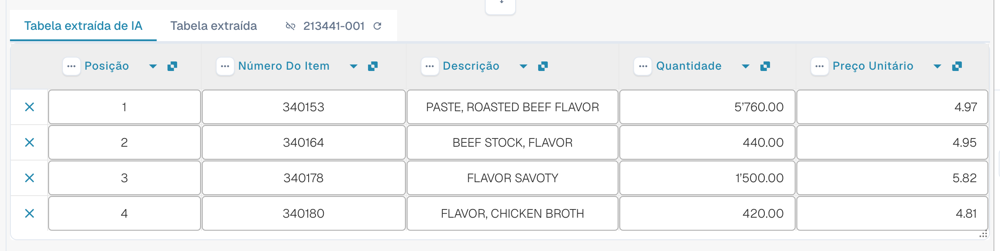<figcaption>
As duas abas, a Tabela extraída de IA e seus cabeçalhos de coluna.
</figcaption></figure>

* **Abas.** _Tabela extraída de IA_ é o que a IA leu. _Tabela extraída_ é a tabela clássica, vinda de regras treinadas. A aba de IA abre por padrão quando o documento tem uma tabela de IA.
* **Cabeçalho da coluna.** Cada coluna mostra seu nome, um pequeno símbolo de **origem** (passe o mouse sobre ele: _IA · mapeamento_, _IA · sinônimo_ e assim por diante indicam como a IA associou a coluna), um menu de **três pontos** e, para uma coluna mapeada, um **botão com o nome** em que você pode clicar para mudar qual coluna ela é.
* **Botões da linha.** O **x** no início de uma linha remove essa linha. Clique com o botão direito em uma linha para _Selecione como custo adicional_ / _Remover como custo adicional_.
* **Barra de ferramentas do rodapé.** Os ícones na parte inferior da tela adicionam ou ocultam colunas e linhas, veja [Barra de ferramentas do rodapé](./#barra-de-ferramentas-do-rodape).
* **Cartão Instruções para a IA** abaixo da tabela: prompt, colunas adicionais, **Alteração de teste**, **Aplicar**, **Salvar como treinamento**, **Excluir**, **Exportar**, veja [Dar instruções à IA](./#dar-instrucoes-a-ia).


Os controles de coluna só funcionam quando você pode editar o documento. Se estiverem acinzentados, o documento é somente leitura ou está bloqueado em outra sessão. Quando o banner vermelho informa que o documento está bloqueado pelo seu próprio usuário em outra sessão, **Desbloquear** assume o bloqueio.


## Alterar uma coluna

### Escolher a coluna certa (remapear)

Use esta opção quando um valor está na coluna errada, por exemplo, o valor líquido está em _Montante total_ ou _Quantidade_ está vazia embora a fatura a tenha.

1. Clique no **nome da coluna** no cabeçalho.
2. Escolha a coluna da tabela configurada à qual os valores realmente pertencem.

<figure>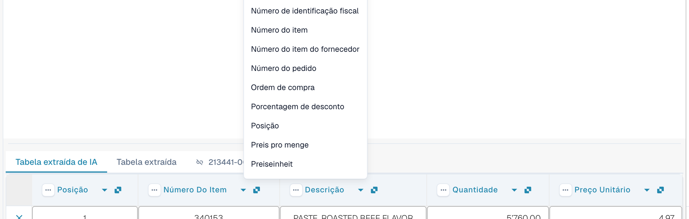<figcaption>
Clique no nome da coluna e escolha qual coluna ela deve ser. A lista mostra todas as colunas de tabela configuradas.
</figcaption></figure>

O DocBits reformata a tabela imediatamente, somente para este documento. Se a coluna escolhida já for usada por outra coluna, uma caixa de diálogo _Remapear "…"?_ avisa que a outra coluna ficará sem mapeamento. Confirme para continuar; a outra coluna passa então a mostrar o ícone de erro _Selecione uma coluna para mapear no menu suspenso_, para que você também escolha uma coluna para ela.

### O menu de três pontos

<figure>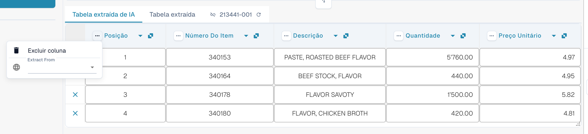<figcaption>
O menu de três pontos de uma coluna.
</figcaption></figure>

| Entrada                      | O que faz                                                                                                                                                                                                                                        |
| ---------------------------- | ------------------------------------------------------------------------------------------------------------------------------------------------------------------------------------------------------------------------------------------------ |
| **Excluir coluna**           | Oculta a coluna. Uma confirmação diz _As modificações serão descartadas_; escolha **Feito**. A tabela é reconstruída sem a coluna. Use **Restaurar coluna da tabela** na barra de ferramentas do rodapé para trazer de volta as colunas ocultas. |
| **Desativar coluna**         | Para uma coluna que você mesmo adicionou: oculta-a sem executar a IA novamente.                                                                                                                                                                  |
| **Formatação de Quantidade** | Somente para colunas de valores. Escolha como os números são lidos (separadores decimais e de milhares). **Auto** deixa o DocBits decidir.                                                                                                       |
| **Extract From**             | Diz à IA para pegar o valor da linha **Acima** ou **Abaixo** do rótulo da coluna. Deixe vazio se o valor estiver no lugar normal.                                                                                                                |

### Barra de ferramentas do rodapé

<figure><figcaption>
Os ícones da tabela no rodapé da tela de validação, da esquerda para a direita.
</figcaption></figure>

| Ícone (dica)                                                        | O que faz                                                                                                                                                                                                                        |
| ------------------------------------------------------------------- | -------------------------------------------------------------------------------------------------------------------------------------------------------------------------------------------------------------------------------- |
| **Ir para a visualização de extração da tabela**                    | Abre o treinamento clássico de tabela. Se o documento tiver uma tabela de IA, o DocBits avisa: _A tabela já foi extraída pela IA. Deseja treinar manualmente? No futuro, a tabela da IA não será extraída para este fornecedor._ |
| **Adicionar colunas mapeadas vazias**                               | Abre **Configurações de colunas** para adicionar colunas configuradas que a IA não preencheu, para que você digite os valores manualmente.                                                                                       |
| **Mostrar colunas não mapeadas** / **Ocultar colunas não mapeadas** | Mostra ou oculta as colunas que a IA retornou e que não estão mapeadas para uma coluna configurada. Por padrão, elas ficam ocultas. Isso só altera a exibição deste documento.                                                   |
| **Extração de tabela de blocos para este fornecedor**               | Desativa a extração de tabela para o fornecedor.                                                                                                                                                                                 |
| **Excluir tabela**                                                  | Limpa a tabela no editor.                                                                                                                                                                                                        |
| **Adicionar nova coluna de tabela**                                 | Adiciona uma coluna personalizada. Somente administradores.                                                                                                                                                                      |
| **Adicionar nova linha de tabela**                                  | Adiciona uma linha vazia.                                                                                                                                                                                                        |
| **Ignorar validação de tabela**                                     | Ignora a validação da tabela para este documento.                                                                                                                                                                                |
| **Restaurar coluna da tabela**                                      | Traz de volta todas as colunas que você excluiu.                                                                                                                                                                                 |

<figure>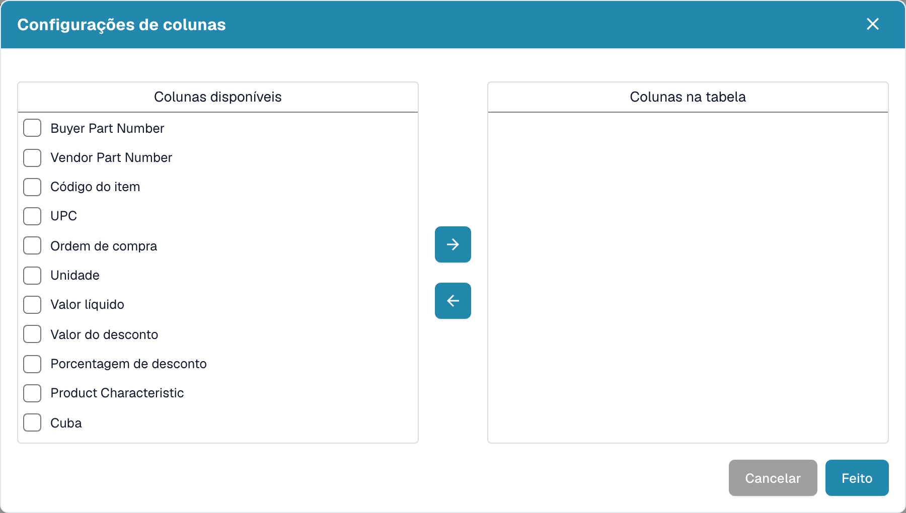<figcaption>
Configurações de colunas: mova colunas de <em>Colunas disponíveis</em> para <em>Colunas na tabela</em> com os botões de seta e depois escolha <strong>Feito</strong>.
</figcaption></figure>

## Dar instruções à IA

Abaixo da tabela, o cartão **Instruções para a IA** diz à IA o que fazer de forma diferente. Ele tem duas entradas e quatro botões que você usará o tempo todo.

<figure>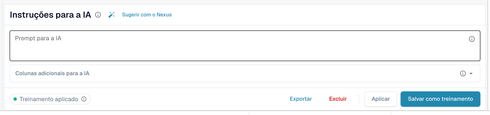<figcaption>
O cartão Instruções para a IA.
</figcaption></figure>

* **Prompt para a IA.** Escreva uma instrução por linha, em linguagem simples. Digite **@** para inserir o nome de uma coluna, para que a IA saiba exatamente a qual coluna você se refere.
* **Colunas adicionais para a IA.** Escolha colunas que a IA deve retornar além das habituais.
* **Status do treinamento.** O chip mostra **Treinamento aplicado** quando um treinamento salvo foi usado na última execução, ou **Nenhum treinamento aplicado**.

<figure>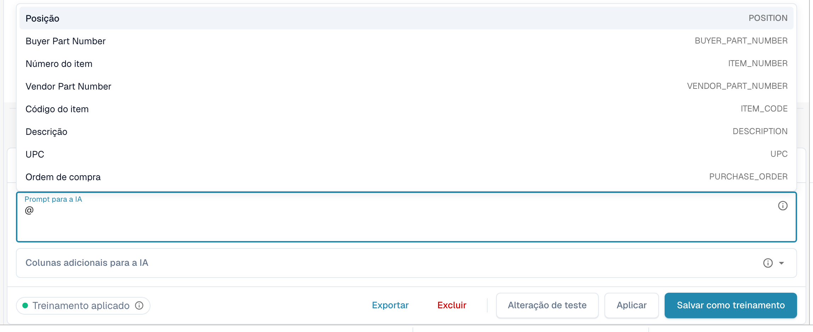<figcaption>
Digite <strong>@</strong> no prompt para escolher uma coluna. Assim que algo muda, <strong>Alteração de teste</strong> aparece ao lado de <strong>Aplicar</strong>.
</figcaption></figure>


Um prompt alterado faz a IA ler a tabela novamente, e isso pode mudar todas as colunas, não apenas a que você tinha em mente. Verifique a tabela inteira depois.


### Sugerir com o Nexus

Não sabe o que escrever? Clique em **Sugerir com o Nexus**. O DocBits analisa a extração deste documento e propõe instruções ou colunas adicionais. Nada é aplicado até você clicar em **Inserir** (adiciona a linha ao seu prompt) ou **Add column**.

<figure>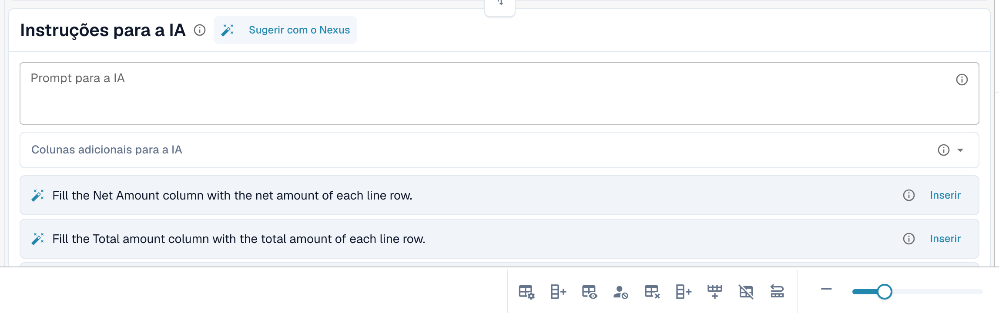<figcaption>
Uma sugestão do Nexus. <strong>Inserir</strong> a copia para o prompt.
</figcaption></figure>

Se a sua organização desativou o consultor de IA, o DocBits informa isso em vez de sugerir.

### Testar, aplicar, salvar: o que cada botão faz

| Botão                                              | O que acontece                                                                                                                                                                                                                                     | Armazenado para os próximos documentos? |
| -------------------------------------------------- | -------------------------------------------------------------------------------------------------------------------------------------------------------------------------------------------------------------------------------------------------- | --------------------------------------- |
| **Alteração de teste**                             | Executa a sua alteração e mostra uma comparação. **Nada é gravado**, nem no documento nem como regra.                                                                                                                                              | Não                                     |
| **Aplicar**                                        | Lê a tabela novamente com as suas alterações e coloca o resultado neste documento no editor. Ele só se torna permanente quando você salva o documento.                                                                                             | Não                                     |
| **Salvar como treinamento** (dica _Salvar regras_) | Armazena o prompt, as colunas adicionais, o mapeamento de colunas, as colunas ocultas, os formatos de valores e as configurações de **Extract From** para este layout de fornecedor. Os próximos documentos desse layout são lidos da mesma forma. | Sim                                     |
| **Excluir** (dica _Excluir regras_)                | Exclui as regras de tabela salvas deste layout de fornecedor, sem confirmação adicional, e executa a IA novamente sem elas. Também remove o treinamento clássico de tabela salvo para o mesmo layout.                                              | Remove-as                               |
| **Exportar**                                       | Baixa a tabela como um arquivo CSV.                                                                                                                                                                                                                | Não                                     |


Remapeamentos de cabeçalho, **Excluir coluna**, **Formatação de Quantidade**, **Extract From** e **Restaurar coluna da tabela** se comportam como **Aplicar**: reconstroem a tabela para este documento imediatamente e são salvos com o documento, não como regra. Somente **Salvar como treinamento** ensina o DocBits para os próximos documentos.


Se o documento já tiver linhas associadas a um pedido de compra, Aplicar e Salvar avisam que **você pode ter perdido conexões de PO**. Escolha **Feito** para continuar e faça a correspondência novamente depois.

<figure>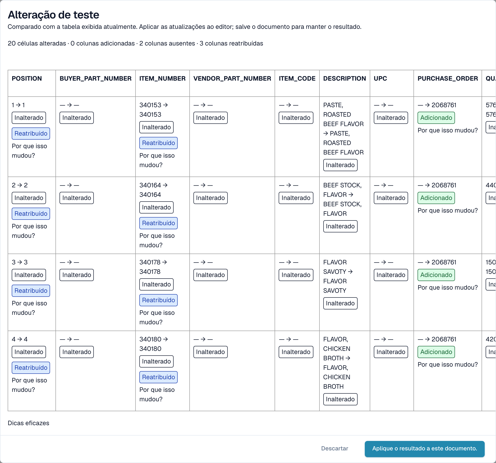<figcaption>
A caixa de diálogo <strong>Alteração de teste</strong> compara o novo resultado com a tabela que você vê agora.
</figcaption></figure>

A caixa de diálogo **Alteração de teste** conta o que mudaria: células alteradas, colunas adicionadas, colunas ausentes e colunas reatribuídas. Cada célula é marcada como **Adicionado**, **Mudado**, **Ausente**, **Reatribuído** ou **Inalterado**. Na parte inferior, a caixa de diálogo lista as evidências da execução: _Dicas eficazes_, _Treinamento selecionado_, _Política de colunas_ e _Substituições de solicitações usadas_. Escolha **Aplique o resultado a este documento.** para assumi-lo (e depois salve o documento) ou **Descartar** para descartá-lo. Se você alterar o prompt depois de testar, o resultado é marcado como desatualizado e você precisa testar novamente.

Depois de **Salvar como treinamento**, o DocBits informa que o treinamento será usado no próximo reprocessamento; a execução atual ainda não o utilizou. Verifique, no próximo documento do fornecedor, se o chip indica **Treinamento aplicado**.

## Ver o que a IA fez

Quatro botões abaixo da tabela explicam a extração.

<figure>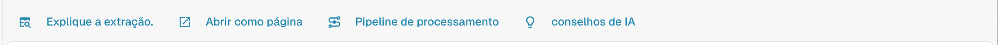<figcaption>
Os botões de explicação.
</figcaption></figure>

* **Explique a extração.** abre _Como a tabela de IA chegou aos seus valores_: o documento, a extração por IA (nível, número de colunas e linhas brutas), o mapeamento para a sua estrutura e o resultado por coluna, com a origem de cada coluna.
* **Abrir como página** mostra a mesma explicação em uma janela própria.
* **Pipeline de processamento** lista as etapas de processamento do documento e onde ele parou.
* **conselhos de IA** pergunta ao Nexus como a extração pode melhorar e lista recomendações concretas, por exemplo _Enable structured output_ ou _Add an instruction tag → Net Amount_. É apenas um conselho; a decisão é sua.

<figure>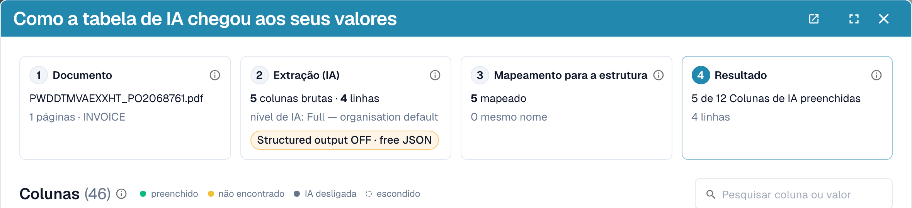<figcaption>
Explique a extração.: quatro etapas, do documento ao resultado.
</figcaption></figure>

<figure>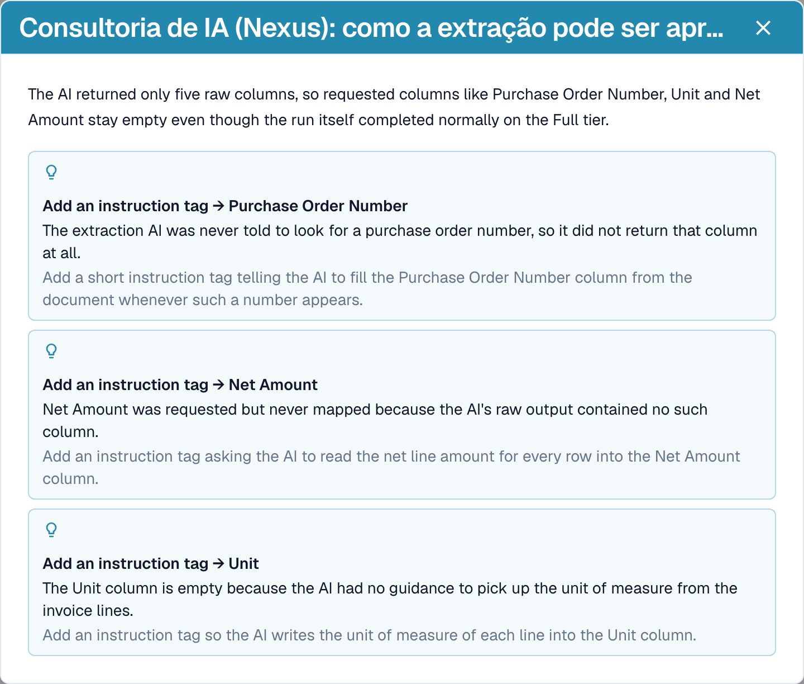<figcaption>
Os conselhos de IA propõem os próximos passos.
</figcaption></figure>

<figure>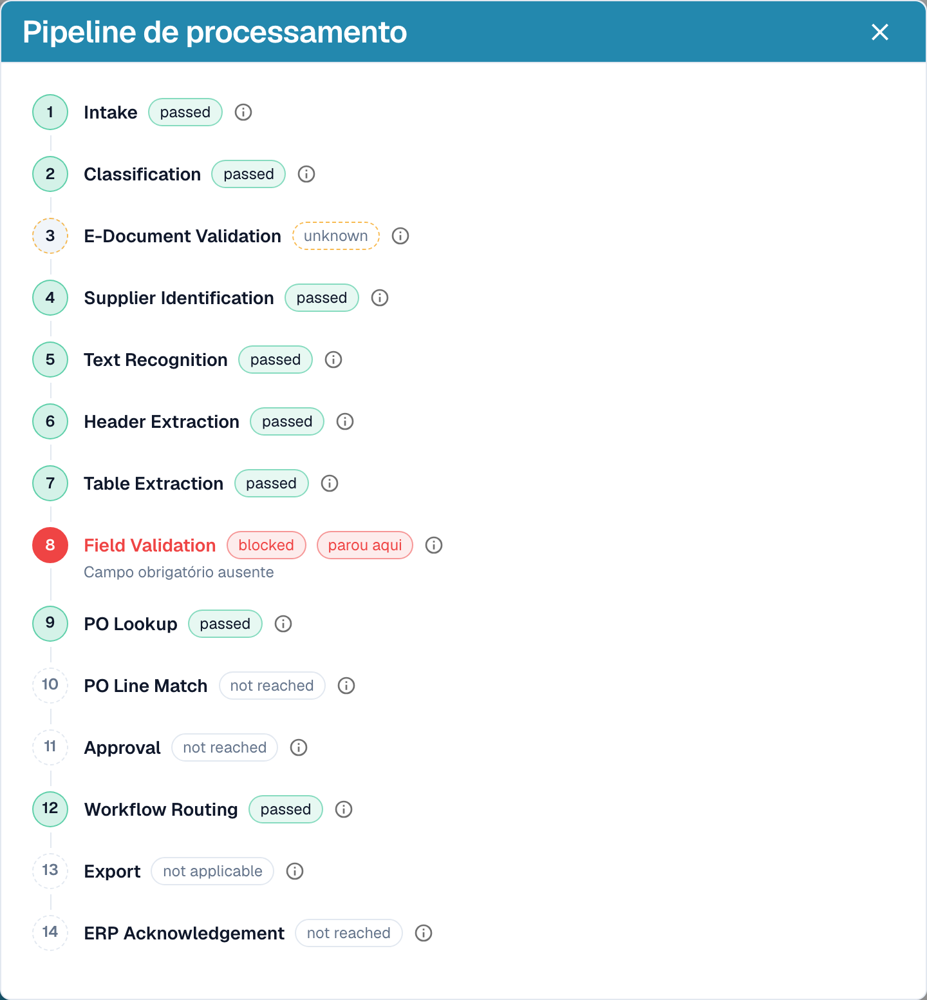<figcaption>
O pipeline de processamento mostra onde um documento parou, aqui na etapa Field Validation.
</figcaption></figure>

Essas explicações pertencem ao módulo **Painel de Análise**. Sem a licença do módulo, ou quando a sua função não tem acesso à aba Análise, o DocBits informa o que pedir ao seu administrador (ativar o módulo em Configurações → Módulos ou conceder a aba à sua função em Configurações → Funções).

## Exemplos práticos

| Situação                                                                              | O que fazer                                                                                                                                                                                                                                                    |
| ------------------------------------------------------------------------------------- | -------------------------------------------------------------------------------------------------------------------------------------------------------------------------------------------------------------------------------------------------------------- |
| Um valor está na coluna errada, por exemplo, _Preço unitário_ está em _Valor líquido_ | Clique no nome da coluna e mapeie-a para a coluna certa. Depois use **Salvar como treinamento** se o fornecedor sempre imprime assim.                                                                                                                          |
| Uma coluna fica vazia em todas as linhas, por exemplo, _Valor do desconto_            | Adicione a coluna em **Colunas adicionais para a IA** ou escreva uma instrução com o termo usado na fatura, como _Preencha a coluna Valor do desconto com a coluna chamada "Rabatt" da fatura._ Verifique com **Alteração de teste** e depois use **Aplicar**. |
| A IA não sabe o que fazer (nada no prompt)                                            | Clique em **Sugerir com o Nexus** e insira o que fizer sentido.                                                                                                                                                                                                |
| Um preço deve ser dividido ou arredondado                                             | Escreva a regra no prompt, por exemplo, _O preço unitário é o valor líquido dividido pela quantidade._                                                                                                                                                         |
| Os valores são lidos com separadores errados (1.234,50 versus 1,234.50)               | Abra o menu de três pontos da coluna, escolha **Formatação de Quantidade** e selecione o formato certo.                                                                                                                                                        |
| O rótulo fica abaixo do valor                                                         | Menu de três pontos → **Extract From** → **Abaixo**.                                                                                                                                                                                                           |
| Uma coluna não é necessária para este fornecedor                                      | Menu de três pontos → **Excluir coluna**. **Salvar como treinamento** a mantém oculta para o fornecedor.                                                                                                                                                       |
| Uma linha está errada ou faltando                                                     | Remova-a com o **x** ou adicione uma com **Adicionar nova linha de tabela** e digite os valores.                                                                                                                                                               |
| As mesmas correções são necessárias o tempo todo                                      | Use **Salvar como treinamento** para que os próximos documentos deste fornecedor saiam corretos. Para layouts complexos, [treine a tabela](../../../administration-and-setup/setup/document-training/training-line-fields-table-training/).                    |


Nem toda linha de descrição quebrada pode ser corrigida com uma instrução. Se as linhas de um item forem divididas em várias linhas da tabela, edite as linhas ou use o treinamento clássico de tabela.


## O Assistente e a tabela de IA

Clique no **Assistente** (ícone de lâmpada ao lado de Salvar na tela de validação) para fazer perguntas sobre o documento.

<figure>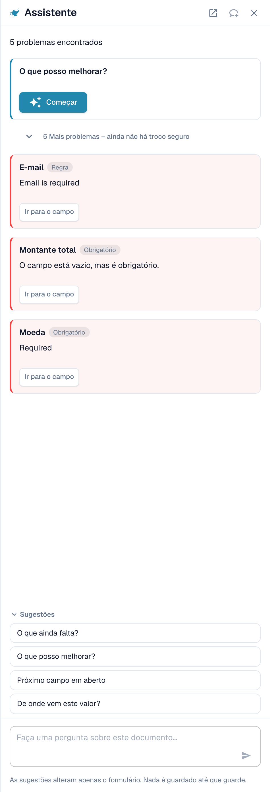<figcaption>
O Assistente lista os problemas em aberto e oferece perguntas para fazer.
</figcaption></figure>

**O que o Assistente faz com tabelas.** Ele pode levar você a uma célula da tabela e, se você puder editar o documento, definir o valor de uma célula ou adicionar uma linha à tabela. Isso funciona tanto na Tabela extraída de IA quanto na Tabela extraída. Ele também responde a perguntas como _O que ainda falta?_ e _O que posso melhorar?_.

<figure>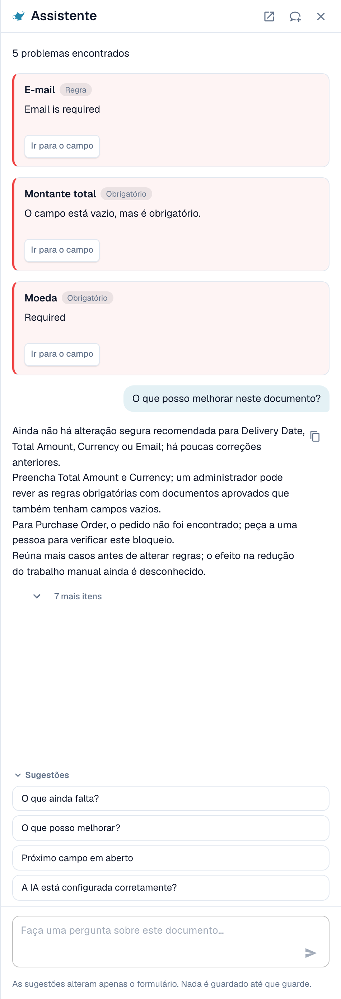<figcaption>
Pergunte <em>O que posso melhorar?</em> para obter uma lista curta do que corrigir em seguida.
</figcaption></figure>

**O que ele não faz.** O Assistente **não** altera instruções de IA, colunas adicionais, mapeamento de colunas nem treinamento. Para isso, use o cartão **Instruções para a IA** (**Sugerir com o Nexus**, **Alteração de teste**, **Aplicar**, **Salvar como treinamento**). Os administradores podem perguntar _A IA está configurada corretamente?_ para ver conselhos de configuração, por exemplo, sobre combinar a leitura de tabela por IA com regras de tabela salvas.

### Sugerir uma regra ao seu administrador

Muitos problemas vêm de um **campo**, não da tabela: um e-mail sempre obrigatório mas vazio, uma data no formato errado, um ID de fornecedor que precisa de uma consulta. Para esses casos, qualquer pessoa que possa abrir o documento pode enviar uma proposta pelo Assistente:

1. Pergunte _O que posso melhorar?_ ou abra um cartão de constatação no Assistente.
2. Se você for administrador, o cartão oferece **Aplicar**. Se não for, ele diz _An administrator can review this proposal._ e mostra **Suggest improvement**. Clique nele.
3. O DocBits mostra _Your suggestion was sent to the administrators._ Se alguém já tiver enviado a mesma sugestão, o seu pedido é contado nela, em vez de criar uma segunda.
4. O cartão passa então a mostrar **Requested** e, depois, **Implemented** ou **Declined** (com o motivo, se o administrador o tiver informado).

A proposta pode ser uma **regra de transformação**, uma **regra de validação** ou uma **consulta**. Você a envia a partir do documento, e o servidor monta o rascunho da regra a partir do problema encontrado, então você não precisa escrever nada. O número de sugestões é limitado a 20 por usuário e por hora.


Você não pode propor **instruções de tabela de IA, mapeamento de colunas ou treinamento** dessa forma. Se uma tabela precisar de correção, corrija-a no documento e avise um administrador, ou peça ao seu administrador para usar **Salvar como treinamento** em um documento desse fornecedor. Os administradores podem salvar regras; veja [Quem pode fazer o quê](./#quem-pode-fazer-o-que).


**O que o administrador vê.** Os administradores são notificados com uma tarefa e um e-mail. Eles abrem **Inteligência sem contato** e encontram a proposta em **Melhorias em aberto** (aba _Em aberto_, histórico em _Histórico_). Um clique abre o painel _Improvement suggestion_ com documentos de exemplo e uma pré-visualização. O administrador pode **Aprovar** ou **Rejeitar**. Ao aprovar, **Switch on right away** decide se a nova regra fica ativa imediatamente; sem isso, a regra é criada inativa e o administrador a ativa na lista de regras. Ao rejeitar, é pedido um motivo e uma observação opcional para os solicitantes. Veja [Touchless Intelligence](../../../administration-and-setup/analytics-dashboard/touchless-intelligence/).

<figure><figcaption>
Os administradores encontram as propostas em <strong>Melhorias em aberto</strong>.
</figcaption></figure>

## Quem pode fazer o quê

| Ação                                                                                                                                        | Quem                                                                                                                                                                                                                                                       |
| ------------------------------------------------------------------------------------------------------------------------------------------- | ---------------------------------------------------------------------------------------------------------------------------------------------------------------------------------------------------------------------------------------------------------- |
| Remapear uma coluna, **Excluir coluna**, **Formatação de Quantidade**, **Extract From**, **Alteração de teste**, **Aplicar**, editar linhas | Todos que podem editar o documento                                                                                                                                                                                                                         |
| **Salvar como treinamento**                                                                                                                 | Todos que podem editar, a menos que a configuração da organização **Salvar regras de extração (somente administrador)** esteja ativada. Nesse caso, somente os administradores da organização podem salvar regras; os demais recebem uma mensagem de erro. |
| **Adicionar nova coluna de tabela**                                                                                                         | Administradores                                                                                                                                                                                                                                            |
| Sugerir uma regra pelo Assistente                                                                                                           | Todos que podem abrir o documento                                                                                                                                                                                                                          |
| Aprovar ou rejeitar uma sugestão                                                                                                            | Administradores                                                                                                                                                                                                                                            |
| **Explique a extração.**, **conselhos de IA**                                                                                               | Usuários cuja função tem acesso ao módulo Painel de Análise                                                                                                                                                                                                |

## Configurações para administradores

Abra **Configurações → Processamento de documentos → Tipos de documentos → Classificação e Extração**, aba **Em geral**, seção **Extração**.

<figure>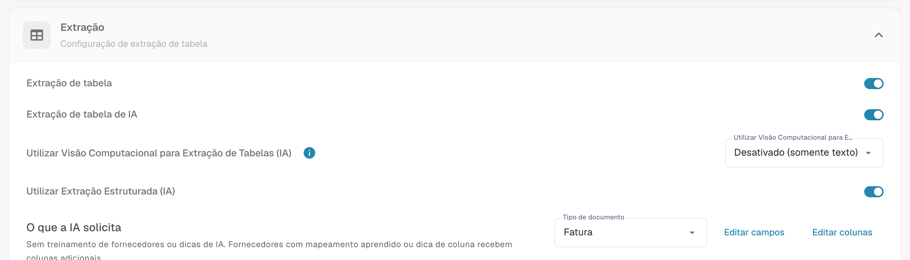<figcaption>
Os botões que decidem se a tabela de IA existe.
</figcaption></figure>

* **Extração de tabela** ativa a tabela clássica.
* **Extração de tabela de IA** ativa ou desativa a tabela de IA para a organização.
* **Utilizar Extração Estruturada (IA)**: a IA retorna a tabela em uma estrutura fixa que se mapeia diretamente para as suas colunas configuradas, em vez de copiar os cabeçalhos do fornecedor. Os nomes das colunas sempre correspondem então à sua configuração; uma coluna que o fornecedor imprime mas que você não configurou não é extraída.
* **Salvar regras de extração (somente administrador)**: quando ativada, somente os administradores da organização podem salvar e exportar regras de extração.

<figure>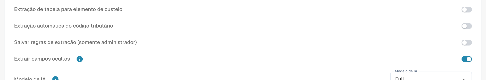<figcaption>
<strong>Salvar regras de extração (somente administrador)</strong> controla quem pode usar <strong>Salvar como treinamento</strong>.
</figcaption></figure>

### Usar IA por coluna

Cada coluna da tabela tem uma opção **Usar IA** (Configurações → Configurações globais → Tipos de documentos → [Colunas da tabela](../../../administration-and-setup/settings/global-settings/document-types/table-columns/)). Com a opção ativada, a IA preenche essa coluna mesmo quando o fornecedor tem regras salvas; as outras colunas continuam vindo das regras. Uso típico: uma coluna de descrição em texto livre que as regras treinadas captam mal.

A IA então deduz essa coluna a partir da linha inteira. Se ela colocar sistematicamente o valor errado ali, por exemplo, o total da linha em _Encargos_, desative **Usar IA** nessa coluna ou adicione uma instrução que diga à IA o que a coluna é.

## Páginas relacionadas

* [Tags e instruções da tabela de IA](ai-table-tags.md)
* [Treinamento de campos de linha / Treinamento de tabelas](../../../administration-and-setup/setup/document-training/training-line-fields-table-training/)
* [Touchless Intelligence](../../../administration-and-setup/analytics-dashboard/touchless-intelligence/)
