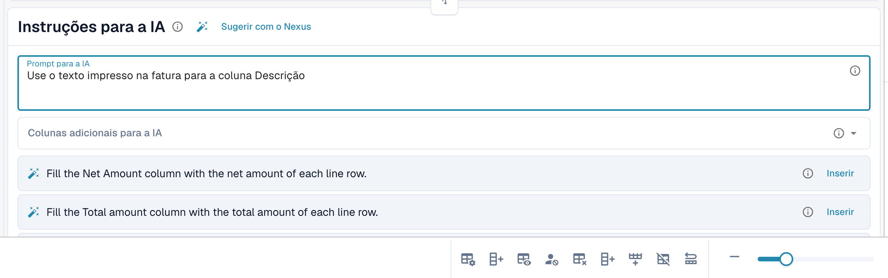

# Tags e instruções da tabela de IA

As tags são a forma de dizer à IA o que fazer com uma tabela. No cartão **Instruções para a IA** abaixo da tabela de IA (veja [Tabela de IA](README.md)), você fornece dois tipos de tags:

| Tipo | Onde você o informa | O que a IA faz com ele |
| --- | --- | --- |
| **Instrução** | **Prompt para a IA**, uma instrução por linha | Segue-a ao ler a tabela, por exemplo, como calcular ou qual termo usar. |
| **Coluna** | **Colunas adicionais para a IA** | Deve retornar essa coluna além das habituais, mesmo que o documento não a rotule com clareza. |

Ambos são armazenados juntos como as tags de IA do fornecedor quando você usa **Salvar como treinamento**.

<figure><figcaption>
Uma instrução por linha em <strong>Prompt para a IA</strong>.
</figcaption></figure>

## Adicionar tags passo a passo

1. Abra o documento na tela de validação e permaneça na aba **Tabela extraída de IA**.
2. Em **Prompt para a IA**, escreva o que a IA deve fazer, uma instrução por linha. Digite **@** para inserir uma coluna da sua configuração.
3. Ou abra **Colunas adicionais para a IA** e escolha as colunas que a IA deve retornar.
4. Não sabe o que escrever? Clique em **Sugerir com o Nexus** e use **Inserir** ou **Add column** em uma sugestão.
5. Clique em **Alteração de teste** para comparar o resultado com a tabela atual. Nada é gravado ainda.
6. Gostou? Clique em **Aplicar** (ou **Aplique o resultado a este documento.** na caixa de diálogo de teste) para colocar o resultado neste documento.
7. Se todos os documentos deste fornecedor precisarem disso, clique em **Salvar como treinamento**. **Excluir** remove as tags e as regras salvas do layout do fornecedor.


Toda linha em **Prompt para a IA** é uma instrução, mesmo que seja uma única palavra (o DocBits adiciona um ponto final para que a IA não a confunda com o nome de uma coluna). As colunas pertencem a **Colunas adicionais para a IA**.


## Como escrever boas instruções

* **Cite a coluna e o termo usado no documento.** *Preencha a coluna Valor do desconto com a coluna chamada "Rabatt".* funciona melhor do que *encontre o desconto*.
* **Uma coisa por linha.** Linhas curtas são mais fáceis de testar e de remover.
* **Descreva os cálculos de forma simples.** *O preço unitário é o valor líquido dividido pela quantidade.*
* **Diga o que deve ser deixado como está.** *Ignore as linhas de frete no final da tabela.*
* **Verifique a tabela inteira.** Um prompt alterado executa a IA novamente e pode mudar todas as colunas.
* **Não repita o que já é conhecido.** Uma tag de coluna que duplica outra tag, ou que é igual a um campo de cabeçalho, é ignorada.

## Exemplos

| Problema | Tag |
| --- | --- |
| A coluna de desconto fica vazia | Coluna adicional **Valor do desconto** e a instrução *Preencha a coluna Valor do desconto com a coluna chamada "Rabatt".* |
| Quantidade e unidade estão na mesma célula | *Coloque o número em Quantidade e a unidade de medida em Unidade.* |
| O preço unitário não está impresso | *O preço unitário é o valor líquido dividido pela quantidade.* |
| As datas devem estar no formato ISO | *Escreva todas as datas como YYYY-MM-DD.* |
| Valores em moeda estrangeira | *Arredonde todos os valores para duas casas decimais.* |

As colunas que você pode escolher são as colunas de tabela configuradas para o tipo de documento, veja [Colunas da tabela](../../../administration-and-setup/settings/global-settings/document-types/table-columns/README.md).

## Antes de salvar

* Use **Alteração de teste** primeiro. Ela nunca grava nada.
* **Salvar como treinamento** vale para o layout do fornecedor, de modo que os próximos documentos são lidos com as suas tags. Verifique, no próximo documento, se o chip indica **Treinamento aplicado**.
* Se **Salvar regras de extração (somente administrador)** estiver ativada, peça a um administrador da organização para salvar.
* As tags mudam a forma como a IA lê a tabela. Para posições de coluna estáveis em um layout recorrente, [treine a tabela](../../../administration-and-setup/setup/document-training/training-line-fields-table-training/README.md).
