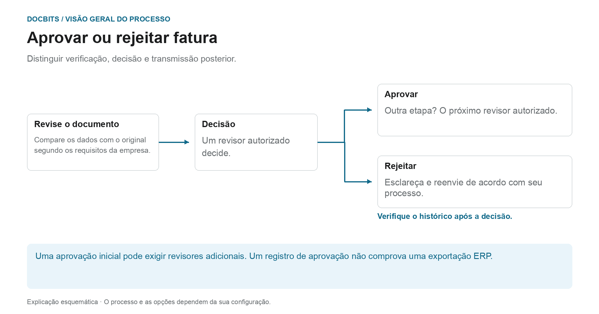
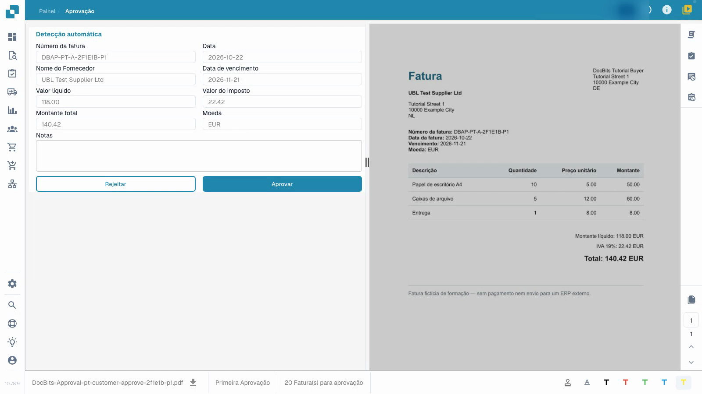
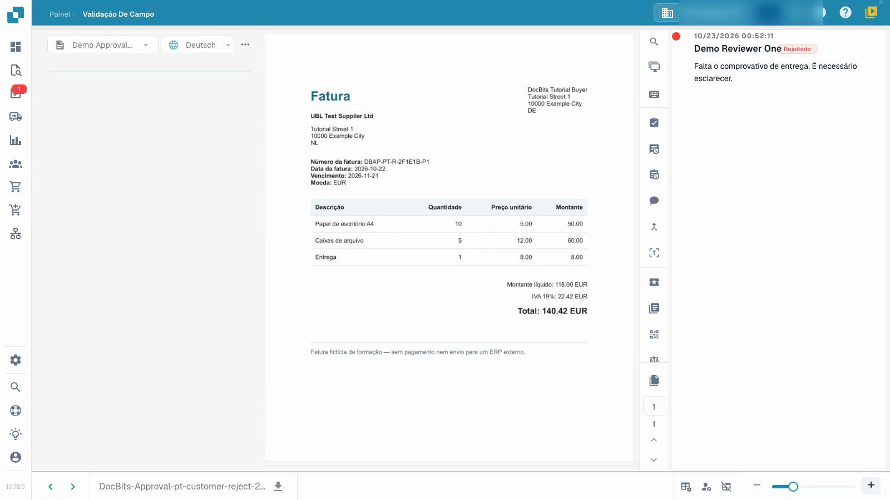

# Aprovar ou rejeitar uma fatura

## O que se segue a uma decisão de aprovação comercial

<figure><figcaption>
Distinguir verificação, decisão e transmissão posterior. O diagrama é esquemático; as configurações ativas da sua organização determinam o comportamento real.
</figcaption></figure>

A validação técnica verifica os dados do documento; a aprovação registra a decisão comercial de um revisor autorizado. Mesmo uma fatura tecnicamente válida pode ainda exigir uma ou mais aprovações.

1. **Verifique a responsabilidade:** Abra a fatura atribuída e verifique qual nível de aprovação você pode decidir.
2. **Revise a fatura:** compare os valores do cabeçalho, itens de linha e impostos com o documento original e os requisitos da sua empresa.
3. **Decisão do documento:** Aprovar uma fatura correta ou rejeitá-la com um motivo específico. Aguarde a resposta e verifique o histórico de aprovações.
4. **Identifique o próximo passo:** Caso sejam configuradas etapas adicionais de aprovação, a fatura aguarda suas decisões. Após rejeição, esclarecimento, correção e qualquer reenvio siga o processo configurado. O processo de exportação separado determina se os dados chegaram ao sistema de destino.

### Três afirmações que não significam a mesma coisa

| declaração | O que não prova automaticamente |
| --- | --- |
| **Os dados são validados.** | Que um revisor de negócios autorizado o aprovou. |
| **Um revisor aprovado.** | Que todas as etapas de aprovação necessárias foram concluídas. |
| **As aprovações foram concluídas.** | Que a fatura já foi exportada ou lançada em ERP. |

Use [Documentar tarefas](tasks.md) para processar o trabalho atribuído e [Status do documento](dashboard/document-status.md) para classificar o status atual.

O vídeo mostra a aprovação na perspetiva de uma pessoa responsável pela revisão.


Aprovar ou rejeitar uma fatura


[Ver vídeo com legendas](https://docbits-videos.fra1.cdn.digitaloceanspaces.com/settings-assistant/invoice-approval-customer/v1/pt.html)

A aplicação real é mostrada; a redação das opções pode depender da versão implementada.

Utilize a aprovação para registar a sua decisão após verificar o conteúdo de uma fatura já validada. Precisa de acesso ao documento e permissão para a sua fase de aprovação atual. O vídeo utiliza uma conta normal de revisão.

## Rever e decidir

1. Abra a fatura que lhe foi atribuída e verifique a fase de aprovação atual.
2. Compare o número da fatura, o fornecedor, as datas e o total com o original. Reveja também as linhas da fatura e os impostos. A validação técnica não substitui a sua verificação do conteúdo.
3. Registe uma nota de revisão clara. Aprove uma fatura correta ou rejeite-a com um motivo específico quando necessitar de esclarecimentos. Aguarde a conclusão da operação.
4. Reabra o documento e inspecione o seu histórico de aprovação. Confirme que o revisor, a hora, a decisão e a nota completa ficaram corretamente guardados.

<figure><figcaption>
Formulário de fatura preenchido em comparação com o original.
</figcaption></figure>

<figure><figcaption>
Rejeição guardada com o respetivo motivo.
</figcaption></figure>

## Verificar a próxima fase

Quando uma segunda aprovação está configurada, a sua primeira aprovação deixa a fatura a aguardar por outro revisor autorizado. Ainda não está totalmente aprovada. Uma rejeição necessita de esclarecimento sobre o conteúdo; a correção e a nova submissão seguem o seu processo configurado.

Uma entrada no histórico de aprovação não prova que os dados chegaram a um sistema ERP. Neste exemplo isolado, o canal de recolha não tem um destino ERP externo. O estado técnico `pending_data_fetch`, quando apresentado, significa que o documento está a aguardar a recolha de dados.

## Páginas relacionadas

- [Ecrã de validação](validation-screen/README.md)
- [Tarefas de documentos](tasks.md)
