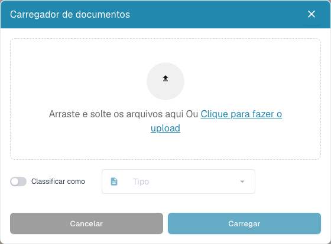

# Ferramentas do painel

As ferramentas estão junto à pesquisa. Passe o ponteiro sobre um ícone para ver a etiqueta. Em janelas de computador mais estreitas, abra **Mais**.

| Ferramenta | Utilização |
| --- | --- |
| Atualizar | Volte a carregar a lista e os estados. Um indicador de alterações assinala dados mais recentes. |
| Definições avançadas (engrenagem) | Abra definições de colunas, atalhos e registo de importação de correio. As definições da organização exigem permissões de administrador. |
| Digitalizar documento | Abra a janela se a digitalização estiver ativa e houver um scanner compatível. Escolha dispositivo e definições antes de iniciar. |
| Análise | Mostre estatísticas de estado e selecione uma categoria para filtrar a lista. |
| Iniciar importação de correio | Inicie uma importação com a configuração de caixa de correio existente. Esta ação não configura uma caixa. |
| Exportar tabela | Peça CSV ou Excel se a opção estiver ativa. Guarde primeiro as alterações de colunas da vista pessoal: a exportação lê a configuração guardada. |
| Carregar | Escolha ou arraste ficheiros, indique opcionalmente um tipo de documento e inicie o carregamento. |

<figure><figcaption>
Ainda não foram selecionados ficheiros. A opção «Classificar como» está desativada e o campo «Tipo» está inativo; «Cancelar» fecha a janela.
</figcaption></figure>

O registo permite verificar importações de correio. Filtre por assunto ou remetente e consulte a informação disponível. Uma confirmação de pedido de exportação da tabela significa que o pedido foi enviado; não significa que um documento tenha sido exportado para o ERP.

O [guia do painel](README.md) descreve pesquisa, ações e vistas guardadas.
