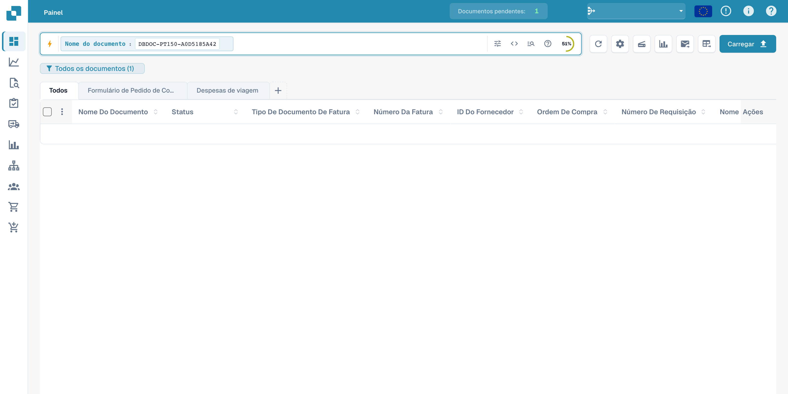
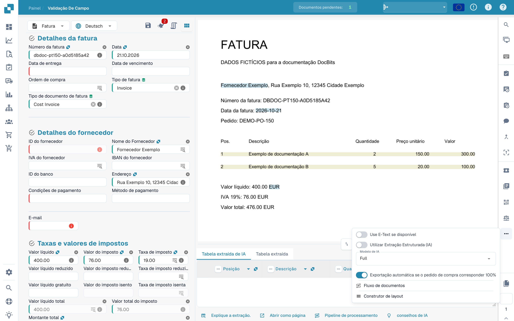
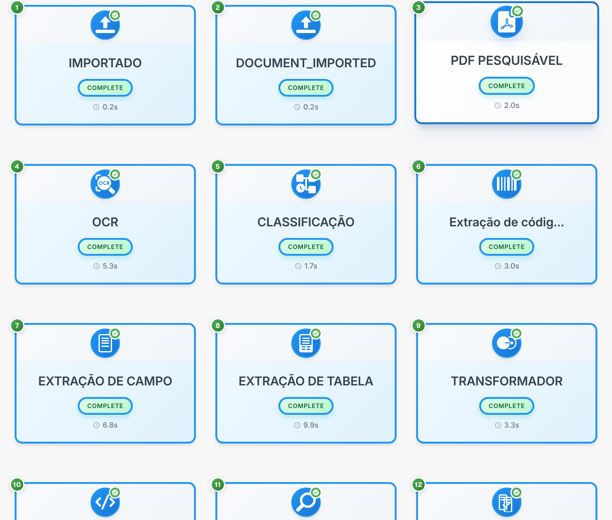

# Fluxo do documento

O fluxo do documento mostra a sequência, o estado e a duração das etapas de processamento. O exemplo utiliza uma fatura fictícia.

## Abrir o fluxo

Encontre o documento no painel. Os valores do documento estão ocultos.

<figure><figcaption>
Pesquisa do documento fictício no painel; valores ocultos.
</figcaption></figure>

Abra a validação de campos e o menu de opções na barra de ferramentas direita para consultar o fluxo do documento.

<figure><figcaption>
Menu de validação para abrir o fluxo do documento.
</figcaption></figure>

## Ler as etapas

Cada cartão representa uma etapa, como importação, OCR, classificação ou extração de campos. Siga a numeração.

<figure><figcaption>
Etapas de processamento de uma fatura fictícia; códigos técnicos inalterados.
</figcaption></figure>

Os códigos técnicos DOCUMENT_IMPORTED e COMPLETE permanecem inalterados. COMPLETE significa que uma etapa terminou.

## Consultar detalhes

Selecione um cartão para consultar os detalhes e registos disponíveis.

| Detalhe | Significado |
| --- | --- |
| Módulo | Componente que processa a etapa |
| Estado | Situação atual da etapa |
| Duração | Tempo de processamento registado |
| Registos | Mensagens técnicas disponíveis |

Investigue as mensagens de uma etapa em espera ou com erro antes de reiniciar o processamento. Alguns títulos de diagnóstico podem permanecer em inglês no produto.

Os detalhes de uma etapa mostram o componente de processamento, o estado, a duração e os registos técnicos disponíveis.
