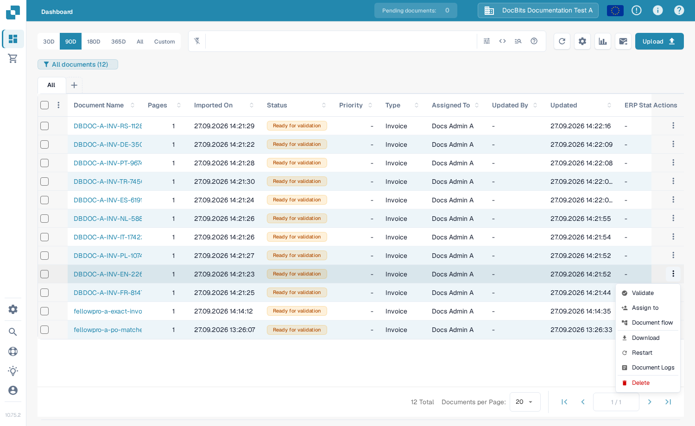

# Document Flow

O **Document Flow** mostra as etapas de processamento de um documento. Use-o para ver quais etapas foram concluídas, qual está em espera e quanto tempo o processamento levou. O exemplo abaixo usa uma fatura sintética no Sandbox em inglês.

## Abrir pelo dashboard

No **Dashboard**, localize o documento. Na coluna **Actions** dele, selecione os três pontos e depois **Document flow**. A opção abre o fluxo desse documento; ela não altera o documento.

<figure><figcaption>Escolha Document flow no menu Actions do documento.</figcaption></figure>

## Abrir pela Field Validation

Abra o documento. Na **Field Validation**, selecione os três pontos na barra de ações à direita e depois **Document Flow** em **More options**.

<figure><figcaption>O mesmo fluxo está disponível na visualização do documento.</figcaption></figure>

## Ler o fluxo

O **Process Statistics**, à esquerda, resume o número de etapas, as etapas concluídas e em espera, as reinicializações, o tempo total, o status atual e o progresso geral. Cada cartão numerado mostra uma etapa de processamento e o respectivo estado atual. Role para baixo para ver as etapas seguintes.

<figure><figcaption>As primeiras etapas do fluxo de uma fatura sintética.</figcaption></figure>

<figure><figcaption>Role para acompanhar a sequência pelas etapas seguintes.</figcaption></figure>

Selecione o cartão de uma etapa para abrir o **Step Details** à esquerda. Ele mostra o módulo e o status dele. Um painel **Task Logs** também pode abrir à direita; os detalhes do log dependem do que está disponível para essa tarefa. Selecione **×** em Step Details para fechar o painel.

<figure><figcaption>O Step Details explica o status do módulo selecionado.</figcaption></figure>
