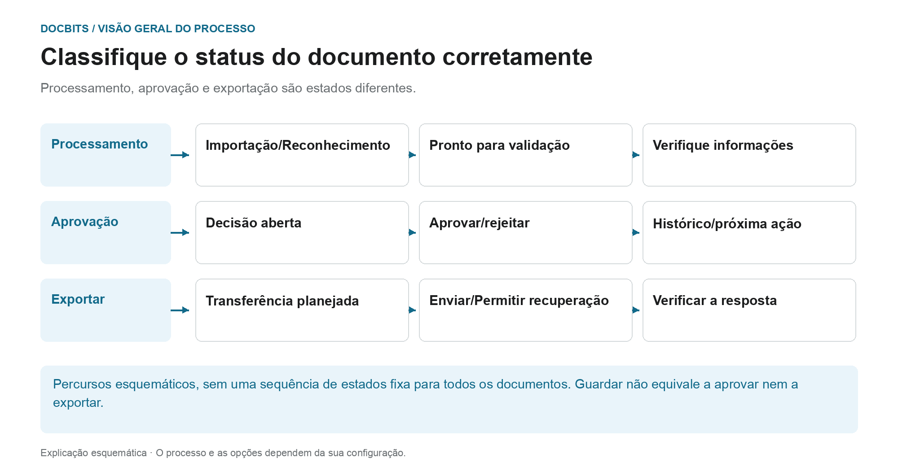
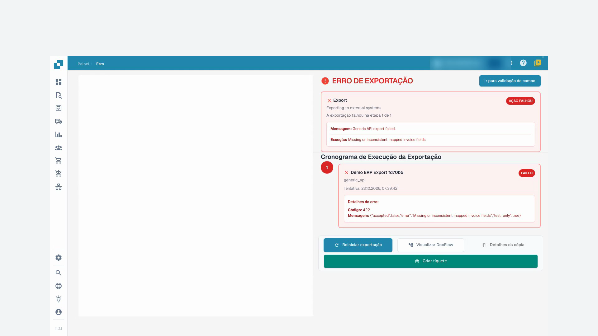
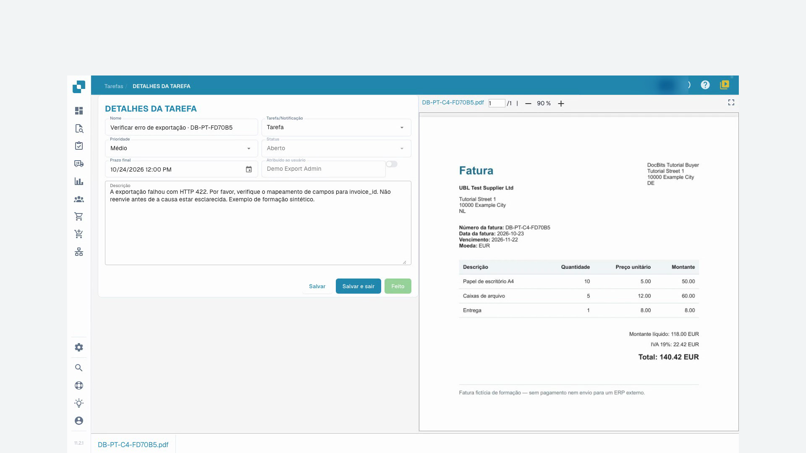

# Estado dos documentos

## Três perguntas de status em vez de uma única cadeia de status

<figure><figcaption>
Processamento, aprovação e exportação são estados diferentes. O diagrama é esquemático; as configurações ativas da sua organização determinam o comportamento real.
</figcaption></figure>

Um documento ainda pode aguardar uma decisão de aprovação comercial mesmo que o reconhecimento tenha terminado. Leia o status exibido no contexto da etapa de processamento e do seu processo de aprovação.

| Pergunta | Significado | Próxima etapa |
| --- | --- | --- |
| **O processamento foi concluído?** | OCR, classificação e extração preparam o documento para revisão. “Pronto para validação” não é uma aprovação comercial. | Abra o documento, compare as informações com o original e edite os erros dos campos obrigatórios. |
| **A decisão de aprovação foi concluída?** | Uma aprovação pode ter vários níveis. Uma aprovação inicial não conclui automaticamente todas as etapas. | Verifique o nível atual, o revisor responsável e o histórico de aprovação. |
| **O documento foi transferido?** | O status da exportação e o feedback descrevem a transferência técnica. Um valor armazenado ou entrada de aprovação não comprova o processamento de ERP. | Leia os detalhes da exportação e, se necessário, reproduza o processo no sistema de destino. |

O gráfico organiza essas questões em três faixas. Não é uma lista exaustiva de códigos de situação técnica e não estabelece uma ordem universal. As transições reais dependem do tipo de documento, do fluxo de trabalho e do caminho de exportação.

### Se ocorrerem erros, comece na etapa afetada

Abra o status de erro e leia a mensagem. Se um valor obrigatório estiver faltando, verifique e corrija-o em relação ao original. Se o destinatário relatar um erro de exportação, resolva a causa antes de tentar novamente. Use [Fluxo de documentos](document-flow.md) para etapas de processamento e o guia [Aprovação](../approve-or-reject-invoices.md) para decisões de aprovação comercial.

Os estados de processamento indicam passos como OCR, classificação ou exportação. **Pronto para validação** significa que pode verificar o documento. Os estados de aprovação indicam uma aprovação pendente. **Exportado** indica que a exportação do documento terminou. Clique no estado **Erro** para consultar os detalhes disponíveis.

Se houver tempos de processamento, passe o ponteiro sobre um estado para ver as fases e a sua duração. Os documentos com possíveis duplicados apresentam um ícone de duplicado; abra-o para comparar os documentos relacionados.

Um documento também pode aguardar a resposta de um colega. Nesse caso mostra o estado **Pending Input** e fica fora da fila ativa até a pessoa consultada responder e a pessoa atribuída fechar o pedido. Ver [Pending Input](../pending-input.md).

Abra uma linha para trabalhar no ecrã de validação. O menu de ações apresenta as operações permitidas, como atribuir, transferir, consultar o histórico ou reiniciar o processamento. As variantes de transferência dependem do documento e podem incluir anotações ou formatos de fatura eletrónica.

Selecione vários documentos nas caixas e abra o menu do cabeçalho para as ações em lote permitidas: atribuição, união, reinício, reinício da exportação ou eliminação. Verifique a seleção e cada confirmação. Estas ações podem alterar documentos; guardar uma vista altera apenas a apresentação da lista.

O [guia do painel](README.md) descreve pesquisa, ações e vistas guardadas.

## Tutorial em vídeo: Resolver faturas bloqueadas


Resolver faturas bloqueadas


[Ver com legendas e capítulos](https://docbits-videos.fra1.cdn.digitaloceanspaces.com/settings-assistant/blocked-invoices-customer/v1/pt.html)

Alguns rótulos nativos podem permanecer noutro idioma. Os identificadores técnicos dos campos são preservados.

Abro a fatura na validação de campos. Neste exemplo, falta o número da fatura. Os restantes valores já estão preenchidos. Comparo-os com o original antes de alterar qualquer coisa.

Agora introduzo o número da fatura e saio do campo. Depois disso, guardo a fatura. Aguardo a resposta e recarrego o documento. Desta forma, vejo se a correção realmente se mantém.

O número continua lá depois de o abrir novamente. O erro do campo obrigatório está resolvido. No entanto, guardar não significa que a fatura tenha sido aprovada ou exportada para o ERP.

Para uma segunda fatura, a lista mostra um erro de exportação. Abro o estado e leio os detalhes. O recetor de teste rejeitou os dados transmitidos com o código de erro 422. O mapeamento técnico tem de ser verificado aqui. Não reinicio simplesmente a exportação várias vezes.

<figure><figcaption>
Erro de exportação e resposta do destinatário
</figcaption></figure>

Nas tarefas do documento, crio uma tarefa com instruções claras para o nosso administrador de testes. Indico o código de erro e peço que verifique o número da fatura no mapeamento. Nesta formação, o envio de e-mails permanece desativado.

Após recarregar, verifico se a tarefa está guardada e atribuída à pessoa certa. A tarefa permanece aberta até que a causa seja esclarecida. Criar uma tarefa ainda não é uma exportação bem-sucedida.

<figure><figcaption>
Tarefa de passagem guardada e atribuída ao administrador
</figcaption></figure>
