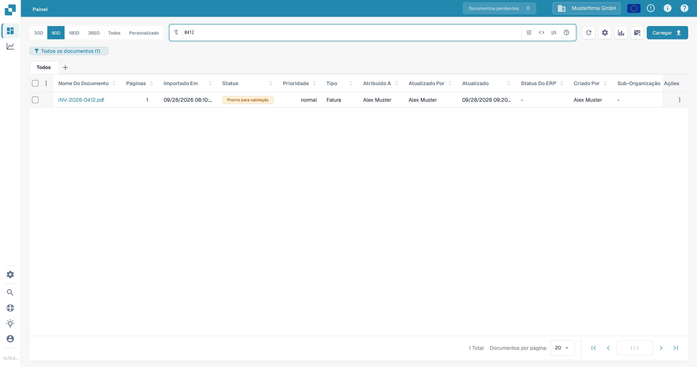
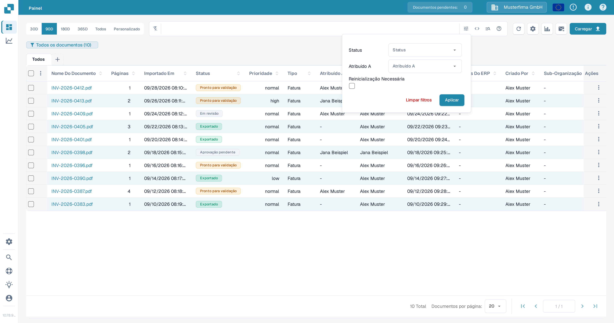
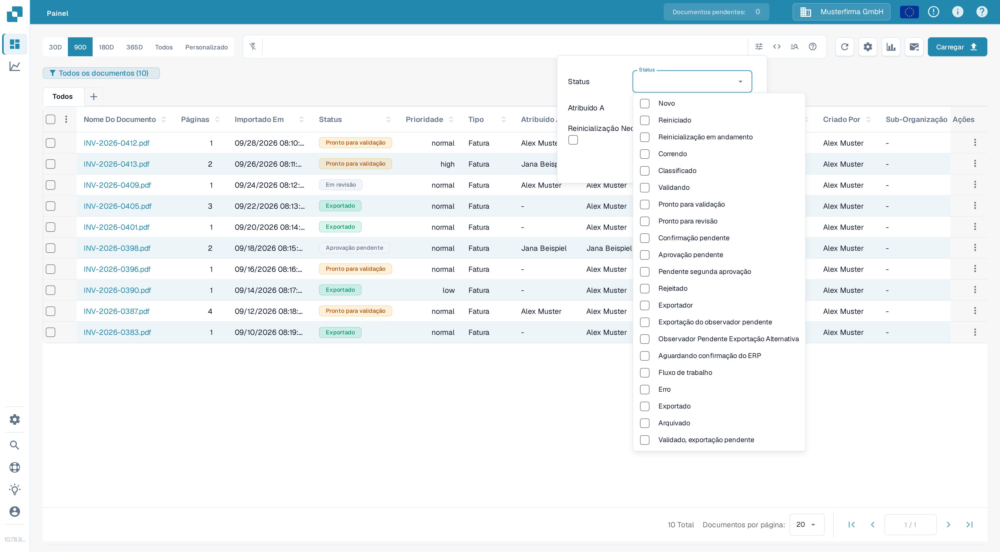
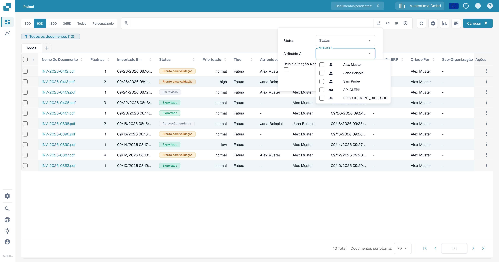
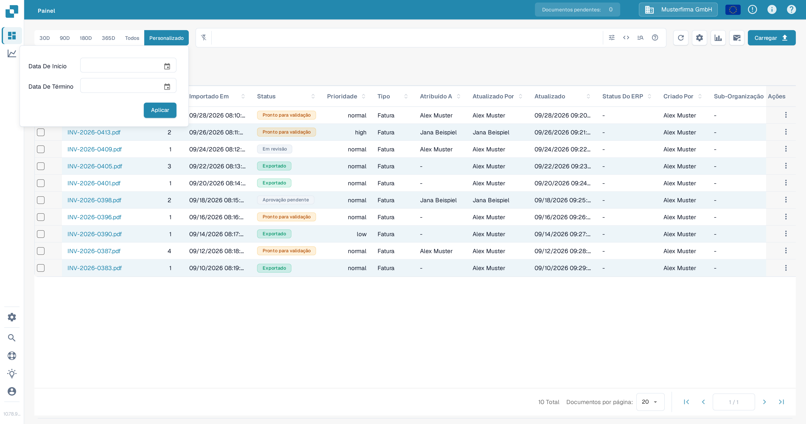
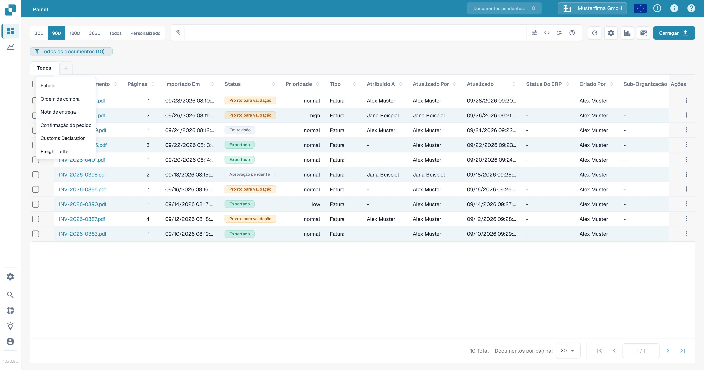
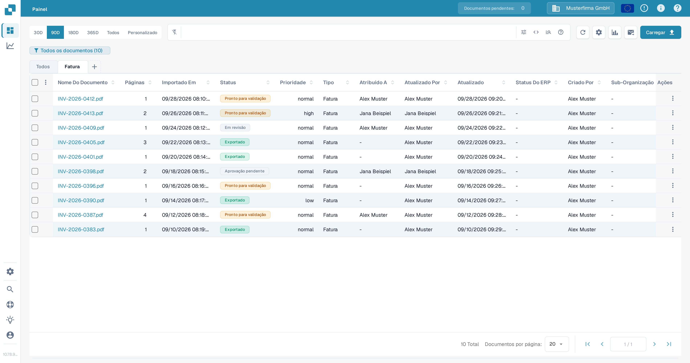

# Filtrar documentos

Use a barra de pesquisa do painel, o painel de filtros, o intervalo de datas e as abas de tipos de documento para restringir a lista de documentos. Os controles funcionam em conjunto: um documento precisa corresponder à pesquisa ativa e aos filtros aplicados para permanecer na tabela.

## Encontrar um documento pelo nome

1. Abra o **Painel**.
2. Digite parte do nome de um documento na barra de pesquisa acima da tabela e pressione **Enter**. A contagem no indicador do painel e a tabela são atualizadas para mostrar os documentos correspondentes.
3. Substitua o termo de pesquisa quando quiser procurar outro documento. Para pesquisas por campo e sintaxe de pesquisa, consulte [Pesquisa rápida](quick-search.md).

<figure><figcaption>Uma pesquisa pelo nome do documento restringe a lista de documentos de teste.</figcaption></figure>

## Filtrar por status, responsável ou necessidade de reinicialização

1. Selecione o ícone **Filtros** (controles deslizantes) na extremidade direita da barra de pesquisa.
2. Escolha um ou mais valores de **Status**. Você pode selecionar vários status ao mesmo tempo.
3. Em **Atribuído A**, selecione os usuários cujos documentos você deseja ver. Se a sua organização tiver permissões de grupo ativadas, os grupos também podem aparecer nesta mesma lista. Não há um campo separado **Atribuído ao grupo** neste painel.
4. Selecione **Reinicialização Necessária** para mostrar os documentos que precisam de uma reinicialização.
5. Selecione **Aplicar**. Selecione **Limpar filtros** neste painel para remover essas seleções; o texto da pesquisa e o intervalo de datas são controles separados.

<figure><figcaption>O painel de filtros atual tem três critérios e duas ações.</figcaption></figure>

<figure><figcaption>Selecione os status de processamento de que precisa.</figcaption></figure>

<figure><figcaption>Selecione um usuário em Atribuído A.</figcaption></figure>

Para uma explicação do significado de cada status de processamento, consulte [Status do Documento](document-status.md).

## Escolher um intervalo de datas de importação

Acima da barra de pesquisa, selecione **30D**, **90D**, **180D**, **365D** ou **Todos** para alterar o intervalo de datas de importação. Selecione **Personalizado**, escolha **Data De Início** e **Data De Término** e, em seguida, selecione **Aplicar** para um intervalo específico. A opção atual fica destacada.

<figure><figcaption>Use Personalizado quando os intervalos de datas predefinidos não forem adequados.</figcaption></figure>

## Usar abas de tipos de documento

1. Selecione **+** ao lado de **Todos**. O menu lista os tipos de documento disponíveis para a sua organização.
2. Selecione um tipo, como **Fatura**, para adicionar a sua aba. Em seguida, selecione a nova aba para filtrar a tabela por esse tipo. **Todos** remove a restrição de tipo sem excluir a aba.
3. Para remover uma aba de tipo, selecione o **×** dela. A aba **Todos** não pode ser removida.

<figure><figcaption>Adicione uma aba de tipo de documento pelo menu de adição.</figcaption></figure>

<figure><figcaption>Escolha a aba para aplicar o filtro de tipo; use × para remover a aba.</figcaption></figure>

Se o menu **+** não tiver tipos, peça a um administrador para verificar quais tipos de documento estão ativos para a sua organização. Consulte [Document Types](../../../administration-and-setup/settings/global-settings/document-types/README.md). Para salvar uma combinação de filtros para usar mais tarde, consulte [Painéis pessoais](personal-dashboards.md).
