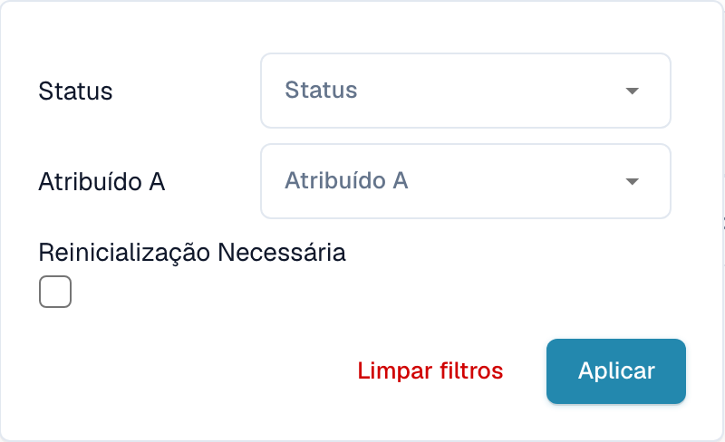

# Filtrar documentos

Abra os filtros ao lado da barra de pesquisa no painel. Pode limitar a lista por estado, atribuição ou reinício necessário.

<figure><figcaption>
Filtros do painel por atribuição e reinício necessário.
</figcaption></figure>

Escolha o estado ou responsável pretendido e aplique os filtros. Limpe os filtros para remover as restrições. As opções de data dependem da configuração e da vista. Verifique os filtros ativos antes de interpretar a contagem de documentos.
