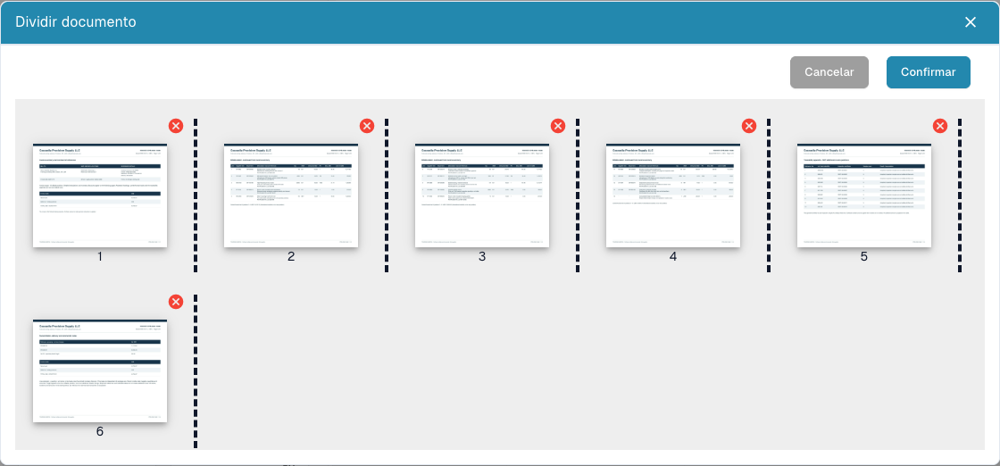

# Dividir um PDF e organizar as páginas

<figure><figcaption>
Miniaturas, separadores e comandos de remoção antes de enviar uma divisão.
</figcaption></figure>

Use a divisão manual quando um PDF contiver documentos independentes. Exemplo: fatura A nas páginas 1–3, fatura B nas páginas 4–7 e guia de remessa nas páginas 8–10. Cada documento deve seguir separadamente.

## Preparação

Precisa de permissão de edição e de um documento com várias páginas. Conserve o original. Resolva um bloqueio com a pessoa responsável antes de alterar o documento.

## Passo a passo

1. Abra o documento no painel e verifique todas as páginas originais.
2. No visualizador, abra as opções adicionais e escolha a divisão do documento.
3. Verifique as miniaturas numeradas. Coloque separadores depois da última página de cada documento: **3** e **7** no exemplo.
4. Arraste as miniaturas para corrigir a ordem. Volte a verificar a ordem e os separadores.
5. Remova uma página com a **cruz vermelha** apenas quando deva ser excluída. Uma folha separadora em branco pode ser dispensável; um detalhe fiscal ou anexo pode ser essencial.
6. Escolha **Confirmar**, leia o pedido de confirmação e prossiga quando os grupos estiverem corretos. **Cancelar** sai sem enviar a divisão.
7. Abra cada documento resultante no painel. Verifique primeira/última página, número de páginas, tipo e valores extraídos.

## Verificar e diagnosticar

Cada página original deve pertencer a um documento previsto ou ser excluída deliberadamente. A divisão não comprova extração, aprovação ou exportação para ERP concluídas com êxito.

Se faltar a opção, verifique páginas, permissões, bloqueio e estado. Sem separadores, reordenação ou remoção, pode surgir uma mensagem de ausência de alterações. Após um erro, consulte o painel antes de repetir uma operação com resultado incerto.

Consulte [Juntar documentos](document-merging.md) e [Classificação e extração](../../../administration-and-setup/settings/document-processing/classification-and-extraction/README.md) para divisão automática por código de barras.
