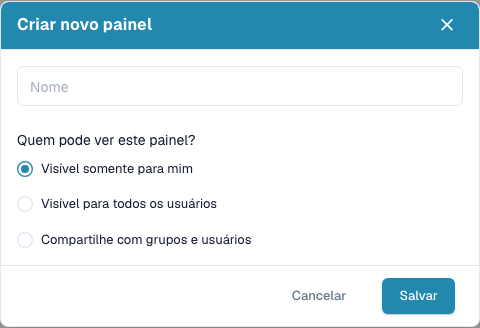

# Painéis pessoais

Guarde uma lista de trabalho recorrente com filtros, ordenação e colunas visíveis. Um painel guardado é uma vista de documentos existentes.

## Criar e partilhar uma vista

1. Defina pesquisa, filtros, tipo de documento, ordenação e colunas.
2. Abra o botão azul de vista abaixo da pesquisa.
3. Crie um novo painel e introduza um nome claro.
4. Escolha visibilidade privada, todos os utilizadores ou grupos e utilizadores específicos.
5. Escolha **Salvar**.

A visibilidade define quem pode usar a vista. Cada pessoa continua a ver apenas os documentos permitidos pelas suas permissões.

<figure><figcaption>
Crie um painel com nome e escolha quem o pode ver.
</figcaption></figure>

## Mudar, atualizar ou remover uma vista

Selecione um painel guardado ou regresse à vista predefinida pelo botão de vista. Depois de alterar uma vista sua, guarde as mudanças quando a ação estiver disponível. Fica desativada se não houver alterações ou se outra pessoa tiver partilhado a vista consigo.

Use a edição de uma vista sua para alterar o nome ou a partilha. Use a eliminação e confirme apenas para remover a vista guardada. Os documentos permanecem. Para adaptar uma vista partilhada por outra pessoa, crie uma sua.
