# Quick Search

A **Quick Search** é a forma mais rápida de encontrar documentos no Dashboard. Você digita o que procura — um nome, um status, um valor, uma data — e a lista de documentos é filtrada instantaneamente.

Este guia está organizado da forma como a pesquisa é construída:

1. **Campos padrão** — as colunas que todo documento tem (nome do documento, status, datas). Sempre disponíveis.
2. **Campos de texto completo (fulltext)** — conteúdo extraído (fornecedor, pedido de compra, número da fatura, valores, itens de linha). Disponíveis quando a pesquisa fulltext está ativada.
3. **Operadores, atalhos e receitas** — a referência completa para quando você já estiver familiarizado.

> Você não precisa memorizar nada: clique na barra de pesquisa e escolha um campo e um valor na lista — a Quick Search monta a consulta para você. Os exemplos abaixo também mostram a forma digitada, para que você possa copiá-los diretamente.

<figure>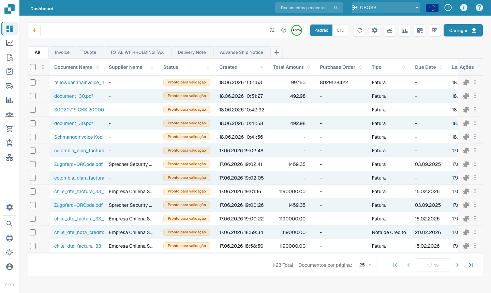<figcaption><p>A barra da Quick Search no topo do Dashboard.</p></figcaption></figure>

---

## Como a barra de pesquisa funciona — chips, barra de ferramentas e visualização bruta

Antes dos campos em si, é útil saber como a barra está organizada.

### As condições viram chips

Quando você conclui uma condição (um campo, um operador e um valor), a Quick Search a transforma em um **chip** — uma pílula colorida dentro da barra — e inicia uma nova. Um chip mostra o **campo**, o **operador** e o **valor**, com um **×** para removê-lo. Os chips têm cores de acordo com o local em que os dados estão:

| Cor do chip | Tipo de campo |
|-------------|---------------|
| **Azul** | Coluna padrão (nome do documento, status, datas) |
| **Laranja** | Campo fulltext / extraído (fornecedor, valor, número da fatura) |
| **Roxo** | Pesquisa vetorial (semântica) |
| **Verde** | Pesquisa de texto OCR |

Clique em um chip para editá-lo (ele volta a se expandir como texto); clique em **×** para excluí-lo. Vários chips combinados são lidos como **AND** por padrão.

### A barra de ferramentas

Na extremidade direita da barra:

- **ⓘ Help** — abre a referência **Dashboard Search — Fields & Syntax** do aplicativo, com todos os campos, operadores e atalhos disponíveis no seu workspace.
- **Filters (tune)** — um painel rápido para os filtros comuns de Status / User / Restart, com **Clear filters** e **Apply**.
- **Index ring** — um pequeno anel de progresso que mostra quanto do seu índice fulltext já foi construído (exibido apenas quando a pesquisa fulltext está ativada).

### Visualização padrão vs. bruta

A barra normalmente mostra sua consulta como chips (**visualização padrão**). Mude para a **visualização bruta** para ver e editar a consulta como texto simples (por exemplo, `status=ready_for_validation AND supplier_name=Test`) — útil para copiar, compartilhar ou digitar diretamente uma consulta longa. Sua consulta é mantida na troca e lembrada quando você recarrega o Dashboard.

---

## Parte 1 — Campos padrão

Os campos padrão são as próprias colunas do documento. Eles estão **sempre disponíveis**, esteja a pesquisa fulltext ativada ou não.

### Encontrar documentos pelo nome

O nome do documento é a pesquisa mais comum. Há três formas de correspondência — todas **sem diferenciar maiúsculas de minúsculas**:

#### `=` → começa com

```
filename=invoice
```

Encontra documentos cujo nome **começa com** "invoice". A correspondência ignora maiúsculas e minúsculas, então todos estes correspondem a `filename=invoice`:

```
Invoice.pdf   iNVoice.pdf   iNvoiCE.pdf   INVOICE.pdf
Invoice.xml   iNVoice.xml   iNvoiCE.edi   …
```

Ele **não** corresponde a `XYZ_Invoice.pdf` (nesse caso "invoice" está no meio — use `:` para isso).

<figure>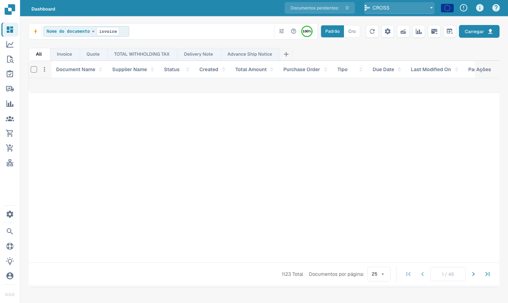<figcaption><p><code>filename=invoice</code> — somente nomes que <strong>começam com</strong> "invoice", em qualquer capitalização (<code>Invoice.pdf</code>, <code>iNVoice.pdf</code>, <code>INVOICE_2026.pdf</code> … todos correspondem). Compare com <code>:</code> abaixo.</p></figcaption></figure>

#### `:` → contém (em qualquer posição)

```
filename:invoice
```

Use `:` para encontrar a palavra **em qualquer posição** do nome — `2026_Invoice.pdf`, `vietnam_einvoice_sample.xml`, `scan_invoice_copy.pdf`.

<figure>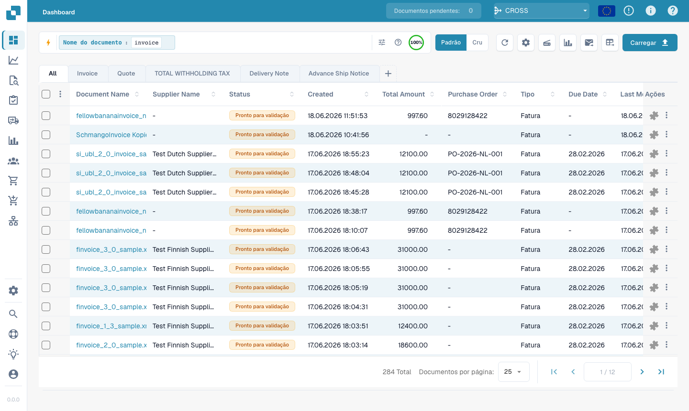<figcaption><p><code>filename:invoice</code> — corresponde à palavra em qualquer posição do nome do documento.</p></figcaption></figure>

#### `="…"` → começa *ou* termina com

```
filename="invoice"
```

As aspas fazem o `=` corresponder a nomes que **começam ou terminam** com o valor — útil para um código no início ou para o final de um arquivo.

> **As três em uma linha:** `=` → começa com · `:` → contém · `="…"` → começa ou termina com. Todas ignoram maiúsculas e minúsculas. Você pode ver esse resumo a qualquer momento pelo **ícone de ajuda** na barra de pesquisa (próxima seção).

### Encontrar documentos por status

```
status=ready_for_validation
```

O status é uma lista fixa, então `=` é uma correspondência **exata** e a barra oferece um seletor de valores quando você digita `status=`.

<figure>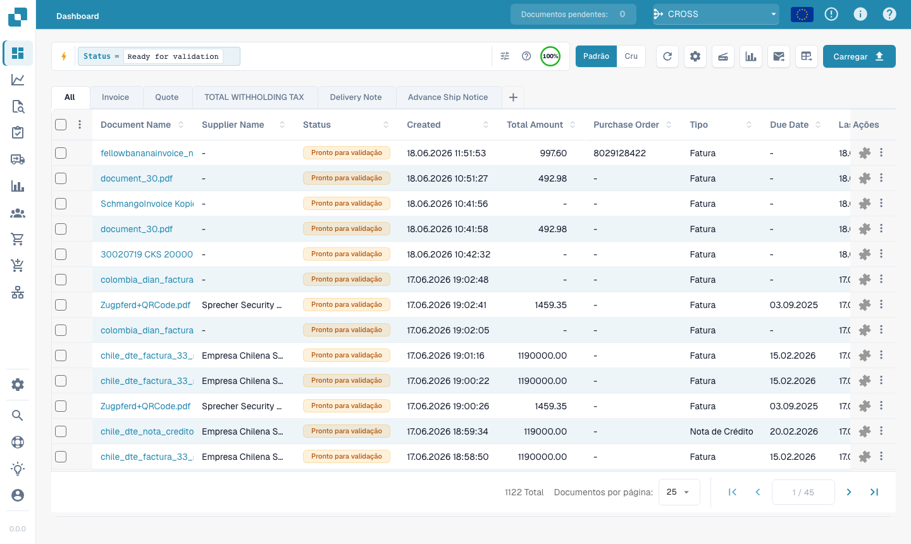<figcaption><p><code>status=ready_for_validation</code> — correspondência exata em um campo de lista fixa.</p></figcaption></figure>

### Encontrar documentos por data

```
created_on>2026-05-25
```

Use `>`, `<`, `>=`, `<=` para intervalos de datas. Você também pode usar datas **relativas**: `today()`, `today()-7` (últimos 7 dias), `today()+30` (próximos 30 dias).

<figure>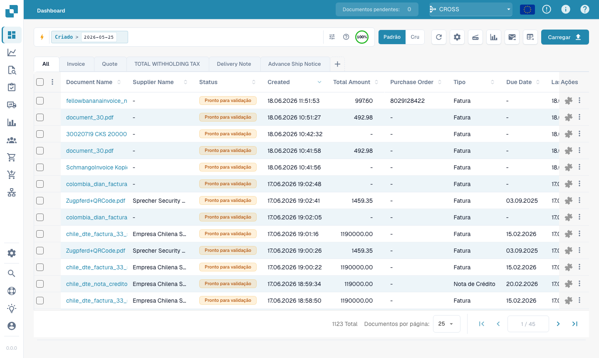<figcaption><p><code>created_on&#62;2026-05-25</code> — documentos criados após uma data.</p></figcaption></figure>

### Encontrar documentos por subtipo de fatura

```
invoice_sub_type="Cost Invoice"
```

O subtipo de fatura é uma lista fixa (por exemplo, **Cost Invoice** ou **Purchase Invoice**), então `=` é uma correspondência **exata** e a barra oferece um seletor de valores quando você digita `invoice_sub_type=`. Use `invoice_sub_type!="Cost Invoice"` para tudo, exceto esse subtipo.

---

## Parte 2 — Campos fulltext

Os campos fulltext pesquisam o **conteúdo extraído** dos seus documentos — fornecedor, pedido de compra, número da fatura, valores, itens de linha. Eles aparecem em **laranja** e ficam disponíveis quando a **pesquisa fulltext está ativada** para a sua organização. As regras de correspondência são exatamente as mesmas dos campos de texto padrão (`=` começa com, `:` contém, `="…"` começa ou termina com).

### Encontrar documentos de um fornecedor

```
supplier_name=Test
```

Começa com, aplicado ao nome do fornecedor extraído. Use `supplier_name:fuji` para corresponder em qualquer posição, ou `supplier_name:"Ruiz Foods"` para colocar entre aspas um valor com espaços.

<figure>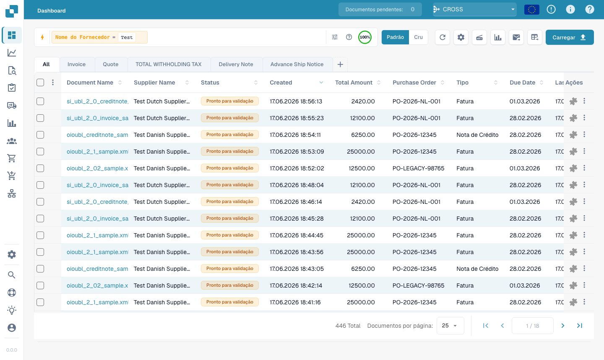<figcaption><p><code>supplier_name=Test</code> — o fornecedor de cada resultado começa com "Test".</p></figcaption></figure>

### Encontrar documentos por pedido de compra

```
purchase_order=PO
```

Começa com, aplicado ao número do pedido de compra extraído — ótimo para um prefixo de pedido de compra.

<figure><figcaption><p><code>purchase_order=PO</code> — documentos cujo número de pedido de compra começa com "PO".</p></figcaption></figure>

### Encontrar documentos por valor

```
total_amount>5000
```

Use `>`, `<`, `>=`, `<=` ou `between 100 and 500` para uma faixa.

<figure>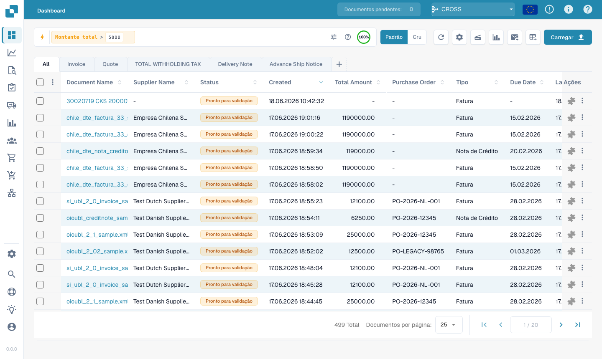<figcaption><p><code>total_amount&#62;5000</code> — faturas acima de 5.000.</p></figcaption></figure>

Para uma faixa de valores, use `between`:

```
total_amount between 1000 and 5000
```

Isso é uma forma abreviada de `total_amount>=1000 AND total_amount<=5000`.

<figure>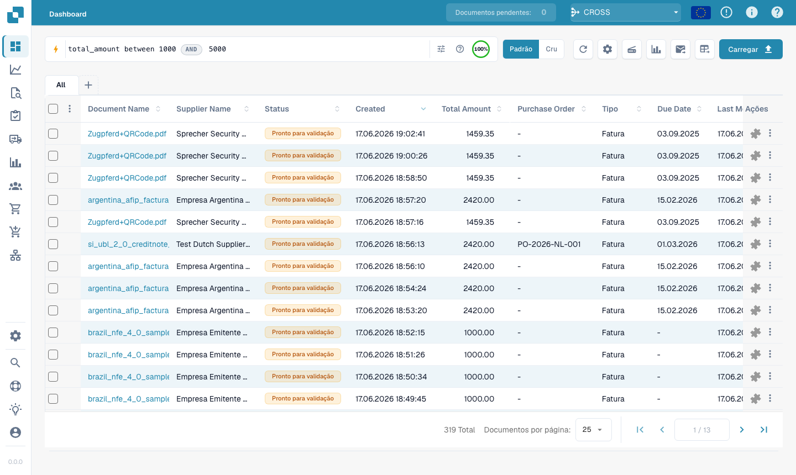<figcaption><p><code>total_amount between 1000 and 5000</code> — todos os resultados ficam dentro da faixa.</p></figcaption></figure>

### Encontrar o que está faltando

```
supplier_name=""
```

`=""` significa "este campo **não está preenchido**"; `supplier_name!=""` significa "tem algum fornecedor".

<figure>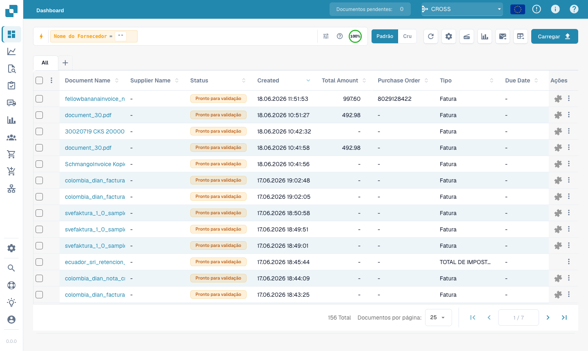<figcaption><p><code>supplier_name=""</code> — documentos que ainda não têm fornecedor.</p></figcaption></figure>

A mesma verificação de presença funciona em qualquer campo — por exemplo, documentos que ainda não têm um código de atribuição de AP:

```
ap_assignment_code=""
```

<figure>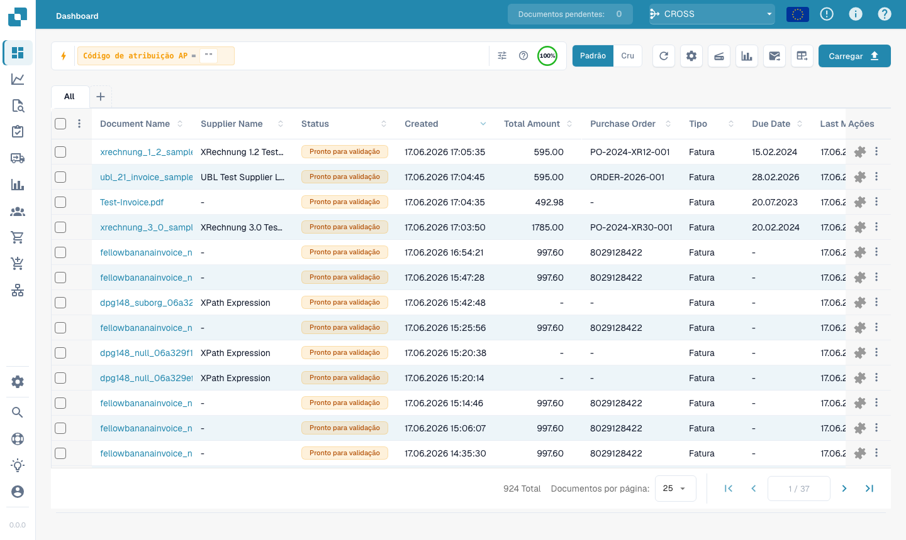<figcaption><p><code>ap_assignment_code=""</code> — documentos que não têm código de atribuição de AP. Use <code>ap_assignment_code!=""</code> para os que têm.</p></figcaption></figure>

---

## Smart Filters — com um clique

No topo da lista suspensa da Quick Search (clique na barra de pesquisa) você encontra os **Smart Filters**: pesquisas prontas que você aplica com um único clique. Cada uma é apenas um atalho para uma consulta que você também poderia digitar:

| Smart Filter | Encontra | Equivale a digitar |
|--------------|----------|--------------------|
| ⚠️ **Overdue** | Com vencimento ultrapassado | `invoice_due_date<today()` |
| 🕐 **Due soon** | Vencendo nos próximos 7 dias | `invoice_due_date<=today()+7` |
| 👤 **Assigned to me** | Itens que aguardam sua ação | `assigned_to=<you>` |
| 📅 **Today's inbox** | Importados hoje | `imported_on>=today()` |
| 📋 **Pending validation** | Prontos para serem validados | `status=ready_for_validation` |
| 🧾 **Electronic documents** | Faturas eletrônicas (XML, ZUGFeRD, EDI) | `is_edoc=true` |
| ✅ **Full PO match** | Totalmente correspondentes a um pedido de compra | `po_match_status=full_matched` |
| ➗ **Partial PO match** | Parcialmente correspondentes a um pedido de compra | `po_match_status=partial_matched` |
| 📉 **Under PO match** | Quantidade ou preço unitário abaixo do pedido de compra | `po_match_status=under_matched` |

Os três filtros de **PO match** e os campos fulltext exigem que a pesquisa fulltext esteja ativada para a sua organização.

<figure><figcaption><p>Os Smart Filters no topo da lista suspensa da Quick Search — um clique aplica o filtro (Overdue, Due soon, Assigned to me, Today's inbox, Pending validation, Electronic documents, Full / Partial / Under PO match).</p></figcaption></figure>

---

## Agrupando resultados

Em vez de uma lista plana, você pode **agrupar** os resultados por qualquer campo — fornecedor, status, tipo de documento, suborganização ou um intervalo de datas. Adicione um agrupamento pela barra de pesquisa:

```
group by supplier_name
```

A lista passa a mostrar **cabeçalhos de grupo** recolhíveis, cada um com o nome do grupo e uma **contagem** (por exemplo, *Ruiz Foods (12)*). Clique em um cabeçalho para expandir ou recolher o grupo. Em campos de data, você pode agrupar por **dia, semana ou mês**.

<figure>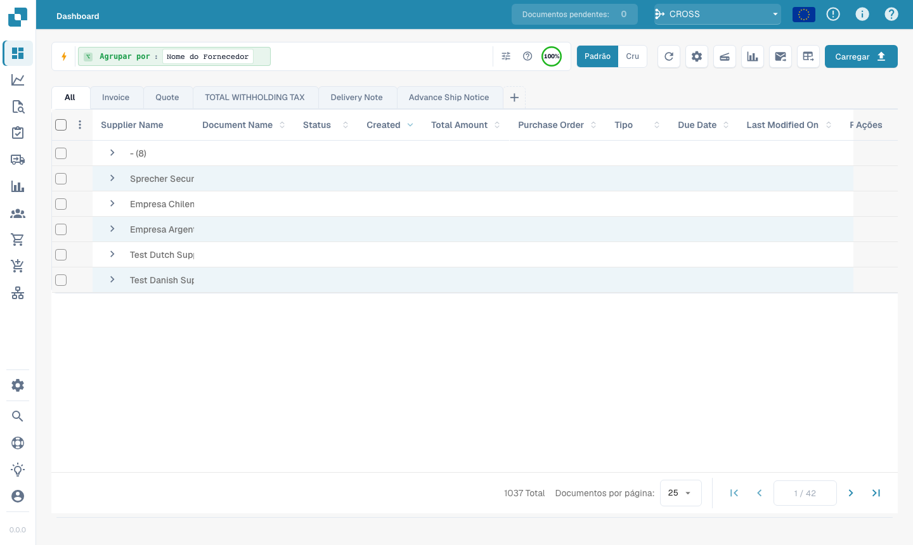<figcaption><p><code>group by supplier_name</code> — os resultados são recolhidos em um cabeçalho expansível por fornecedor.</p></figcaption></figure>

O agrupamento combina com qualquer filtro — `status=ready_for_validation group by
supplier_name` agrupa apenas os documentos correspondentes. Ao clicar em um grupo, você **detalha** o resultado: o valor desse grupo é aplicado como filtro e você volta à lista plana dessa seleção.

---

## Parte 3 — Operadores, conectores, atalhos

### A ajuda integrada

O **ícone de ajuda** na barra de pesquisa abre uma referência completa de todos os campos, operadores e atalhos disponíveis no seu workspace — incluindo quais campos são padrão e quais são fulltext.

<figure><figcaption><p>A ajuda integrada <strong>Dashboard Search — Fields &#38; Syntax</strong>, que lista todos os operadores e como os valores são correspondidos.</p></figcaption></figure>

### Como o `=` corresponde, por tipo de campo

Toda correspondência de texto ignora maiúsculas e minúsculas.

| Tipo de campo | Exemplo | `=` significa |
|---------------|---------|---------------|
| Texto (nome, fornecedor, pedido de compra) | `filename=invoice` | **começa com** |
| Texto, em qualquer posição | `filename:invoice` | **contém** |
| Texto, início *ou* fim | `filename="invoice"` | **começa ou termina com** |
| Status / tipo / PO match (listas fixas) | `status=finished` | **exato** |
| Identificadores (número da fatura, ID do fornecedor) | `invoice_number=INV-100` | **exato** |
| Número | `total_amount>5000` | faixa (`> < >= <= between`) |
| Data | `created_on>2026-01-01` | faixa + `today()±N` |

### Operadores

| Operador | Significado |
|----------|-------------|
| `=` | começa com (texto) / exato (lista, número, data) |
| `:` | contém (texto, em qualquer posição) |
| `="…"` | começa com ou termina com (texto) |
| `!=` | o oposto de `=` |
| `>` `<` `>=` `<=` | maior / menor que |
| `between … and …` | faixa inclusiva |
| `field=""` / `field!=""` | está vazio / está preenchido |
| `today()`, `today()-7`, `today()+30` | datas relativas |

### Conectores

Combine condições com **AND** (ambas verdadeiras), **OR** (qualquer uma), **NOT** e parênteses `( … )` para agrupar:

```
status=ready_for_validation AND supplier_name=Test
(status=error OR status=failed) AND created_on>today()-1
```

<figure>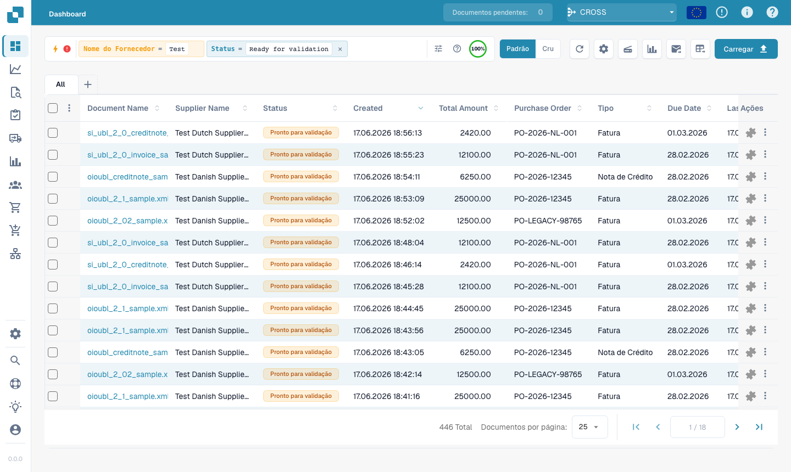<figcaption><p><code>status=ready_for_validation AND supplier_name=Test</code> — duas condições combinadas.</p></figcaption></figure>

### Atalhos

Formas mais curtas de escrever as mesmas consultas — use a que ficar mais legível:

| Atalho | Equivale a | Descrição |
|--------|------------|-----------|
| `total_amount gt 5000` | `total_amount>5000` | Apelidos em palavras para os operadores de comparação (`gt`/`gte`/`lt`/`lte`/`eq`/`ne`) |
| `due_date > today` | `due_date>today()` | `today` / `yesterday` / `tomorrow` sem parênteses |
| `imported_on this_week` | `imported_on>=today()-7 AND imported_on<=today()` | Períodos relativos (`this_week`, `last_week`, `this_month`, …) |
| `ap_assignment_code is empty` | `ap_assignment_code=""` | Se um campo tem algum valor |
| `status:open` | `status=ready_for_validation` | Rótulo de status amigável (`open`/`closed`/`failed`/`done`) |
| `total_amount not between 100, 200` | `total_amount<100 OR total_amount>200` | Valor fora de uma faixa |
| `status in (finished, error)` | `status=finished OR status=error` | Corresponde a qualquer valor de uma lista |
| `not status=finished` | `status!=finished` | Nega qualquer predicado |
| `filename contains rechnung` | `filename:rechnung` | Correspondência de texto (`contains`/`starts_with`/`ends_with`) |
| `total_amount > 5k` | `total_amount>5000` | Sufixo de moeda `k` (×1.000), `M` (×1.000.000) |
| `overdue` | `invoice_due_date<today() AND status!=finished` | Faturas não pagas e vencidas |
| `#INV-1234` | `invoice_id:INV-1234` | Prefixo no estilo Twitter para o ID da fatura |
| `@User` | `assigned_to:User` | Prefixo no estilo Twitter para o responsável |
| `$5000+` | `total_amount>=5000` | Prefixo `$` para limites de valor |

### Atalhos: consulta + galeria de resultados

Estes exemplos mostram cada padrão de atalho com a consulta que você digita e o resultado que o Dashboard exibe. O primeiro grupo usa campos padrão e funciona mesmo quando a pesquisa fulltext não está ativada. O segundo grupo usa campos exclusivos de fulltext, como valor ou data de vencimento da fatura.

#### Funciona sem fulltext

##### Apelidos de operadores

- Consulta: `created_on gt 2026-05-25`
- Equivale a: `created_on>2026-05-25`
- Resultado: Filtra por Created após 25 de maio de 2026.

<figure><figcaption><p><code>created_on gt 2026-05-25</code> - Filtra por Created após 25 de maio de 2026.</p></figcaption></figure>

##### Palavras de data sem parênteses

- Consulta: `created_on < today`
- Equivale a: `created_on<today()`
- Resultado: Expande a palavra today para today().

<figure><figcaption><p><code>created_on &lt; today</code> - Expande a palavra today para today().</p></figcaption></figure>

##### Período relativo

- Consulta: `created_on this_month`
- Equivale a: `created_on>=first day of this month AND created_on<=last day of this month`
- Resultado: Expande this_month em uma janela de datas.

<figure>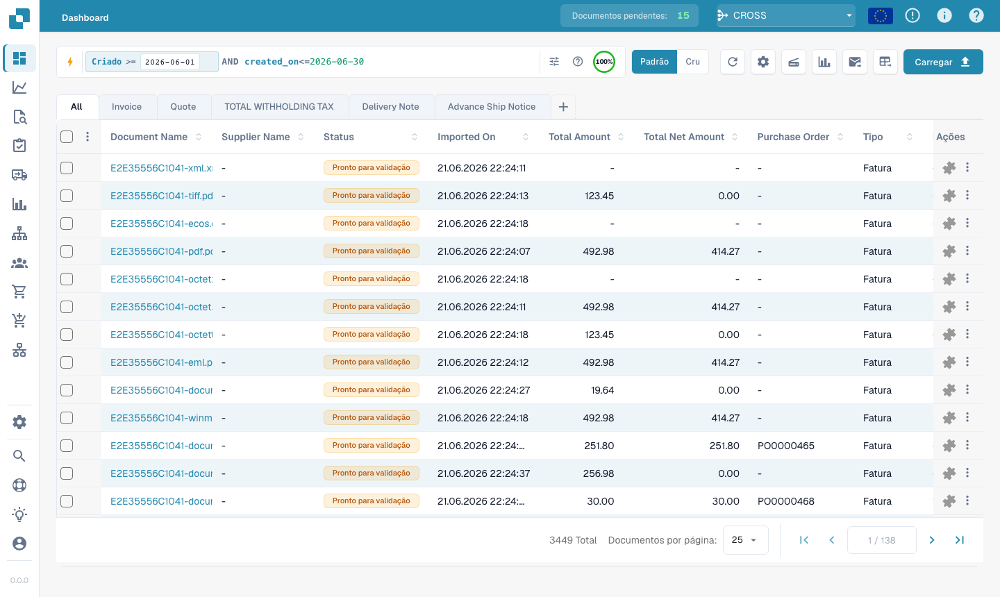<figcaption><p><code>created_on this_month</code> - Expande this_month em uma janela de datas.</p></figcaption></figure>

##### Palavras para vazio ou preenchido

- Consulta: `assigned_to is empty`
- Equivale a: `assigned_to=""`
- Resultado: Encontra documentos sem responsável.

<figure><figcaption><p><code>assigned_to is empty</code> - Encontra documentos sem responsável.</p></figcaption></figure>

##### Status amigável

- Consulta: `status:open`
- Equivale a: `status=ready_for_validation`
- Resultado: Mapeia open para o status de validação.

<figure>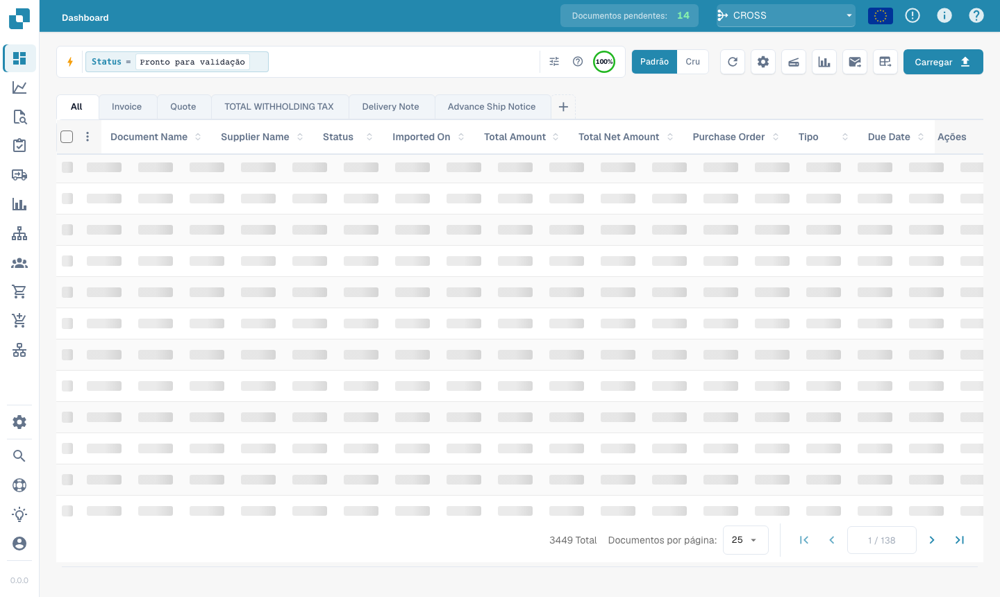<figcaption><p><code>status:open</code> - Mapeia open para o status de validação.</p></figcaption></figure>

##### Not between

- Consulta: `created_on not between 2026-06-01, 2026-06-15`
- Equivale a: `(created_on<2026-06-01 OR created_on>2026-06-15)`
- Resultado: Encontra valores fora de uma janela de datas.

<figure><figcaption><p><code>created_on not between 2026-06-01, 2026-06-15</code> - Encontra valores fora de uma janela de datas.</p></figcaption></figure>

##### In-list

- Consulta: `status in (ready_for_validation, exported)`
- Equivale a: `status=ready_for_validation OR status=exported`
- Resultado: Corresponde a qualquer status listado.

<figure><figcaption><p><code>status in (ready_for_validation, exported)</code> - Corresponde a qualquer status listado.</p></figcaption></figure>

##### Prefixo de negação

- Consulta: `not status=finished`
- Equivale a: `status!=finished`
- Resultado: Inverte o predicado do status finished.

<figure><figcaption><p><code>not status=finished</code> - Inverte o predicado do status finished.</p></figcaption></figure>

##### String contains

- Consulta: `filename contains E2E`
- Equivale a: `filename:E2E`
- Resultado: Usa contains como pesquisa de substring no nome do arquivo.

<figure>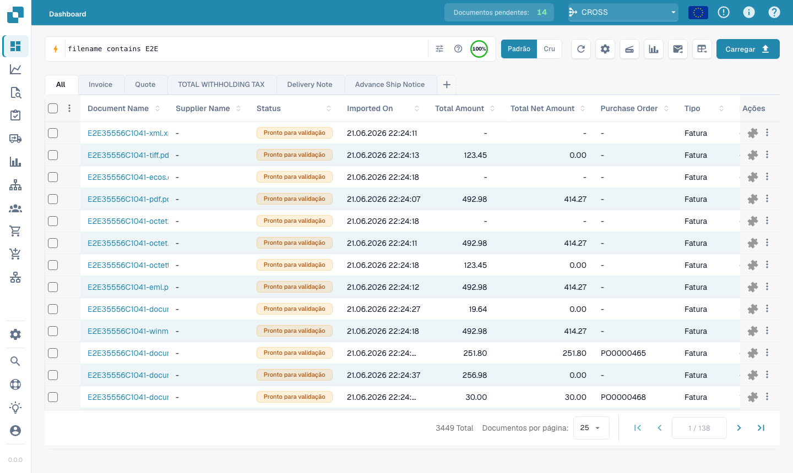<figcaption><p><code>filename contains E2E</code> - Usa contains como pesquisa de substring no nome do arquivo.</p></figcaption></figure>

##### Prefixo de fatura

- Consulta: `#INV-1234`
- Equivale a: `invoice_id:INV-1234`
- Resultado: Mapeia #... para uma pesquisa por ID da fatura.

<figure>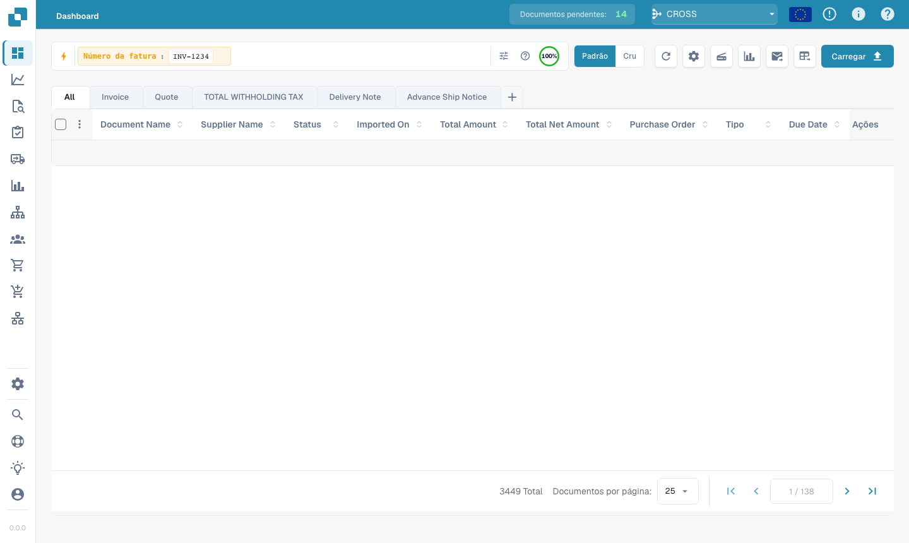<figcaption><p><code>#INV-1234</code> - Mapeia #... para uma pesquisa por ID da fatura.</p></figcaption></figure>

##### Prefixo de responsável

- Consulta: `@Daniel`
- Equivale a: `assigned_to:"Daniel"`
- Resultado: Mapeia @... para uma pesquisa pelo nome do responsável.

<figure><figcaption><p><code>@Daniel</code> - Mapeia @... para uma pesquisa pelo nome do responsável.</p></figcaption></figure>

#### Requer pesquisa fulltext

Se você usar o mesmo atalho com um campo exclusivo de fulltext, a consulta continua exigindo fulltext. Por exemplo, `ap_assignment_code is empty` usa o mesmo atalho de vazio/preenchido que `assigned_to is empty`, mas o campo de atribuição de AP é exclusivo de fulltext.

##### Sufixo de moeda

- Consulta: `total_amount > 5k`
- Equivale a: `total_amount>5000`
- Resultado: Expande k para milhares em um campo de valor.

<figure>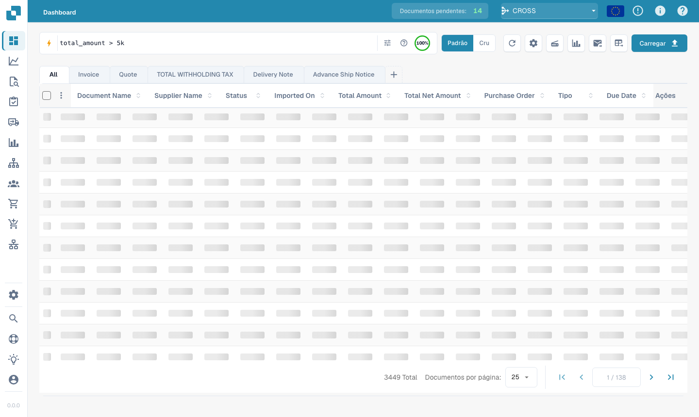<figcaption><p><code>total_amount &gt; 5k</code> - Expande k para milhares em um campo de valor.</p></figcaption></figure>

##### Atalho overdue

- Consulta: `overdue`
- Equivale a: `invoice_due_date<today() AND status!=finished`
- Resultado: Encontra faturas não concluídas com vencimento ultrapassado.

<figure><figcaption><p><code>overdue</code> - Encontra faturas não concluídas com vencimento ultrapassado.</p></figcaption></figure>

##### Prefixo de valor

- Consulta: `$5000+`
- Equivale a: `total_amount>=5000`
- Resultado: Mapeia $...+ para um limite de valor.

<figure><figcaption><p><code>$5000+</code> - Mapeia $...+ para um limite de valor.</p></figcaption></figure>

---

## Parte 4 — Modos de pesquisa avançados

Além da pesquisa por campos, três modos com prefixo pesquisam o próprio conteúdo do documento.

### Pesquisa vetorial (semântica) — `vector:`

Corresponde pelo **significado**, não pelo texto exato — útil para "encontrar documentos sobre XYZ". Requer o módulo Vector; aplica-se ao conteúdo do documento.

```
vector: invoices about office supplies
vector: shipping delays with Hamburg port
```

<figure>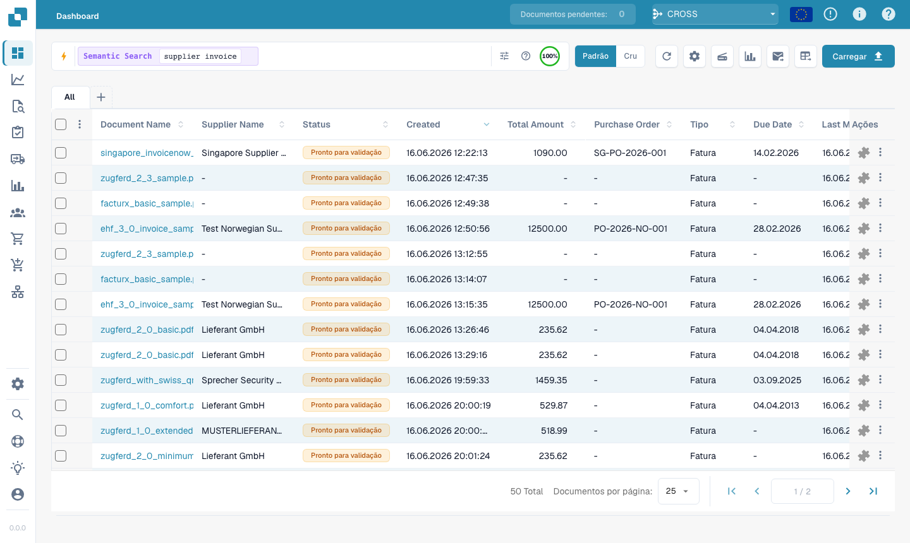<figcaption><p><code>vector: supplier invoice</code> — documentos semanticamente relacionados, mesmo sem essas palavras exatas.</p></figcaption></figure>

### Pesquisa de texto OCR — `ocr:`

Pesquisa **dentro do texto das páginas** extraído pelo mecanismo de OCR — não apenas nas colunas estruturadas. Útil quando o valor de que você se lembra está no corpo do documento.

```
ocr: Versandkosten
ocr: "purchase order PO-12345"
ocr: Hamburg AND doc_type=INVOICE
ocr: IBAN
```

<figure>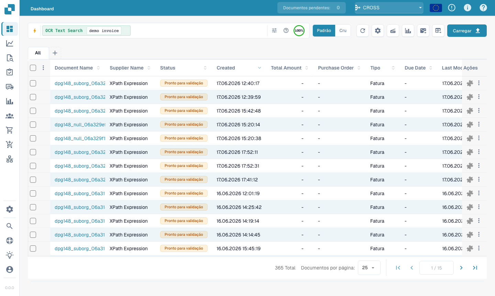<figcaption><p><code>ocr: demo invoice</code> — corresponde a texto encontrado em qualquer parte das páginas do documento.</p></figcaption></figure>

### Pesquisa em linguagem natural (IA) — `ai:`

Descreva o que você quer em linguagem simples; a IA lê a sua frase e extrai filtros (fornecedor, datas, valores) para uma consulta estruturada. Ao contrário da Vector, ela **monta uma consulta** em vez de encontrar documentos semelhantes.

```
ai: invoices from Ruiz over 1000 last quarter
ai: overdue invoices waiting on approval
ai: shipping documents from Hamburg last month
```

<figure>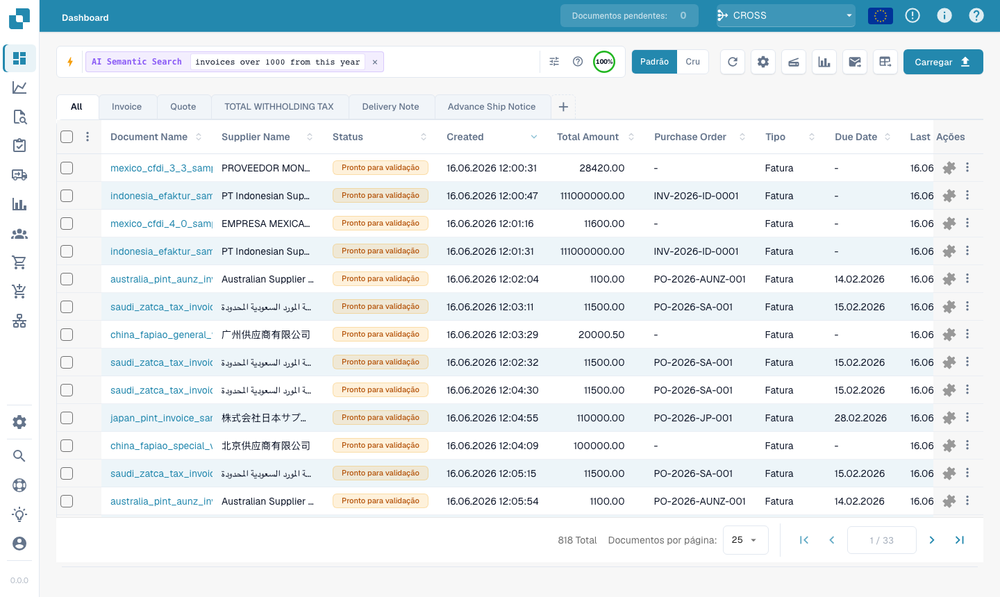<figcaption><p><code>ai: invoices over 1000 from this year</code> — a IA transforma a frase em filtros automaticamente.</p></figcaption></figure>

---

### Receitas

| Você quer… | Digite isto |
|------------|-------------|
| Prontos para validar, totalmente correspondentes | `status=ready_for_validation AND po_match_status=full_matched` |
| Este fornecedor, esta semana | `supplier_name=Test AND created_on>today()-7` |
| Faturas vencidas de alto valor | `total_amount>5000 AND invoice_due_date<today()` |
| Dois fornecedores ao mesmo tempo | `supplier_name=fuji OR supplier_name=acme` |
| Documentos com erro de hoje | `(status=error OR status=failed) AND created_on>today()-1` |
| Notas de crédito eletrônicas | `is_edoc=true AND sub_doc_type=CREDIT_NOTE` |
| Por prefixo de pedido de compra | `purchase_order=PO-2026` |

> Os campos laranja (fulltext) exigem que a **pesquisa fulltext** esteja ativada para a sua organização. Um `%` ou `_` literal em um valor é tratado como um caractere normal.
