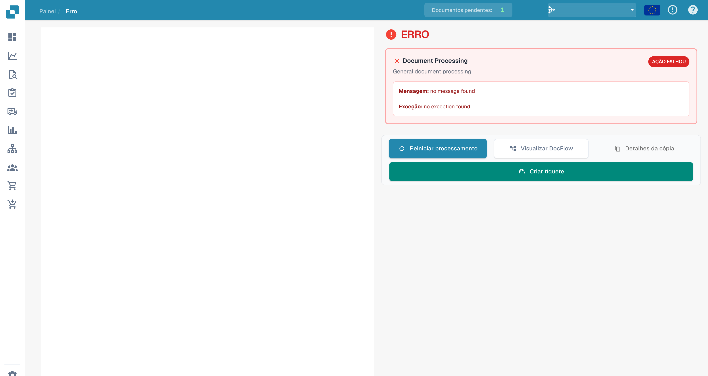
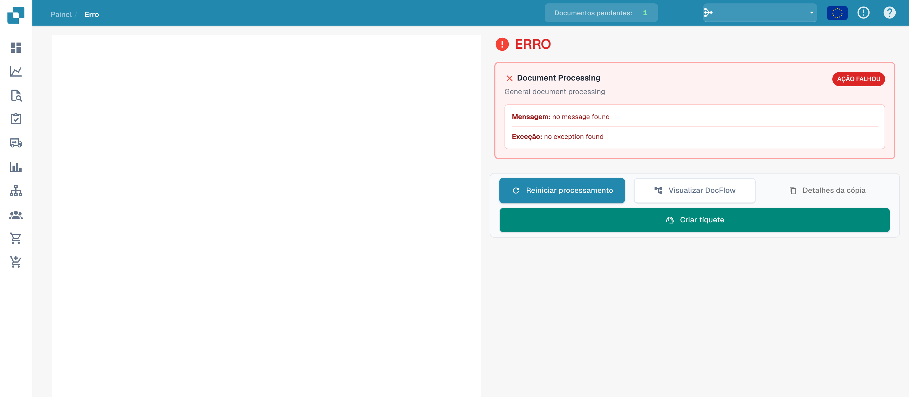

# Vista de erro

Se o processamento falhar, a vista de erro permite investigar a etapa, a mensagem e a exceção disponível.

## Investigar os detalhes

<figure><figcaption>
Mensagem e exceção na vista de erro sem mensagem registada.
</figcaption></figure>

Este exemplo mostra a interface sem erro registado. Os textos no message found e no exception found não constituem um diagnóstico de incidente. Num erro real, investigue as mensagens disponíveis e o fluxo do documento.

## Ações disponíveis

<figure><figcaption>
Ações na vista de erro; o exemplo não contém detalhes de erro registados.
</figcaption></figure>

| Ação | Utilização |
| --- | --- |
| Reiniciar o processamento | Tentar novamente depois de investigar ou resolver a causa. |
| Abrir DocFlow | Investigar as etapas e os seus estados. |
| Copiar detalhes | Recolher informações técnicas disponíveis. |
| Criar um pedido de suporte | Preparar um pedido de ajuda. |

As ações do documento e da pré-visualização dependem do carregamento do documento. A antiga barra de ferramentas PDF não é um elemento permanente desta vista.

Se o erro se repetir, envie ao suporte o ID do documento, a mensagem exata, a hora e as verificações realizadas. Verifique informações confidenciais antes de partilhar os detalhes.
