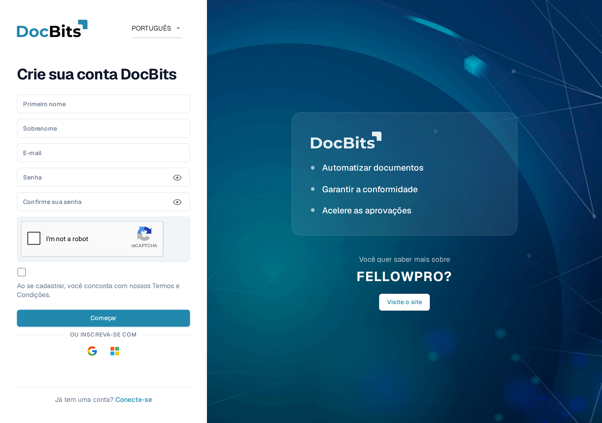
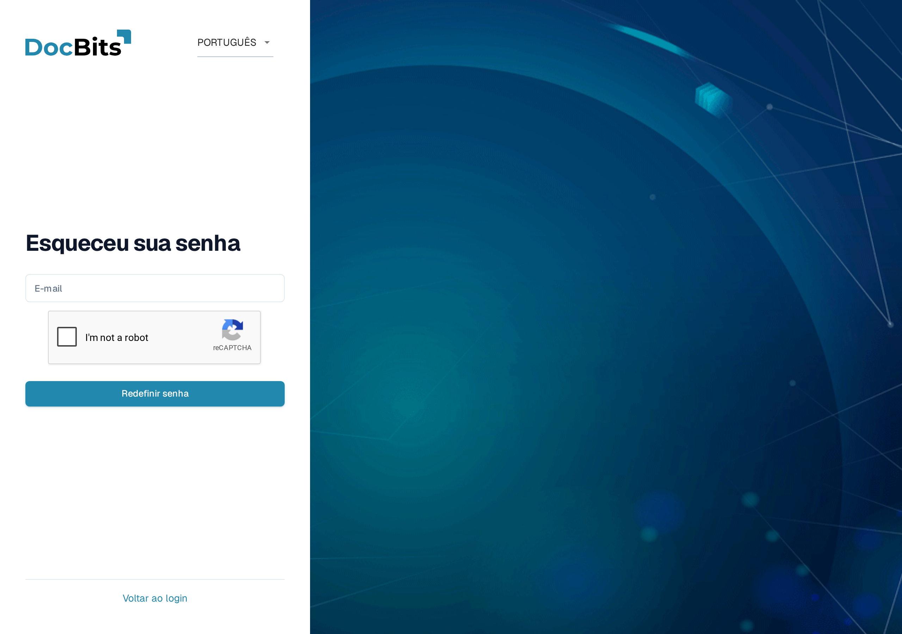
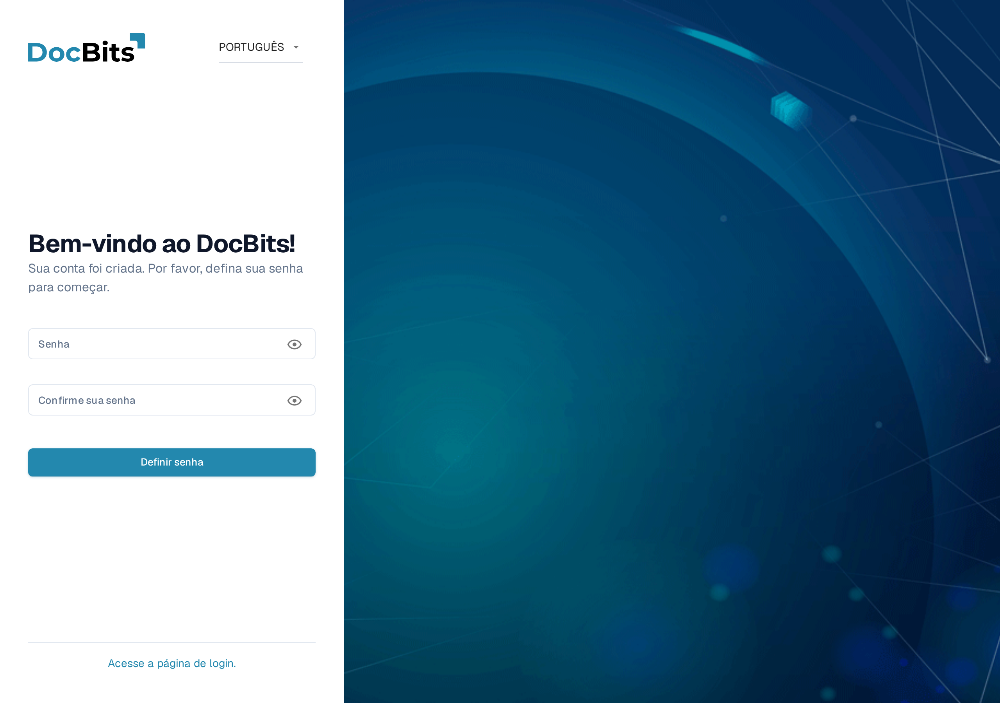

# Obter acesso e iniciar sessão

Esta página explica como obter uma conta DocBits e como iniciar sessão quando não tem a sua palavra-passe:

* [Registo](#registo) — crie a sua própria conta DocBits.
* [Esqueceu-se da palavra-passe](#esqueceu-se-da-palavra-passe) — redefina a sua palavra-passe com uma ligação de redefinição.
* [Primeira palavra-passe para contas criadas pelo administrador](#primeira-palavra-passe-para-contas-criadas-pelo-administrador) — defina a primeira palavra-passe de uma conta que o seu administrador criou para você.

Iniciar sessão com uma conta existente e a Autenticação de Dois Fatores estão cobertos em [Autenticação de Dois Fatores (2FA)](../../overview-and-basics/two-factor-authentication.md). Use o menu de idioma no canto superior direito destes formulários se precisar de outro idioma de exibição.

## Registo

Pode criar uma conta DocBits você mesmo na página de registo. Abra-a a partir da ligação **Registar** no ecrã de início de sessão ou navegue para `https://app.docbits.com/register` (use o endereço web que a sua organização recebeu).

<figure><figcaption>
O formulário de registo. Todos os campos são obrigatórios, exceto onde indicado.
</figcaption></figure>

Preencha o formulário:

1. **Primeiro nome** e **Sobrenome** — o seu nome como deve aparecer no DocBits.
2. **E-mail** — o seu endereço de e-mail profissional. Este é o seu identificador de início de sessão.
3. **Senha** e **Confirme sua senha** — veja as regras de palavra-passe abaixo. Uma lista de verificação por baixo do campo da palavra-passe mostra que regras a sua palavra-passe já cumpre.
4. Se a página mostrar um widget **reCAPTCHA**, complete-o. O widget só aparece quando a sua instalação do DocBits tem a proteção contra bots ativada.
5. Marque a caixa de verificação para confirmar que concorda com os **Termos e Condições**.
6. Clique em **Começar**. Se já tem uma conta, clique em **Conecte-se** na parte inferior para voltar ao ecrã de início de sessão. **Visite o site** abre o website do DocBits com informações sobre o produto.

Use o ícone de olho junto a um campo de palavra-passe para mostrar ou ocultar os caracteres que introduziu.

### Regras de palavra-passe

A sua palavra-passe deve:

* ter entre **8 e 20 caracteres**,
* conter pelo menos uma letra **maiúscula** e uma **minúscula**,
* conter pelo menos um **dígito**,
* conter pelo menos um **caractere especial** (`!@#$%^&*()_+=\[{]\};:,.<>?/\|~-`).

Apenas letras, dígitos e estes caracteres especiais são permitidos.

### Registar-se com Google ou Microsoft

Em vez de uma palavra-passe, pode clicar no botão **Google** ou **Microsoft** em **OU INSCREVA-SE COM**. O DocBits cria a sua conta através do seu fornecedor de identidade e, mais tarde, inicia sessão da mesma forma.

### Confirme o seu endereço de e-mail

Depois de enviar o formulário, o DocBits mostra uma página de confirmação e envia um **e-mail de verificação** para o endereço que introduziu. Abra o e-mail e clique na ligação — ela leva-o a uma página de confirmação que verifica o seu endereço. Se o e-mail não chegar, a página de confirmação oferece uma opção de **reenvio**. Assim que o endereço estiver verificado, clique em **Conecte-se** e inicie sessão com o seu e-mail e palavra-passe.

## Esqueceu-se da palavra-passe

O DocBits guarda as palavras-passe como hashes unidirecionais com salt. Uma palavra-passe existente não pode ser recuperada a partir do hash, pelo que este procedimento define uma nova. Consulte [Armazenamento seguro de credenciais](../../overview-and-basics/secure-storage-of-credentials.md).

Se se esqueceu da sua palavra-passe:

1. No ecrã de início de sessão, clique em **Esqueceu sua senha**.
2. Na página **Esqueceu sua senha**, introduza o seu endereço de **E-mail** e clique em **Redefinir senha**. Se for mostrado um widget reCAPTCHA, complete-o primeiro.

   <figure><figcaption>
A página Esqueceu sua senha. Introduza o e-mail da sua conta e o DocBits enviar-lhe-á uma ligação de redefinição.
</figcaption></figure>

   Se não quiser redefinir a sua palavra-passe, clique em **Voltar ao login** para voltar ao início de sessão.

3. O DocBits envia-lhe uma **ligação de redefinição de palavra-passe** por e-mail. Abra o e-mail e clique na ligação — ela abre a página de redefinição.
4. Introduza a sua **nova palavra-passe duas vezes**. Aplicam-se as mesmas regras de palavra-passe do [registo](#regras-de-palavra-passe) e uma lista de verificação mostra que regras são cumpridas.
5. Clique em **Redefinir senha**. O DocBits confirma a alteração e devolve-o ao ecrã de início de sessão, onde pode iniciar sessão com a nova palavra-passe.


As ligações de redefinição expiram após um curto período de tempo. Se a ligação já não funcionar, repita os passos acima para pedir uma nova.


## Primeira palavra-passe para contas criadas pelo administrador

Quando o seu administrador o adiciona como utilizador (consulte [Usuários](../../administration-and-setup/settings/global-settings/groups-users-and-permissions/users/README.md)), recebe um e-mail com os seus dados de início de sessão e uma ligação para definir a sua **primeira palavra-passe**. A ligação abre a página **Definir senha**:

<figure><figcaption>
A página Definir senha, mostrada depois de um administrador ter criado a sua conta.
</figcaption></figure>

1. Clique na ligação no e-mail de convite. A página dá-lhe as boas-vindas com "Bem-vindo ao DocBits! Sua conta foi criada. Por favor, defina sua senha para começar."
2. Introduza a sua palavra-passe duas vezes — aplicam-se as mesmas [regras de palavra-passe](#regras-de-palavra-passe).
3. Clique em **Definir senha**. Depois pode iniciar sessão com o seu e-mail e esta palavra-passe.

Os ícones de olho mostram ou ocultam o que introduziu. Se sair antes de definir uma palavra-passe, **Acesse a página de login** devolve-o ao início de sessão.

A ligação está associada à sua conta e funciona apenas uma vez. Se expirar antes de a utilizar, peça ao seu administrador para reenviar o convite ou use **Esqueceu sua senha** com o seu endereço de e-mail.
