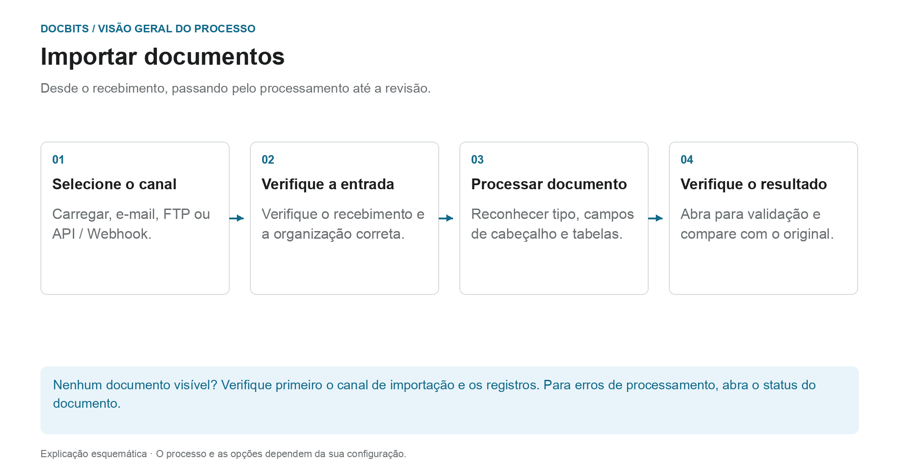

# Como Importar Documentos

## Do recebimento a um documento pronto para revisão

<figure><figcaption>
Desde o recebimento, passando pelo processamento até a revisão. O diagrama é esquemático; as configurações ativas da sua organização determinam o comportamento real.
</figcaption></figure>

Primeiro selecione a rota de importação. O envio bem-sucedido de um e-mail ou de uma solicitação API não prova que o documento foi totalmente processado. Verifique seu recebimento em DocBits e a seguir o status do documento.

1. **Selecione o canal de importação:** Use o upload manual para arquivos individuais ou um canal automático configurado para entradas regulares.
2. **Verifique o recebimento:** Localize o documento na organização correta. Para e-mails recebidos, verifique os logs de importação, se necessário; as regras de formato e remetente suportam o anexo?
3. **Aguarde processamento:** DocBits processa o documento de acordo com o tipo de documento e configurações ativas. Para PDFs, OCR ou texto PDF existente pode ser usado; documentos eletrônicos podem fornecer dados estruturados. Nem toda importação passa pelo mesmo caminho de extração.
4. **Abra o resultado:** Assim que o documento estiver pronto para validação, compare os valores reconhecidos com o original. A importação de um documento não o aprova nem o exporta para o ERP.

### Encontre a rota de importação certa

| Entrada | Instruções |
| --- | --- |
| Carregar documentos individuais | [Importação manual](manual-import.md) |
| Conecte a caixa de correio ou encaminhe e-mails | [Importação de e-mail](email/README.md) |
| Recuperar arquivos através de um canal FTP configurado | [FTP](ftp.md) |
| Transferir documentos de um aplicativo | [Webhook / API](webhook.md) |

**Se algo estiver faltando:** Verifique primeiro o canal de entrada. Se o documento já existir em DocBits, [Status do documento](../dashboard/document-status.md) e [Fluxo de documentos](../dashboard/document-flow.md) ajudam a localizar a etapa de processamento afetada.


Tutorial de importação do DocBits: carregar documentos, arrastar e largar e classificação manual ou automática


Um guia para fazer upload de documentos no DocBits.
