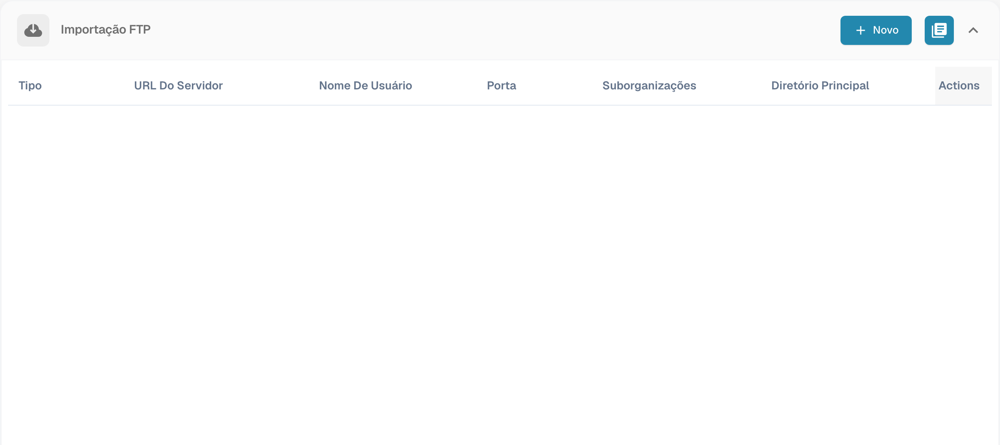
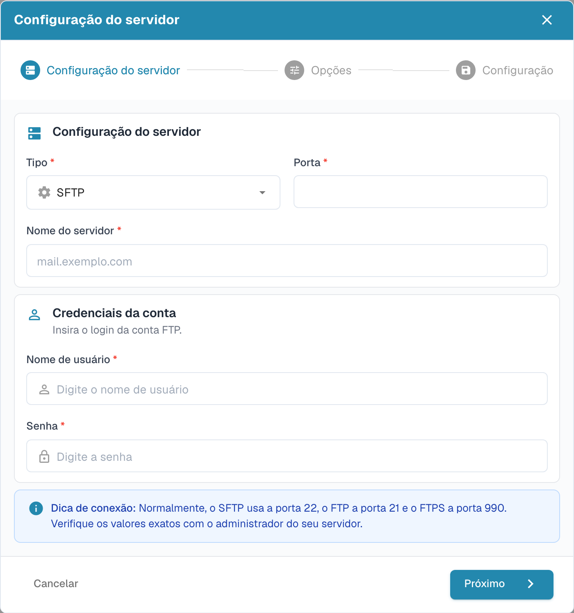

# Importar por FTP e SFTP

A importação automática exige dados de ligação aprovados e uma pasta acessível à conta do servidor.

## Criar uma ligação

Abra as definições de importação e crie uma ligação na secção FTP.

<figure><figcaption>
Resumo das ligações FTP com dados de ligação ocultos.
</figcaption></figure>

O assistente começa pela configuração do servidor. Escolha o protocolo, servidor, porta e credenciais adequados. Utilize os valores confirmados pelo administrador do servidor.

<figure><figcaption>
Primeira etapa do assistente de importação FTP: configuração do servidor.
</figcaption></figure>

Continue para as opções e a configuração. Verifique toda a ligação antes de guardar.

## Arquivar ficheiros

Se a ligação suportar arquivo, configure-o nas opções de importação. Verifique se a conta pode escrever na pasta de arquivo e teste o comportamento com um ficheiro de exemplo. O antigo formulário separado de arquivo foi substituído pelo assistente atual.
