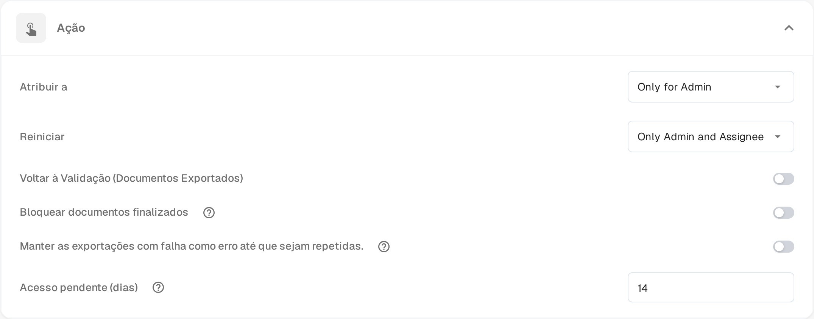

# Pending Input

**Pending Input** coloca um documento em pausa enquanto aguarda a resposta de um colega. A pergunta é feita no fluxo de atividade do documento e identifica as pessoas que devem responder. O documento sai da fila ativa até que respondam, e as pessoas identificadas podem abri-lo em modo de leitura através de uma ligação recebida por e-mail.

O estado aparece no [painel](dashboard/README.md) como **Pending Input**, e pode filtrar a lista de trabalho por este estado.

## Pedir uma informação

1. Abra o documento num ecrã que disponibilize o fluxo de atividade — os ecrãs de aprovação e de revisão disponibilizam-no — e selecione o ícone de balão de diálogo na barra de ferramentas.
2. Escreva a pergunta e introduza **@** seguido do nome da pessoa a quem quer perguntar. Escolha-a na lista que aparece. É a identificação que concede o acesso: só as pessoas identificadas recebem a ligação para o documento.
3. Assim que uma pessoa é identificada, surge uma caixa por baixo do campo de escrita com duas opções:

* **Comment only** (apenas comentário) – a pergunta é publicada no fluxo de atividade e o estado mantém-se. Use esta opção quando só precisa de uma resposta e não quer retomar o documento.
* **Send & set to Pending Input** (enviar e colocar em Pending Input) – a pergunta é publicada e o documento fica em espera. Sai da fila ativa e permanece em pausa até a pessoa identificada responder.

As pessoas identificadas recebem um e-mail com uma ligação para o documento. **Enter** ou o ícone de envio continuam a publicar um comentário normal sem conceder acesso; **Shift+Enter** inicia uma nova linha. Num documento já em pausa, ou num documento que ainda não pode ser colocado em pausa, a caixa oferece a pergunta sem a opção de pausa.

## Responder a um pedido

É-lhe pedida uma informação quando um colega o identifica no fluxo de atividade.

* Abra a ligação do e-mail. A página **Pending Input** mostra à esquerda as páginas do documento e à direita o fluxo de atividade, com o selo **Pending Input**.
* O seu acesso é de leitura: pode ler o documento e responder no fluxo de atividade, mas não pode alterar campos nem exportar.
* Escreva a resposta no fluxo de atividade e envie-a. Quem fez a pergunta é notificado e a conversa fica no histórico do documento.
* O cabeçalho da página indica quanto tempo dura o seu acesso, por exemplo **Read-only access until 09.11.2026**. O acesso termina também assim que o documento avança.

Se abrir a ligação depois de o pedido ter sido respondido ou depois de o seu acesso ter terminado, a página informa que o pedido foi resolvido ou expirou e que não é necessária qualquer ação.

## Fechar o pedido

O documento permanece em pausa até a pessoa atribuída retomar a resposta.

1. Abra o documento a partir do painel. Um documento em pausa abre diretamente na sua página **Pending Input**.
2. Leia a resposta no fluxo de atividade.
3. Selecione **Resolve & Proceed** (resolver e continuar). O documento segue no estado seguinte do seu fluxo de trabalho, pelo que chega diretamente ao ecrã onde continua o trabalho.

Só a pessoa atribuída ao documento, ou um membro do grupo ao qual está atribuído, pode fechar o pedido. Administradores e aprovadores podem abrir um documento em pausa em modo de leitura para ver porque está à espera.

## Definir o período de acesso

A funcionalidade está disponível em todas as organizações. O que pode configurar é quanto tempo uma pessoa a quem foi pedida informação mantém o acesso ao documento:

1. Abra **Configurações → Painel**.
2. Expanda **Ação**.
3. Em **Acesso pendente (dias)** introduza um número inteiro de dias. O valor predefinido é **14** e é necessário pelo menos um dia.
4. Guarde as alterações.

O prazo começa no envio do pedido. Termina mais cedo quando o documento é fechado ou passa para outro estado.

<figure><figcaption>
Acesso pendente (dias) na secção Ação das configurações do painel. Os valores de permissão acima continuam a ser apresentados em inglês pelo produto.
</figcaption></figure>
