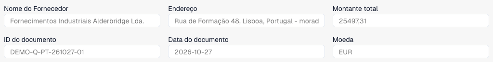
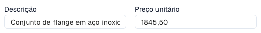

# Verificar linhas e preços de uma proposta

A vista de propostas aplica-se a documentos configurados para esse processo. Tipo, esquema, permissões e fluxo determinam os campos e ações. É distinta da correspondência de encomendas.

<figure><figcaption>
Cabeçalho de um orçamento fictício português de três páginas no DocBits: fornecedor, referência, data, moeda e total. O recorte mostra os primeiros seis campos.
</figcaption></figure>

Descarregar o orçamento fictício de três páginas (PDF)



## Analisar e corrigir

<figure><figcaption>
Descrição e preço unitário da primeira linha selecionada. Nenhum valor foi alterado ou guardado.
</figcaption></figure>

1. Abra a proposta correta. Compare fornecedor, referência, data e moeda com o original.
2. Verifique artigos, descrições, quantidades, unidades, preços e montantes. Um artigo coincidente não comprova preço ou unidade coincidentes.
3. Selecione uma linha para apresentar os detalhes abaixo da tabela.
4. Use a pesquisa de dados mestres configurada, quando disponível. Verifique seleção e valores preenchidos; investigue avisos.
5. Corrija a linha e escolha **Guardar** ou **Guardar e seguinte**. **Cancelar** fecha o editor sem enviar essas alterações da linha.
6. Copie valores predefinidos para a próxima linha apenas se forem adequados. Verifique os valores copiados.
7. Reabra documento e linha para confirmar os valores guardados. Numa linha rejeitada, leia a nota disponível e resolva o motivo comercial.

## Casos especiais

Adicionar uma linha cria uma posição manual quando a edição é permitida. Compare com o original e preencha os campos obrigatórios. Remover é uma ação separada; não apague uma posição real para acertar os totais.

Num documento só de leitura, verifique permissões, bloqueio e fase. Para linhas ausentes, examine original, extração e esquema.

Os controlos automáticos contra preços geridos, anteriores ou contratuais usam [Cartões de comparação de propostas](../../administration-and-setup/workflow/cards-overview/quote-comparison-guide.md). Guardar não comprova execução dos controlos, aprovação nem exportação ERP concluída.
