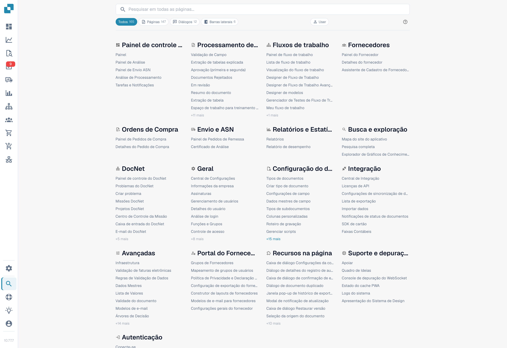
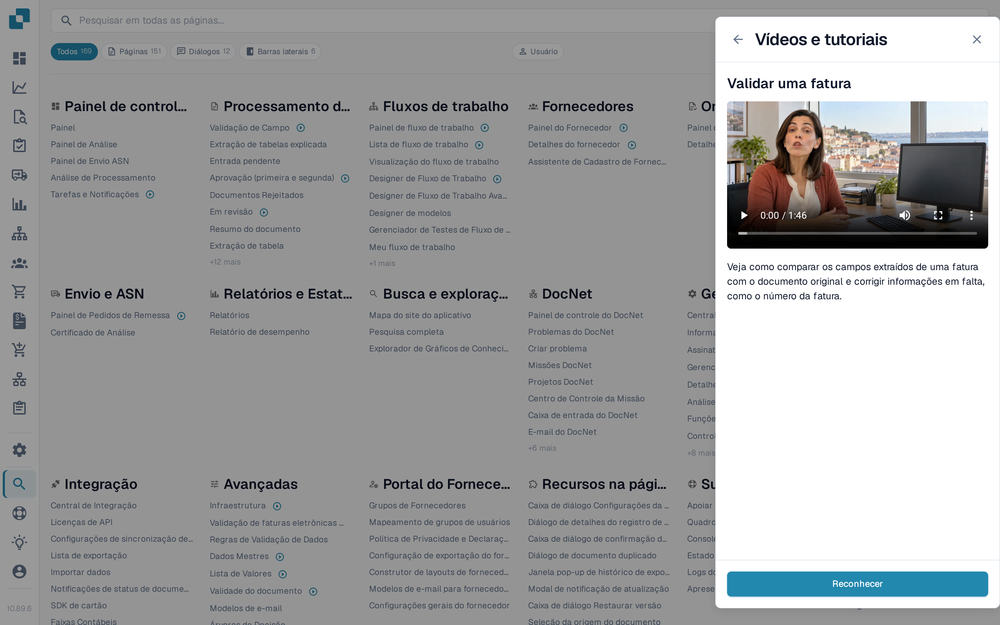

# Mapa do Site

O Mapa do Site é o índice completo e pesquisável de tudo o que o DocBits expõe — cada página, diálogo, entrada da barra lateral, ação e funcionalidade interna às páginas, agrupados por categoria. É o complemento estendido da [Pesquisa Rápida Global](global-quick-search.md).

## Como acessar

Abra o Mapa do Site pela barra lateral (entrada perto do final) ou pressione <kbd>Cmd</kbd>/<kbd>Ctrl</kbd> + <kbd>K</kbd> e escolha **Ver todos os resultados**. A URL direta é `/sitemap`.

<figure><figcaption>
Catálogo de páginas no interface português. Os filtros de tipo de página estão traduzidos; a indicação de função User mantém-se em inglês na versão ilustrada.
</figcaption></figure>

## Navegando pelo catálogo

O Mapa do Site é agrupado em categorias que espelham a estrutura da aplicação — Configurações, Processamento de Documentos, Workflow, Validação e assim por diante. Cada categoria lista primeiro suas páginas e depois as funcionalidades dentro das páginas, agrupadas por subcategoria.

As entradas são coloridas por tipo:

* **Página** — uma rota navegável completa.
* **Diálogo** — um modal aberto a partir de outro ponto da aplicação.
* **Barra lateral / Painel / Menu** — uma superfície de navegação ou contexto.
* **Ação** — um botão ou atalho que executa algo sem navegar.

Clique em qualquer entrada para pular diretamente até ela. Entradas que precisam de um parâmetro (como um tipo ou identificador de documento) incluem um seletor embutido — escolha o valor antes de clicar.

## Vídeos de formação na lista

As entradas de páginas com vídeo de formação mostram um ícone de vídeo depois do nome — não só em Definições, mas em todo o catálogo, por exemplo no Painel, na Validação de campos ou nas páginas de Workflow. Selecione o ícone para reproduzir o vídeo dessa página no painel **Vídeos e tutoriais** sem sair do mapa do site.

<figure><figcaption>
As entradas com vídeo de formação têm um ícone de vídeo; ao selecioná-lo, o vídeo abre no painel.
</figcaption></figure>

O painel continua a listar cada vídeo por tema, pelo que também pode percorrer e pesquisar toda a biblioteca a partir do ícone da barra superior. Ver [Vídeos e tutoriais](videos-and-tutorials.md).

## Pesquisa e filtros

O cabeçalho fixo na parte superior contém a caixa de pesquisa e os filtros em forma de pílulas. Digite alguns caracteres para filtrar a lista ao vivo por nome e descrição. Use as pílulas de tipo para restringir a um único tipo de entrada — por exemplo, apenas **Diálogo**.

A pesquisa e o filtro atuais são adicionados à URL, então uma visualização filtrada pode ser favoritada ou compartilhada.

<mark>O Mapa do Site respeita as mesmas permissões que o restante do DocBits. Páginas que você não pode acessar não aparecem.</mark>

## Modo desenvolvedor

Um botão **Usuário / Dev** no cabeçalho ativa informações adicionais para desenvolvedores parceiros:

* O caminho interno de rota de cada entrada.
* As etiquetas de parâmetros (`:docType`, `:docId`, chaves de deep link).

O modo desenvolvedor é lembrado no seu navegador. Volte ao modo Usuário para a leitura normal.

## Voltar ao topo

O Mapa do Site é longo. Assim que você rola para além da primeira tela, um botão Voltar ao topo aparece no canto inferior direito.
