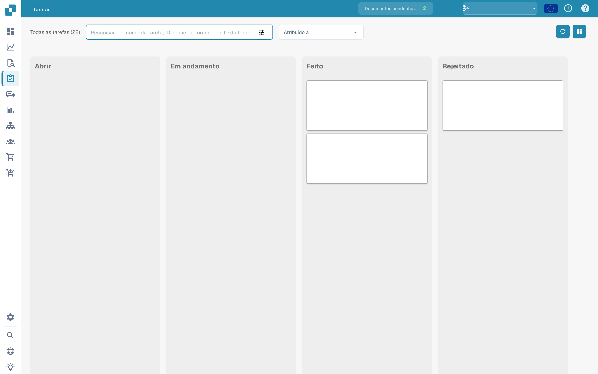
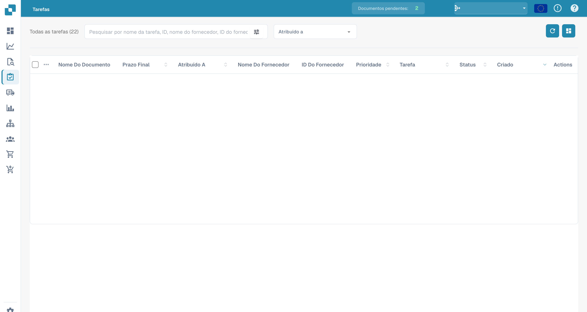

# Tarefas


DocBits Tasks & Notifications Tutorial: Assign Work, Track Status & Handle Workflow Tasks


Aqui é onde você pode acompanhar suas tarefas. Você pode escolher entre dois layouts diferentes – um é um pouco mais detalhado que o outro. Você também pode filtrar tarefas por diferentes critérios, como se estão atribuídas a você ou o status da tarefa.

<figure><figcaption>
Quadro de tarefas por estado; conteúdo das tarefas oculto.
</figcaption></figure>

<figure><figcaption>
Lista de tarefas com dados dos documentos ocultos.
</figcaption></figure>
