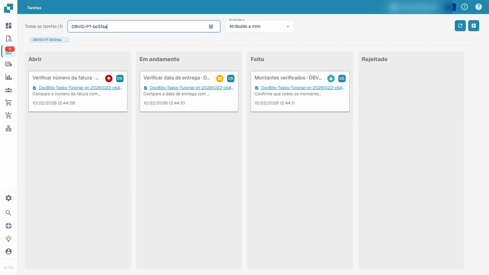
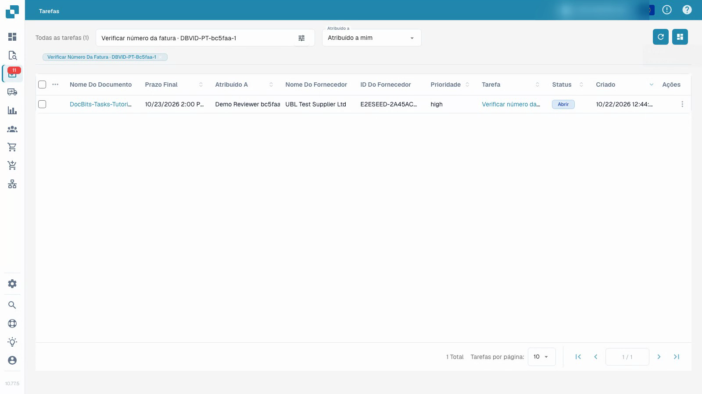

# Tarefas

Tratar uma tarefa atribuída com uma conta de teste normal: consultar o documento, registar o resultado, concluir a tarefa e confirmar os dados guardados.


Tarefas


[Ver com legendas](https://docbits-videos.fra1.cdn.digitaloceanspaces.com/settings-assistant/document-tasks-customer/v1/pt.html)

A gravação mostra a interface real. Alguns textos do produto podem ainda não estar traduzidos.

Utilize o resumo de tarefas para encontrar o trabalho atribuído e acompanhar o seu progresso. O quadro agrupa as tarefas por estado e a lista apresenta mais pormenores. Filtre pela atribuição e pesquise uma tarefa específica. A prioridade e o prazo ajudam a definir a ordem do trabalho.

## Tratar uma tarefa de documento atribuída

1. Abra a tarefa e leia a descrição e a atribuição.
2. Compare os dados com o documento original associado. O nome da tarefa não substitui esta verificação.
3. Coloque a tarefa em curso e guarde o estado de trabalho.
4. Registe o resultado na descrição da tarefa.
5. Conclua a tarefa, guarde-a e volte a carregá-la. Confirme o estado, o resultado registado e a sua posição no resumo de tarefas.

O vídeo utiliza uma conta de teste normal e documentos sintéticos. Concluir uma tarefa é um passo distinto da aprovação ou exportação da respetiva fatura. As ações disponíveis dependem das permissões da conta.

## Quando não consegue marcar uma tarefa como concluída

A sua organização pode limitar quem pode encerrar tarefas, ou seja, defini-las como **Feito** ou **Rejeitado**. Nesse caso, o botão **Feito**, os estados **Feito** e **Rejeitado** e a ação **Marcar como concluído** não são apresentados para as tarefas que não pode encerrar, e o quadro de tarefas não permite largar essas tarefas na coluna **Feito** ou **Rejeitado**. As tarefas atribuídas a si podem continuar a ser editadas, guardadas e movidas entre **Aberto** e **Em andamento**.

Um administrador da sua organização define quem pode encerrar e eliminar tarefas. Consulte [Tarefas e Notificações](../../administration-and-setup/settings/document-processing/module/tasks-and-notifications.md).

<figure><figcaption>
Quadro de tarefas com dados de exemplo sintéticos.
</figcaption></figure>

<figure><figcaption>
Lista de tarefas com dados de demonstração sintéticos.
</figcaption></figure>

## Vídeo adicional


Tutorial de tarefas e notificações do DocBits: atribuir trabalho, acompanhar estados e gerir tarefas de fluxo de trabalho

