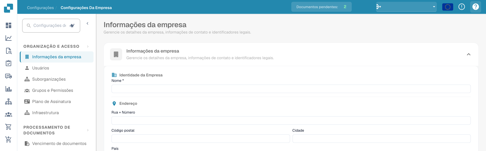

# Ícones de Ajuda

Ícones de ajuda foram colocados em todo o DocBits para ajudá-lo a aprender e entender o que uma funcionalidade realmente faz e como ela pode ajudá-lo no processamento de documentos.

Esses ícones de ajuda se parecem com o seguinte

<figure><figcaption>
Ícone de ajuda no canto superior direito das definições.
</figcaption></figure>
