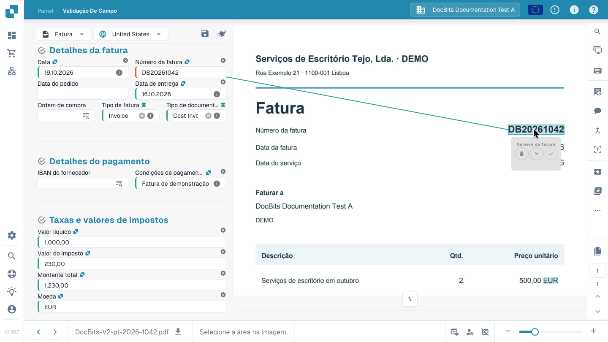

# Ecrã de validação

## Verificar uma fatura e concluir a conferência

Acompanhe uma fatura do painel até à passagem à etapa seguinte: compare fornecedor, datas, número, montantes e moeda com o original e leia um aviso de campo obrigatório. Selecione o número diretamente no documento, confirme a associação e conserve a regra de extração com Guardar regras. Neste exemplo, a fatura verificada é depois submetida para aprovação. As ações disponíveis dependem das permissões e do processo da sua empresa.



## Abrir e utilizar o ecrã de validação

Abra um documento no painel. Na **validação de campos**, compare os campos editáveis com o documento original apresentado ao lado. O tipo de documento e o esquema configurado determinam os campos, tabelas e botões disponíveis. Mova o separador para dar mais espaço aos campos ou ao documento.

Utilize os controlos de página nos documentos com várias páginas e o zoom para ler texto pequeno. As setas inferiores mudam de documento e são diferentes dos controlos de página.

### Origem do documento

Confira a **origem do documento** antes das datas e dos montantes. Determina como são interpretados os formatos de data e número; não traduz o documento nem altera o idioma da interface. Escolha a origem correspondente ao documento e compare os valores com o original.

## Corrigir um campo e ensinar ao DocBits onde o ler

Se o número da fatura não tiver sido lido corretamente:

1. Selecione o campo **Número da fatura**.
2. Faça duplo clique no número completo no original ou selecione a área que o contém.
3. Verifique o campo proposto e confirme a associação com o visto quando solicitado.
4. Confira o valor e a área de origem realçada. Repita a seleção se o número estiver incompleto ou associado ao campo errado.
5. Guarde o documento. Para conservar a aprendizagem de extração, utilize também **Guardar regras / Save Rules** e confirme a caixa de diálogo.

<figure><figcaption>
O número selecionado no original e a associação ao campo. Confirme a associação antes de guardar a regra.
</figcaption></figure>


Escrever um valor de substituição corrige este documento, mas não cria a associação à área de origem necessária para esta aprendizagem. Selecione o valor no original, confirme a associação e guarde a regra para a reutilizar em documentos correspondentes deste fornecedor. A aprendizagem a partir da imagem não está disponível para documentos lidos diretamente como dados de fatura eletrónica.


## Guardar, conservar regras e prosseguir

| Ação | Resultado |
| --- | --- |
| **Guardar** — disquete acima dos campos | Guarda alterações no documento atual. Por si só, não o aprova nem o exporta. |
| **Guardar regras / Save Rules** | Conserva regras de extração com base no documento e nas associações às áreas de origem. É diferente de guardar os valores. |
| **Export**, aprovação ou outra ação configurada | Envia o documento para a etapa seguinte configurada após os controlos relevantes. A ação e o estado obtido dependem do processo e das permissões. |

No vídeo, a fatura conferida é submetida para aprovação. Um botão **Export** não garante que a fatura já chegou ao ERP de destino. Confira o novo estado no painel e eventuais erros de processamento.

## Campos obrigatórios e mensagens de validação

Um contorno vermelho ou ícone de aviso chama a atenção para um campo. Leia a mensagem: pode faltar um valor obrigatório, ser necessário conferir a extração ou ter falhado um controlo configurado. A presença de um valor não comprova, por si só, a sua validade.

Compare fornecedor, número, datas, montantes e moeda com o original. Nos totais, confira os campos de cabeçalho afetados e as linhas correspondentes. Corrija a causa indicada antes de prosseguir. Os controlos dependem do tipo de documento e da configuração da organização; consulte [Verificações automáticas](automatic-checks-on-the-validation-screen.md).

## Utilizar o assistente

O botão **Assistente** acima dos campos apresenta os problemas de validação pendentes. Abra-o e utilize **Ir para o campo** para conferir o campo afetado. As perguntas e sugestões IA dependem da ativação para a organização e das suas permissões. Se não estiverem disponíveis, leia o aviso no painel. As sugestões alteram o formulário: confira-as e guarde o documento para conservar as alterações.

## Selecionar dados mestre

Os campos com uma pesquisa configurada podem consultar fornecedores, encomendas ou outros dados mestre. Abra a pesquisa do campo, filtre os resultados e selecione o registo correto. A seleção pode preencher vários campos relacionados: confira-os também. Estes valores vêm dos dados mestre e podem diferir do texto impresso. Consulte [Dados fuzzy](fuzzy-data.md).

## Conferir as linhas da fatura

Se o esquema incluir tabelas, compare linhas, descrições, quantidades, preços e montantes com o documento. **Tabela extraída** e **Tabela extraída por IA** são vistas de extração diferentes. A disponibilidade depende dos métodos ativos e do esquema. Um separador vazio ou ausente não explica, por si só, um problema de extração.

Corrija células e linhas em falta ou duplicadas com os controlos disponíveis. As alterações dizem respeito ao documento atual. O treino reutilizável de tabelas, as etiquetas de IA e o treino dos campos de cabeçalho são operações distintas. Consulte [Etiquetas das tabelas IA](../ai-table/ai-table-tags.md) e [Treino de tabelas](../../../administration-and-setup/setup/document-training/training-line-fields-table-training/README.md).

Leia os avisos sobre colunas obrigatórias, cálculos de linha e totais. Antes de aplicar outra extração IA ou voltar a extrair uma tabela, leia a confirmação: pode ser necessário remover e recriar associações existentes a encomendas.

## Visualização e colaboração

Passe o ponteiro sobre um ícone para ler o nome. Algumas ferramentas dependem dos módulos, do tipo de documento ou das permissões.

| Ferramenta | Utilização |
| --- | --- |
| **Lupa** e zoom | Examinar pequenos detalhes do original. |
| **Abrir imagem numa nova janela** | Mostrar a mesma imagem noutra janela, por exemplo num segundo monitor. A interface identifica-a como funcionalidade do Chrome. |
| **Atalhos de teclado** | Abrir a ajuda; consulte [Atalhos de teclado](keyboard-shortcuts.md). |
| **Tarefas** | Criar e acompanhar trabalho interno atribuído a uma pessoa ou grupo. |
| **Fluxo de atividade** | Consultar atividades registadas no documento. |
| **Histórico de aprovações** | Consultar aprovações e rejeições quando a funcionalidade está ativa. |
| **Modo de anotação** | Adicionar notas ao documento se as anotações estiverem ativas. |
| **Unir / adicionar páginas** | Unir documentos ou adicionar páginas em falta através da caixa de diálogo disponível. Conferir as páginas selecionadas antes de confirmar. |
| **Vista OCR** | Consultar texto já reconhecido. A abertura não inicia uma nova extração OCR. Não está disponível para certos documentos eletrónicos. |
| **Criar ticket** | Preparar um pedido de suporte com o contexto do documento e a descrição do problema. As tarefas internas são tratadas separadamente. |
| **Registos de scripts** | Consultar mensagens dos scripts do documento se o módulo estiver ativo. É uma vista de registos, não um editor de scripts. |

## Mais opções e definições de administração

Nas faturas, **Mais opções → Fluxo do documento** abre o percurso de processamento. Consoante as permissões e a configuração, o menu também pode incluir divisão de documentos, acesso ao modelo de esquema e preferências de extração do fornecedor.

**Utilizar E-Text se disponível**, **Utilizar extração estruturada (IA)** e **Modelo IA** são definições de extração do fornecedor, não correções normais de campos. Apenas administradores autorizados as podem alterar. Siga a confirmação de reinício quando for necessário voltar a processar o documento. Um modelo de esquema configura o formulário de validação; não altera a apresentação impressa da fatura. Consulte [Modelo IA por fornecedor](supplier-specific-ai-model-for-field-and-table-extraction.md).

## Se não conseguir editar ou prosseguir

Leia o motivo apresentado: o documento pode estar bloqueado, ser só de leitura, estar noutro estado ou ter restrições associadas ao seu papel. Resolva as mensagens e consulte a pessoa responsável ou o administrador sobre acesso e configuração. Se o erro persistir, consulte a [Resolução de problemas](troubleshooting/README.md) ou prepare um ticket com o documento e a mensagem exata.
