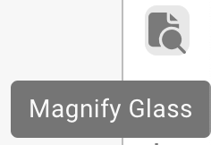
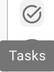
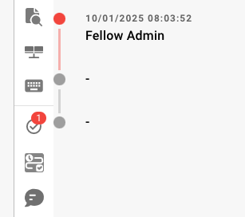
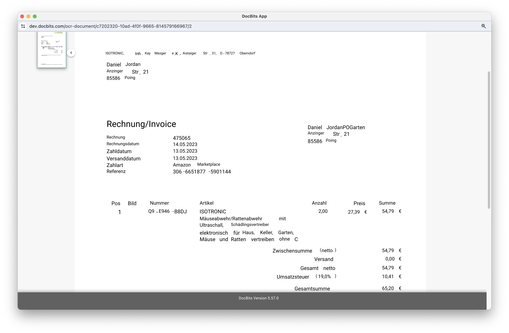

# Schermo di validazione



## Visão Geral

<figure><figcaption></figcaption></figure>

### Origem do Documento (Document Origin)


DocBits Origin Setting Explained: Country Standards for Dates & Number Formats


## **Botão Salvar:**

<figure><figcaption></figcaption></figure>

* **Botão Salvar:**
  * **Propósito:** Salva o estado atual do documento ou script em que se está trabalhando.
  * **Caso de Uso:** Após fazer alterações ou anotações em um documento, use este botão para garantir que todas as modificações sejam salvas.

### **Adicionar Regras Especiais:**

<figure><figcaption></figcaption></figure>

<figure><figcaption></figcaption></figure>

* **Adicionar Regras Especiais / Adicionar Script no DocBits:**
  * **Propósito:** Permite que os usuários implementem regras ou scripts específicos que personalizam como os documentos são processados.
  * **Caso de Uso:** Use este recurso para automatizar tarefas como extração de dados ou validação de formato, aumentando a eficiência do fluxo de trabalho.


Veja aqui como adicionar[ Script no DocBits](../../../administration-and-setup/settings/global-settings/document-types/script/scripting-in-docbits/)


### **Campos Fuzzy:**

<figure><figcaption></figcaption></figure>

* **Campos Fuzzy:**
  * **Propósito:** Ajuda a identificar e corrigir campos em que os dados podem não ser uma correspondência perfeita, mas são suficientemente próximos.
  * **Caso de Uso:** Útil em processos de validação de dados em que correspondências exatas nem sempre são possíveis, como nomes ou endereços com pequenos erros de grafia.

### **Campos Obrigatórios:**

<figure><figcaption></figcaption></figure>

Existem campos que são obrigatórios para a edição posterior; eles podem ser editados nas configurações.

Use a dica de ferramenta para descobrir se:

* É um campo obrigatório (required)
* Validação necessária
* Baixa confiança
* Divergência no valor total de impostos

**Campos Obrigatórios:**

* **Propósito:** Identifica campos obrigatórios dentro dos documentos que devem ser preenchidos ou corrigidos antes do processamento posterior.
* **Caso de Uso:** Garante que dados essenciais sejam capturados com precisão, mantendo a integridade dos dados e a conformidade com as regras de negócios.

<figure><figcaption></figcaption></figure>

## Tabela extraída (itens de linha)

<figure><figcaption>
A tabela extraída abaixo dos campos de cabeçalho
</figcaption></figure>

Abaixo dos campos de cabeçalho, o DocBits mostra a tabela de itens de linha do documento: uma linha por linha da fatura, uma coluna por [coluna de tabela](../../../administration-and-setup/settings/global-settings/document-types/table-columns/) configurada para o tipo de documento. Quando um tipo de documento tem várias tabelas (por exemplo, itens e encargos), cada tabela tem sua própria aba acima da grade.

### De onde vem a tabela

Acima da grade há uma aba para cada caminho de extração que a organização ativou:

| Aba                    | Significado                                                                                                                                                                                                                                                                                 |
| ---------------------- | ------------------------------------------------------------------------------------------------------------------------------------------------------------------------------------------------------------------------------------------------------------------------------------------- |
| **Extracted table**    | Extração baseada em regras (configuração _Table Extraction_). Para um fornecedor com tabela treinada, essas linhas vêm das regras salvas e são extraídas da mesma forma em todos os documentos desse fornecedor; para um fornecedor sem treinamento, a aba pode estar vazia.                |
| **AI Extracted table** | A extração de tabelas por IA (configuração _AI Table Extraction_). Preenchida quando o fornecedor não tem regras salvas e, para colunas marcadas como _Use AI_, mesmo quando existem regras. Uma dica _AI table not found_ na aba significa que a IA não retornou nada para este documento. |
| **PO Tables**          | Somente no construtor de layouts: as linhas do pedido de compra usadas para a correspondência.                                                                                                                                                                                              |

Se nenhuma das abas aparecer, as duas configurações de tabela estão desativadas para a organização (Configurações → Document Processing → Classification and Extraction). O nível de IA que lê a tabela é definido por organização e pode ser substituído por fornecedor, veja [Modelo de IA específico do fornecedor](supplier-specific-ai-model-for-field-and-table-extraction.md).

### Trabalhando na tabela

* **Editar uma célula**: clique nela e digite. As colunas de valor, número e data são validadas enquanto você digita.
* **Add new table row**: adiciona uma linha vazia no final. Use-a quando uma linha não foi reconhecida.
* **Excluir uma linha**: o ícone de lixeira no final da linha.
* **Add empty mapped columns**: mostra as colunas configuradas que a IA deixou vazias, para que você possa preenchê-las manualmente.
* **Restore Table Column**: traz de volta uma coluna que você removeu da visualização deste documento.
* **Delete table**: limpa todas as linhas desta tabela neste documento. A configuração não é alterada.
* **Add new table column** (administradores): a mesma caixa de diálogo das configurações de colunas de tabela, sem sair do documento.
* **Tags** (somente tabela de IA): breves dicas em texto para a IA, por exemplo _"a última coluna é o valor líquido"_. Veja [Tags da tabela de IA](../ai-table/ai-table-tags.md).
* **Apply** / **Save** / **Delete** ao lado das tags: _Apply_ executa a tabela de IA novamente para este documento com as tags e as alterações de colunas que você fez, sem armazenar nada (se o documento tiver linhas com correspondência de pedido de compra, o DocBits avisa que as correspondências serão removidas); _Save Rules_ armazena o mapeamento de colunas e as tags atuais para este fornecedor; _Delete Rules_ os remove e executa a extração por IA novamente para este documento.
* **Export**: baixa a tabela como um arquivo CSV.
* **Go to table extraction view**: abre o treinamento de tabelas para este documento. Use-o quando o mesmo fornecedor continua saindo errado: desenhe a tabela uma vez, mapeie as colunas e clique em _Save Rules_; a partir daí, as linhas aparecem na aba _Extracted table_. Veja [Treinamento de campos de linha / Treinamento de tabelas](../../../administration-and-setup/setup/document-training/training-line-fields-table-training/).


Se a tabela foi extraída pela IA e você abrir o treinamento de tabelas, o DocBits pergunta _Table is already extracted by AI. Do you want to train manually?_ Depois que você salvar as regras, a tabela de IA deixa de ser usada para este fornecedor.


### Extraindo a tabela novamente

* **Mesmo documento, tabela de IA:** adicione ou altere tags e clique em **Apply**; a tabela de IA é reconstruída somente para este documento. Para descartar também as tags e a formatação salvas do fornecedor, clique em **Delete** (_Delete Rules_): o DocBits confirma _Rules has been deleted successfully_ e executa a extração por IA novamente.
* **Mesmo documento, regras treinadas:** abra _Go to table extraction view_, corrija a tabela e clique em _Save & re-extract_.
* **Documento inteiro novamente (cabeçalho e tabela):** Dashboard → menu do documento → _Restart_. Necessário depois que um administrador alterar as colunas da tabela ou as configurações de extração.

### O que bloqueia a aprovação

A tabela é verificada quando você salva ou aprova. Uma célula vermelha ou uma mensagem abaixo da tabela significa uma das situações a seguir:

| Mensagem                                                              | Causa                                                                                                                                                        | O que fazer                                                                                                                                                                                                                                                                               |
| --------------------------------------------------------------------- | ------------------------------------------------------------------------------------------------------------------------------------------------------------ | ----------------------------------------------------------------------------------------------------------------------------------------------------------------------------------------------------------------------------------------------------------------------------------------- |
| Coluna obrigatória vazia                                              | Uma coluna marcada como _Is Required_ não tem valor nesta linha.                                                                                             | Preencha a célula ou pergunte a um administrador se a coluna precisa mesmo ser obrigatória.                                                                                                                                                                                               |
| _Line total does not match quantity x unit price (expected …, got …)_ | `quantidade × preço unitário + encargos − desconto` difere do total da linha em mais de 0,02. Muitas vezes, um dos quatro valores foi lido na coluna errada. | Corrija o valor que está errado no documento; se uma coluna como _Charges_ for sempre preenchida com o valor errado, avise seu administrador (veja [Solução de problemas](../../../administration-and-setup/settings/global-settings/document-types/table-columns/troubleshooting-1.md)). |
| _Line items add up to … but the net total is …_                       | A soma dos totais das linhas difere do valor líquido no cabeçalho.                                                                                           | Verifique se há uma linha faltando ou duplicada, ou um valor de cabeçalho lido incorretamente.                                                                                                                                                                                            |
| _Line Item Table is missing Mandatory column for PO_                  | A correspondência de pedidos de compra precisa de número do item, preço unitário, quantidade e valor total; uma dessas colunas está oculta.                  | Administrador: exiba a coluna novamente em Table Columns.                                                                                                                                                                                                                                 |

Um administrador pode desativar todas as verificações de tabela de um tipo de documento com _Skip table validation_ (Document Types → More Settings); divergências nas linhas e colunas obrigatórias vazias deixam de ser reportadas.

Mais sobre as verificações: [Verificações automáticas na Tela de Validação](automatic-checks-on-the-validation-screen.md) e [Table Extraction Troubleshoot](../../../overview-and-basics/faq/document-processing/table-extraction-troubleshoot.md).

### **Lupa:**

<figure><figcaption></figcaption></figure>

* **Lupa:**
  * **Propósito:** Fornece uma visão ampliada de uma área selecionada do documento.
  * **Caso de Uso:** Ajuda a examinar detalhes finos ou texto pequeno em documentos, garantindo precisão na entrada ou revisão de dados.

<figure><figcaption></figcaption></figure>

### **Abrir nova janela:**

<figure><figcaption></figcaption></figure>

* **Abrir Nova Janela:**
  * **Propósito:** Abre uma nova janela para comparação lado a lado de documentos ou multitarefa.
  * **Caso de Uso:** Útil ao comparar dois documentos ou ao consultar informações adicionais sem sair do documento atual.

### **Atalhos de teclado:**

<figure><figcaption></figcaption></figure>

1. **Atalhos de Teclado:**
   * **Propósito:** Permite que os usuários realizem ações rapidamente usando combinações de teclas.
   * **Caso de Uso:** Aumenta a velocidade e a eficiência na navegação e no processamento de documentos, reduzindo a dependência do mouse.

### **Tarefas:**

<figure><figcaption></figcaption></figure>

Para compartilhar informações internas, você pode criar tarefas e atribuí-las a um funcionário específico ou a um grupo dentro da empresa.

* **Tarefas:**
  * **Propósito:** Permite que os usuários criem tarefas relacionadas a documentos e as atribuam a membros da equipe.
  * **Caso de Uso:** Facilita a colaboração e a gestão de tarefas dentro das equipes, garantindo que todos saibam suas responsabilidades.

<figure><figcaption></figcaption></figure>

### Histórico de Aprovação

<figure><figcaption></figcaption></figure>

**Observação:** o histórico de aprovação precisa ser ativado antes de poder ser exibido aqui.

**Histórico de Aprovação:**

* **Propósito**: Exibe o histórico de aprovação do documento na validação de campos, com vermelho indicando rejeitado e a cor do aplicativo indicando aprovado.
* **Caso de Uso**: Útil para organizações que exigem um registro transparente das ações de aprovação durante a validação de campos.

<figure><figcaption></figcaption></figure>

### **Modo de Anotação:**

<figure><figcaption></figcaption></figure>

<figure><figcaption></figcaption></figure>


DocBits Annotation Mode Tutorial: Add Notes in Validation & Download With/Without Annotations


Você pode deixar anotações em um documento. Isso pode ajudar a deixar informações para outros usuários que continuarão editando este documento.

* **Modo de Anotação:**
  * **Propósito:** Permite que os usuários deixem notas ou anotações diretamente no documento.
  * **Caso de Uso:** Útil para fornecer feedback, instruções ou notas importantes para outros membros da equipe que trabalharão no documento mais tarde.

### **Mesclar:**

<figure><figcaption></figcaption></figure>

Os documentos podem ser mesclados aqui. Por exemplo, se faltava uma página de uma fatura, essas páginas podem ser mescladas posteriormente dessa forma, sem que o documento inteiro precise ser excluído ou reenviado.

* **Mesclar Documentos:**
  * **Propósito:** Combina vários documentos em um único arquivo.
  * **Caso de Uso:** Útil em cenários em que partes de um documento são digitalizadas separadamente e precisam ser consolidadas.

### **Visualização OCR:**

<figure><figcaption></figcaption></figure>

Na visualização OCR, o texto é filtrado automaticamente do documento. Isso é usado para reconhecer características relevantes, como o código postal, o número do contrato, o número da fatura e a classificação de um documento.

* **Visualização OCR:**
  * **Propósito:** Reconhece automaticamente o texto dentro dos documentos usando tecnologia de Reconhecimento Óptico de Caracteres.
  * **Caso de Uso:** Simplifica o processo de digitalização de textos impressos ou manuscritos, tornando-os pesquisáveis e editáveis.

<figure><figcaption>
OCR
</figcaption></figure>

### **Criar ticket:**

<figure><figcaption></figcaption></figure>

Ao contrário das tarefas, que são repassadas internamente dentro da empresa, este ticket de suporte serve para nos notificar e criar imediatamente um ticket em caso de erros e/ou discrepâncias. Isso facilita muito o processo, pois você pode enviar o erro imediatamente junto com o documento correspondente. Também é possível definir a prioridade, tirar uma captura de tela do documento ou enviar uma.

* **Criar Ticket:**
  * **Propósito:** Permite que os usuários relatem problemas ou discrepâncias criando um ticket de suporte.
  * **Caso de Uso:** Essencial para a rápida resolução de problemas e bugs, ajudando a manter a integridade e o bom funcionamento do sistema.

<figure><figcaption></figcaption></figure>

### **Logs de Script do Documento:**

<figure><figcaption></figcaption></figure>

Os scripts podem ser criados nas configurações, em Tipos de Documento; essas informações serão então exibidas aqui.

* **Logs de Script do Documento:**
  * **Propósito:** Exibe logs relacionados a scripts implementados para diferentes tipos de documentos.
  * **Caso de Uso:** Útil para rastrear e depurar ações de script em documentos, ajudando os usuários a entender os processos automatizados e corrigir quaisquer problemas.

<figure><figcaption></figcaption></figure>

### **Mais configurações:**

<figure><figcaption></figcaption></figure>

### **Fluxo do Documento:**

Lá você encontrará o fluxo do documento

* **Propósito:** Mostra a sequência e a progressão do processamento de documentos dentro do sistema.
* **Caso de Uso:** Ajuda a rastrear o status do documento pelas diferentes etapas, garantindo que todas as etapas de processamento necessárias sejam seguidas.

### **Ir para o Modelo de Layout:**

* Com esta opção você será redirecionado e poderá editar seu layout ou usar o modelo padrão
* **Ir para o Modelo de Layout:**
  * **Propósito:** Redireciona os usuários para um editor de layout, onde eles podem modificar modelos existentes ou aplicar um padrão.
  * **Caso de Uso:** Permite a personalização dos layouts de documentos para atender a necessidades ou preferências específicas de negócios, melhorando o alinhamento visual e funcional do documento com os padrões da empresa.

### Use E-Text if Available

* **Propósito:** Permite que o DocBits use o e-text, se disponível, em todos os documentos de um fornecedor específico, melhorando a precisão da extração.
* **Caso de Uso:** Melhora a extração de texto ao aproveitar o texto incorporado em vez do OCR, o que pode levar a resultados mais precisos para este fornecedor.

### [Modelo de IA Baseado no Fornecedor](supplier-specific-ai-model-for-field-and-table-extraction.md)

* **Propósito:** Permite escolher entre três modelos de IA diferentes para otimizar os resultados de extração de um fornecedor específico.
* **Caso de Uso:** Garante melhor precisão de extração ao escolher o modelo de IA mais adequado para a estrutura e o conteúdo dos documentos de cada fornecedor.
