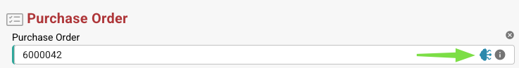

# Dados Fuzzy

### **Visão geral**

Os campos de Dados Fuzzy permitem que os usuários preencham campos relacionados com base em correspondências aproximadas dos dados mestres. Esses campos são identificados por um **ícone azul** ao lado deles.

<figure><figcaption></figcaption></figure>

### **Funcionalidade**

#### **O que os campos de Dados Fuzzy fazem?**

* Eles preenchem campos relacionados com base no valor ou na entrada do campo.
* Os três campos padrão que usam Dados Fuzzy são:
  * **Purchase Order**
  * **Supplier**
  * **Vendor ID**

#### **Usando os campos de Dados Fuzzy**

1. **Selecionar um pedido de compra**
   *   Ao clicar no **ícone azul** ao lado do campo Purchase Order, abre-se uma **janela de seleção**.

       <figure><figcaption></figcaption></figure>
   * Essa janela contém uma tabela com todos os pedidos de compra da **tabela de consulta de dados mestres**.
   * Ao ativar a opção **"Display all columns"**, são exibidos detalhes adicionais.
   * Selecione um **Purchase Order** e clique em **Proceed**:
     * Se o sistema encontrar um pedido de compra no documento, ele filtra por ele automaticamente.
     * Se nenhuma correspondência for encontrada, você pode **criar filtros personalizados** para localizar o pedido de compra correto.
     * É possível adicionar vários filtros; ao ativar **"Match all filters"**, todas as condições precisam ser atendidas.
     * Opções de filtro disponíveis:
       * **Smart**
       * **Contains**
       * **Exact**
       * **Starts with**
       * **Ends with**
   * Um botão ao lado de **Proceed** permite **criar uma nova tarefa/notificação**.
2. **Selecionar um fornecedor ou um Vendor ID**
   * O processo é o mesmo dos pedidos de compra.
   * A diferença é que os campos **Supplier e Vendor ID usam a tabela de dados mestres de fornecedores** em vez da tabela de dados mestres de cabeçalhos de pedidos de compra.

#### **Indicação de preenchimento do campo**

* Se um campo for preenchido por Dados Fuzzy em vez de extraído do documento, aparece uma **pequena dica ou um ícone de informação** indicando que o dado **não foi extraído do documento**, mas preenchido com base nos dados mestres.

### **Configuração do administrador**


[fuzzy-data-configuration-with-master-data.md](../../../administration-and-setup/setup/document-types/fuzzy-data-configuration-with-master-data.md)



[fuzzy-data-configuration-with-list-of-values.md](../../../administration-and-setup/setup/document-types/fuzzy-data-configuration-with-list-of-values.md)



