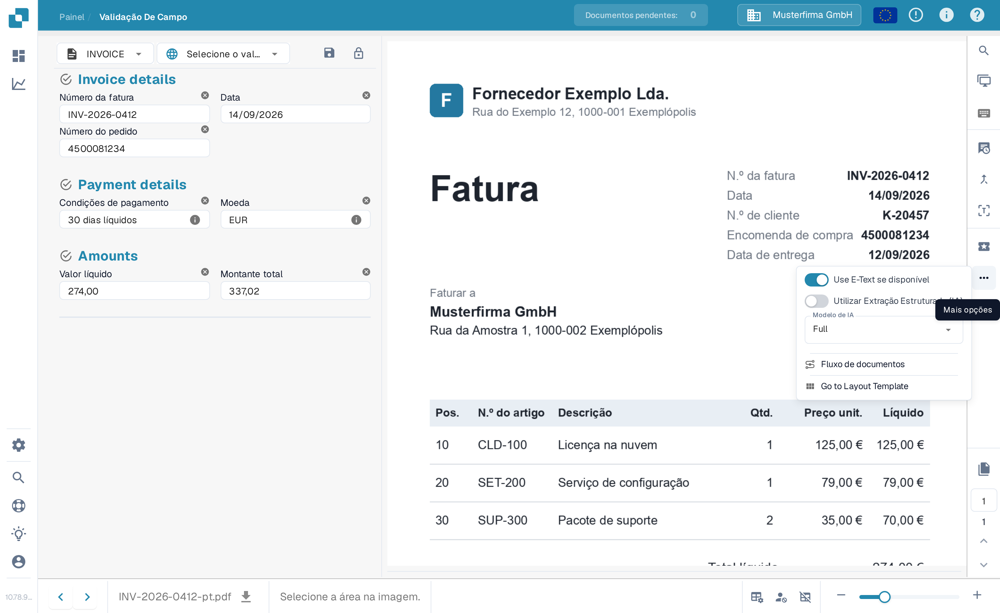
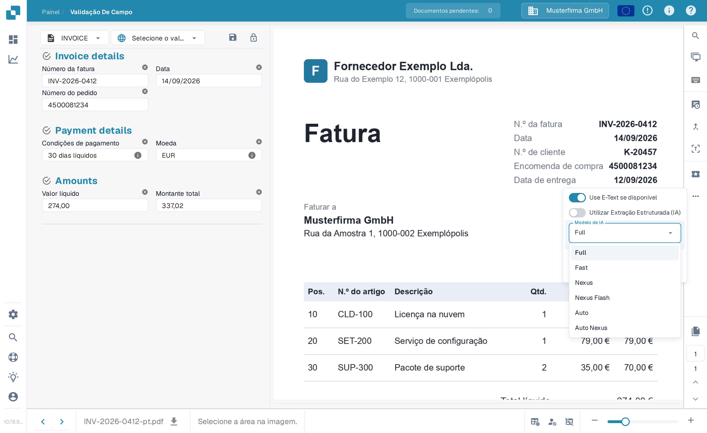

# Modelo de IA Específico do Fornecedor para Extração de Campos e Tabelas

Na seção de ferramentas da **Tela de validação**, você pode escolher o modelo de IA usado para **Extração de campos** e **Extração de tabelas**.\ O **modelo de IA** selecionado é aplicado apenas a todos os documentos do fornecedor atual.

Para alterar o modelo, abra o menu de opções clicando no botão **Mais opções** (três pontos) no lado direito da tela e escolha um dos modelos disponíveis: 

* **Full** – Maior precisão; custa 2 tokens por documento
* **Fast** – Nível predefinido; custa 1 token por documento
* **Nexus** – Custa 1 token por documento
* **Nexus Flash** – Nível mais rápido da família Nexus; custa 1 token por documento
* **Auto** – O DocBits decide por documento se o Fast é suficiente ou se é necessário o Full; custa 1 token por documento
* **Auto Nexus** – Como o Auto, mas restrito à família de modelos Nexus; custa 1 token por documento

<figure><figcaption>
Abra o menu de opções e escolha o modelo de IA para este fornecedor.
</figcaption></figure>

<figure><figcaption>
A lista <strong>Modelo de IA</strong> com as seis opções disponíveis.
</figcaption></figure>

Se os resultados da **extração de campos** ou **extração de tabelas** não forem satisfatórios, tente mudar para outro modelo para melhorar a precisão.

Para configurar o modelo de IA **globalmente para fornecedores sem modelo personalizado** ou para **gerenciar qual modelo está ativo para cada fornecedor**, consulte a documentação correspondente [**aqui**](../../../administration-and-setup/settings/document-processing/classification-and-extraction/ai-model.md).
