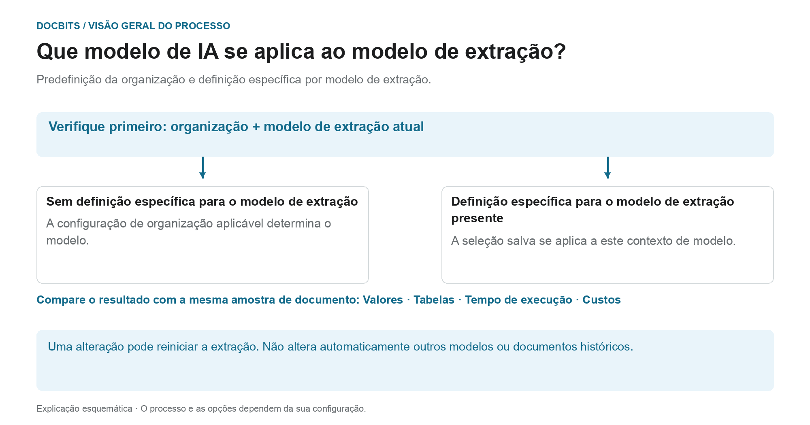

# Selecionar um Modelo de IA Específico do Fornecedor para Extração de Campos e Tabelas

## Do padrão organizacional ao modelo eficaz

<figure><figcaption>
Predefinição da organização e definição específica por modelo de extração. O diagrama é esquemático; as configurações ativas da sua organização determinam o comportamento real.
</figcaption></figure>

A entrada na tela de validação é chamada de modelo de IA específico do fornecedor. No entanto, o **contexto atual do modelo de extração** é crucial: a substituição é salva por organização e modelo. Um fornecedor pode ter vários modelos com configurações diferentes.

1. **Determine o contexto:** revise a organização, o documento e o modelo de extração atual antes de modificar um modelo.
2. **Substituição de verificação:** Se um modelo for armazenado para este modelo, esta seleção entrará em vigor dentro de seu escopo. Se uma substituição estiver faltando, a configuração da organização aplicável será aplicada.
3. **Confirme a alteração deliberadamente:** Selecione apenas uma opção disponível em seu ambiente. Uma alteração pode exigir confirmação e acionar a extração novamente. Abrir o menu por si só não altera a seleção.
4. **Compare resultados:** Verifique os valores dos campos, tabelas, tempo de execução e custos com uma amostra fixa. Um nível de modelo diferente não garante melhor extração, validação bem-sucedida ou correspondência PO.

**Exemplo:** O Fornecedor A utiliza os modelos “Fatura Nacional” e “Fatura Estrangeira”. Uma substituição de “Fatura nacional” não altera todas as faturas desse fornecedor. Para outro documento, verifique novamente seu modelo e configuração efetiva.

O gráfico mostra a hierarquia de seleção, não uma recomendação para um nível de modelo específico. As informações sobre o diagnóstico [Padrão organizacional e substituições](../../../administration-and-setup/settings/document-processing/classification-and-extraction/ai-model.md) e [Qual caminho de extração foi usado?](../../../overview-and-basics/faq/document-processing/which-extraction-path-was-used.md) ajudam a classificar o resultado real.

Na seção de ferramentas da **Tela de validação**, você pode escolher o modelo de IA usado para **Extração de campos** e **Extração de tabelas**.\\
O **modelo de IA** selecionado é aplicado apenas a todos os documentos do fornecedor atual.

Para alterar o modelo, abra o menu de opções clicando no botão **Mais opções** (três pontos) no lado direito da tela e escolha um dos modelos disponíveis: 

* **Full** – Maior precisão; custa 2 tokens por documento
* **Fast** – Nível predefinido; custa 1 token por documento
* **Nexus** – Custa 1 token por documento
* **Nexus Flash** – Nível mais rápido da família Nexus; custa 1 token por documento
* **Auto** – O DocBits decide por documento se o Fast é suficiente ou se é necessário o Full; custa 1 token por documento
* **Auto Nexus** – Como o Auto, mas restrito à família de modelos Nexus; custa 1 token por documento

<figure><figcaption>
Abra o menu de opções e escolha o modelo de IA para este fornecedor.
</figcaption></figure>

<figure><figcaption>
A lista <strong>Modelo de IA</strong> com as seis opções disponíveis.
</figcaption></figure>

Se os resultados da **extração de campos** ou **extração de tabelas** não forem satisfatórios, tente mudar para outro modelo para melhorar a precisão.

Para configurar o modelo de IA **globalmente para fornecedores sem modelo personalizado** ou para **gerenciar qual modelo está ativo para cada fornecedor**, consulte a documentação correspondente [**aqui**](../../../administration-and-setup/settings/document-processing/classification-and-extraction/ai-model.md).
